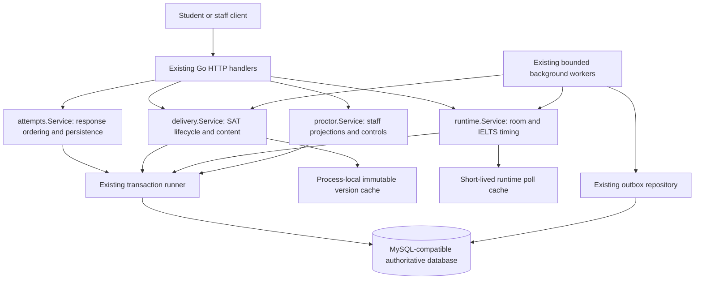

# SAT / IELTS: Go and database core implementation design

Date: 2026-10-23. Status: implemented 2026-10-23 (orders 1–8), uncommitted. Fixes found while implementing: batch saves now stage same-question projections (an older version later in one batch no longer overwrites a newer one); ACT seal scoring reads materialized protocol-2 answers; first IELTS readiness activation returns its persisted start/deadline; extensions and pause/resume realign working SAT recovery boundaries. Deliberately unchanged: outbox claim/partitioning (already compliant), IELTS due scans and the stored scheduling projection (optional), `satStartPolicy` reads (code-required pre-start only).

This companion to [the performance delivery plan](2026-10-23-go-db-performance.md) concentrates on code structure, algorithms, SQL, transaction boundaries and concurrency. Testing, load qualification and observability are covered in that document. Existing behavior described here comes from the inspected working tree, including uncommitted changes; proposed types and query shapes are explicitly design sketches.

## 1. Implementation objective

Make each student operation consume fewer SQL round trips, fewer bytes, less repeated computation and less time holding an attempt lock. Preserve answer durability, current authorization, server-owned timing, adaptive routing and recovery semantics.

The initial implementation has four main changes:

1. Prepare and reuse canonical answer data within the existing save algorithm.
2. Load only the database rows required by the operation, in bounded sets.
3. Keep immutable content separate from mutable attempt state.
4. Schedule due work through existing indexed state, with bounded concurrency.

Keep responsibilities in the existing services. Public HTTP contracts stay compatible. No new service, broker or distributed cache is required for these changes.

## 2. System structure and ownership



| Responsibility | Owner | Implementation rule |
| --- | --- | --- |
| Payload bounds, wire decoding, transport errors | `cmd/api` handlers | Reject malformed envelopes before opening transactions. Domain authorization remains in the owning service. |
| Live identity, writer lease, response ordering, mutation ledger | `internal/attempts` | One validation loop serves single-answer saves, batched saves and frozen recovery writes. |
| SAT close, route, entry and lifecycle receipts | `internal/delivery` | All writers use the same attempt-owned transition rules. |
| IELTS readiness, personal section clock and room control | `internal/runtime` | Existing captured timing model determines behavior. A retry cannot reinterpret the model. |
| Connection/session initialization | `internal/platform/db` | Every physical connection starts with the required session settings. |
| Transaction isolation, rollback and bounded transient retry | `internal/platform/tx` | The transaction callback recreates mutable attempt-local state on each retry. |
| Student answer projection | `attempt_responses_v2` for protocol 2 | Compatibility blobs are derived where row-first mode is active; protocol 1 keeps its existing contract. |

Repository paths below are relative to `backend/go/` unless otherwise specified.

## 3. Data authority and transaction model

### 3.1 Separate three kinds of data

| Data | Examples | Read/write strategy |
| --- | --- | --- |
| Versioned exam content | Sections, modules, question revisions, delivery-safe instructions | Cache by published version and verified revision; share immutable structures inside one process. |
| Mutable attempt authority | Token session, lease/control epochs, proctor status, module state, personal deadlines | Read from the database at the authoritative decision point; lock according to the existing protocol. |
| Derived presentation | Roster status, visible question tree, poll response | Assemble from authorized inputs; cache only within its explicit freshness contract. |

An exam-version cache hit never proves that a student's module, permission, clock or recovery phase is unchanged. Full bootstrap and pinned SAT lifecycle responses remain current attempt projections. Keep `Cache-Control: no-store` on those responses.

### 3.2 Preserve lock order

The common mutation boundary is the attempt row. A response save locks the attempt before consulting mutable runtime/module state. SAT close already documents attempt → runtime → module ordering. Room-wide commands use `runtime.LockScheduleAttemptsInTx` before locking runtime state; some entry/readiness paths also acquire a schedule lock first.

Follow each existing path's complete order. The shared rule is: do not acquire a conflicting attempt lock after taking runtime/module locks that an attempt-owning writer will need. Token, timeline and boundary locks remain in their established positions within that order.

`cmd/api/v2locker_snapshot.go` uses transaction-local runtime reads without a runtime row lock because room commands first lock affected attempts. That is a coordination protocol, not a cache optimization. Removing the room's attempt locks would require replacing that protocol across all relevant writers.

### 3.3 Move session setup to the connection boundary

`internal/platform/db/db.go` already builds DSNs with `parseTime`, UTC location and `time_zone = '+00:00'`. `internal/platform/tx/tx.go` additionally executes `SET time_zone` on each write transaction.

Implementation:

1. Make the shared pool constructor the required production connection entry point.
2. Keep per-physical-connection UTC initialization in the normalized DSN/connector.
3. Remove the repeated transaction-level UTC statement once all affected callers meet that pool contract.
4. Apply the same ownership rule to manual transaction paths in student compatibility writes, terminalization and outbox; retain explicit setup for any supported externally supplied pool that cannot guarantee initialization.

The resulting transaction sequence is `BEGIN → domain work → COMMIT`, without an extra session statement on each request. Do not globally change isolation: V2 hot mutations already use READ COMMITTED; coherent read snapshots and other workflows retain their current isolation needs.

Database time remains authoritative. Reuse a DB instant within one domain decision, but do not stamp a start time with a much earlier request timestamp or carry an old eligibility instant across a long wait. Start updates should record their actual database execution instant; returned timestamps must match persisted values.

## 4. Response saves: prepare once, classify once, persist in sets

Primary files: `internal/attempts/{service.go,batch_io.go,canonicaljson.go,question_identity.go,types.go}` and `cmd/api/handlers_v2.go`.

### 4.1 Preserve the existing decision order

```text
1. Validate bounded envelope and credential signature.
2. Begin the existing retryable transaction.
3. Lock attempt and validate protocol, identity and live token session.
4. Canonicalize SAT question identity against the pinned attempt exam.
5. Probe exact replay using write IDs and request hashes.
6. If all commands replay, validate the credential lease and return stored acks.
7. Otherwise enforce lease/control/active-session fences.
8. Load authoritative runtime/time and any registered frozen-write context.
9. Process commands in original order:
   replay → writability → ownership → version collision → projection decision.
10. Flush response rows and ledger, update revisions, append required audit.
11. Commit, then expose the success acknowledgment.
```

Exact replay intentionally precedes normal writability checks. A previously committed answer can remain replayable after a module deadline; the replay must not apply a new answer. Preserve this distinction and existing error precedence.

### 4.2 Introduce a request-local prepared value

Currently `saveInTx` repeatedly converts the same response, computes canonical bytes/hashes, canonicalizes it for persistence and builds ledger content. `exactReplay` also computes command request hashes. `payloadToAny` converts typed SAT annotation anchors through JSON.

Add a small unexported value in the `attempts` package, not a new generic encoding framework:

```go
// Design sketch: internal fields, no wire/API change.
type preparedCommand struct {
    command       ResponseCommand
    payloadJSON   []byte
    payloadHash   string
    requestHash   string
    payloadErr    error
    requestErr    error
    payloadReady  bool
    requestReady  bool
}
```

Use lazy helpers to establish correctness first:

- Normalize the response with the existing rules once.
- Produce canonical payload bytes once and hash those same bytes.
- Reuse those bytes for an applied projection and its ledger acknowledgment.
- Compute the command request hash once after canonical question-ID resolution.
- For a superseded command, use the current stored projection's canonical response/hash in its acknowledgment and ledger, not the incoming older payload.
- For replay, return the ledger's stored canonical result rather than rebuilding it from the caller's payload.

Preserve `commandHash`'s current format: it uses `commandToAny(0, command)`, which omits the lease from that particular hash shape. Lease validity is enforced separately. Adding a lease field to those hash bytes would break replay compatibility.

The canonicalization algorithm remains `sha256-canonicaljson-v1`: identical object keys, numeric behavior, nil/empty collection normalization and annotation defaults. If canonical serialization reports an error, surface it at the same logical step as before. Do not eagerly return a later command's encoding error ahead of an earlier ownership or version error.

After reuse is correct, pure response-byte preparation can move before the transaction, storing errors for later evaluation. SAT question-ID normalization and all mutable ownership/timing facts stay inside the transaction. Reuse across retries only when the inputs to the cached value are unchanged; reconstruct transaction-owned state every time.

Remove the unused canonical command byte result currently assigned and discarded in `saveInTx` only after accounting for any validation error it can produce. Keep necessary validation explicitly rather than accidentally removing it with the allocation.

### 4.3 Narrow ledger reads to exact keys

The batch path already uses one replay lookup for all requested write IDs. Its later `loadVersionRows` fetches write IDs again and uses independent question/version lists, potentially returning unrelated cross-combinations.

Retain the pre-fence write-ID lookup. Reuse its request-local results and query exact version pairs after the existing fences, provided the attempt-lock ownership audit confirms no competing ledger writer can bypass that lock:

```sql
-- Proposed shape; placeholders remain bound parameters.
SELECT client_write_id, question_id, client_version, lease_epoch,
       request_hash, response_hash, outcome, server_revision,
       CAST(canonical_response AS CHAR)
FROM attempt_mutations_v2
WHERE attempt_id = ?
  AND lease_epoch = ?
  AND (
       (question_id = ? AND client_version = ?)
    OR (question_id = ? AND client_version = ?)
  )
FOR UPDATE;
```

Reuse existing unique keys `(attempt_id, client_write_id)` and `(attempt_id, lease_epoch, question_id, client_version)`. Deduplicate identical lookup pairs without reordering the command array. Compare pair predicates with engine-supported row constructors before choosing syntax; no new index is assumed necessary.

### 4.4 Keep a transaction-local staged view

Use typed keys for pending ledger entries:

```go
type questionVersionKey struct {
    leaseEpoch    uint64
    questionID    string
    clientVersion uint64
}
```

The batch context owns a persisted lookup map plus pending maps keyed by write ID and `questionVersionKey`. This replaces repeated linear scans of already-staged ledger writes. Maintain a staged projection per question so later commands observe earlier accepted commands exactly as a sequential database implementation would.

Process commands in client order. Store acknowledgments in a slice, not a map. Deduplicate projection output only after classifying every command and recording every required ledger outcome. If multiple accepted commands target one question, the final row must have the same content/version/revision that ordered application would produce.

Flush in the existing transaction: projection writes → ledger inserts → attempt revision update → required audit. Keep uniqueness constraints as the final integrity boundary. A database error rolls back the entire batch; buffered in-memory writes never count as accepted before commit.

### 4.5 Keep single and batch saves on one algorithm

`bulkWriteThreshold` is already 1: a single command uses per-command I/O; two or more use set-based I/O. Reuse `saveIO` rather than introducing a second mutation service. Ownership can already resolve in sets through `BulkQuestionResolver`; SAT canonicalization also returns resolved owners. Consume those results instead of resolving the same question again.

For IELTS snapshot fallback, load the pinned snapshot and attempt timelines once per batch and resolve all missing question IDs in memory. Keep the provider rule that SAT cannot obtain question ownership through the legacy snapshot fallback.

## 5. Answer storage and compatibility reads

Protocol-2 row-first writes use `attempt_responses_v2` as the current per-question projection. The mutation ledger provides replay history. Both must commit together with attempt revision changes.

Avoid re-reading, decoding, modifying and rewriting the full `student_attempts.answers/writing_answers/flags` blobs for every answer when row-first mode is active. Existing `internal/student/readthrough.go` materializes compatibility views through `answerblobs.Assemble`.

Implementation order:

1. Route protocol-2 answer consumers through existing row-first materialization or direct row queries, including grading/export/submission consumers that still require a whole-attempt view.
2. Preserve protocol-1 blob authority and existing V1 compatibility handling.
3. Keep the current `ROW_FIRST_WRITES` rollout boundary while migrating consumers; activation follows consumer readiness.
4. Build a whole-attempt representation only where the operation needs it, such as final sealing/export. Lifecycle reads and roster status must not load essays or response histories.

Keep long IELTS writing answers out of broad attempt-header reads. Their canonical response is still durable within the answer transaction. Compression or asynchronous answer persistence would change the storage/recovery contract and is outside this implementation.

## 6. SAT close, recovery and next-module entry

Primary files: `internal/delivery/{close_module.go,close_intent.go,module_boundary.go,recovery_resolution.go,start_submit.go,sat_close_admission.go}`.

### 6.1 Preserve the durable boundary state machine

| Boundary phase | Meaning | Next action |
| --- | --- | --- |
| `preparing` | Next module awaits an eligible start/entry action | Start → `working`; entry expiry → `blocked`. |
| `working` | Module work is open under its clock | Work deadline → `collecting`; recovery expiry can move directly to `blocked` if the worker is late. |
| `collecting` | Frozen frontier/recovery is being resolved | Valid close can settle; recovery deadline → `blocked`. |
| `blocked` | An explicit recovery decision is required | Existing authorized resolution or termination flow only. |
| `settled` | The module boundary has been durably resolved | No automatic legacy fallback. |
| `ended` | The attempt/boundary has ended | No further work. |

Policy-owned boundaries must not fall through to legacy timeout sealing. Preserve `reconcileSatRecoveryBoundaryTx`'s handling of every policy-owned phase.

### 6.2 Keep the close transaction compact

Current close already uses a lifecycle receipt, compact acknowledgment, metadata-only content for unopened recovery modules and shared frozen-response application. Build on those mechanisms:

```text
Validate/normalize immutable manifest outside the transaction.
Acquire bounded close admission before obtaining a DB connection.
Begin → lock attempt → verify live writer/runtime → look up receipt.
If receipt exists, return the recorded result after authorization.
Otherwise:
  lock/verify module and boundary;
  verify registered frontier and existing durable answer rows;
  apply eligible final commands through attempts.Service in this transaction;
  compute required score/route from the accepted final answer set;
  update module, boundary, route and successor state;
  construct the compact acknowledgment and persist its lifecycle receipt;
  commit.
```

Do not open a nested transaction from frozen-response application. Pass the caller's `tx.Tx` and share the same ordering/persistence rules. Reuse prepared manifest hashes and resolved command data only where they remain valid for this close.

The required final score, adaptive route and receipt stay inside the authoritative atomic transition. Already-asynchronous notifications/derived work continue through existing hooks/outbox. Batch compatible durable event inserts; do not enqueue a redundant full-answer or full-bootstrap payload for a wakeup.

### 6.3 Preserve separate close and entry semantics

Close confirms the old module's durable boundary; start/entry establishes permission and time for the successor. Keep the pinned handoff mode. Do not merge these actions merely to reduce HTTP count if doing so starts the next clock before the candidate's authorized entry action.

For recovery closes, return the next module ID and metadata without assembling questions that must be withheld. The authenticated start path releases eligible content and persists actual start timestamps. Replay returns the existing start/receipt rather than allocating new time.

## 7. Lifecycle reads and immutable content loading

Primary files: `internal/delivery/{lifecycle_state.go,service.go,versioncache.go}`, `cmd/api/handlers_delivery.go`.

### 7.1 Replace repeated helper probes with an operation projection

`LifecycleState` currently obtains schedule binding, attempt binding, policy and version information through separate calls, then loads several more related projections in a read-only transaction.

Introduce a small delivery-internal context value populated by one narrow joined header query inside the coherent snapshot:

```go
// Design sketch; existing response types remain unchanged.
type lifecycleReadContext struct {
    scheduleID, attemptID, examID string
    publishedVersionID          string
    versionRevision             int64
    providerKey                 string
    sessionMode                 string
    policy                      *attempts.SATDeliveryPolicy
    now                         time.Time
    // Include only authority/control fields this operation consumes.
}
```

Bind the URL, bearer and attempt in that read. Preserve established forbidden/not-found/conflict behavior; if the existing preflight is required for that behavior, retain its minimum check. The snapshot-loaded context is the source for assembling the actual result, avoiding repeated policy/header probes.

Read the remaining state in bounded groups:

| Group | Rows | Change |
| --- | --- | --- |
| Attempt/schedule/version header | One bound attempt plus schedule/version/runtime header | Include needed policy, mode, control and current section-scope inputs once. |
| Module state | This attempt's modules, optional boundary per module, entry fields | Combine existing module/boundary/entry passes where joins remain one-to-one. |
| Runtime timing | This runtime's section rows | Share the same loaded rows across timing and start-policy assembly. |
| Personal breaks | This attempt's breaks | Keep as a separate bounded one-to-many query. |
| Optional result/device data | Only when required by the response | Keep selective lookups separate if joining would multiply rows or fetch unnecessary data. |

Pass the context and loaded rows to pure assembly helpers. Do not make each helper rediscover schedule, runtime, policy or attempt identity. Avoid a giant join between modules, breaks, timelines and response rows: those independent collections would multiply each other.

Pinned SAT `/state` continues to omit response rows and content assembly. Legacy/non-SAT fallback stays explicit until its contract is migrated.

### 7.2 Load an immutable exam tree in three bounded row groups

Current cold loading issues a sections query, a module query per section and a question query per module. Change that core tree-loading stage from `1 + sectionCount + moduleCount` queries to three set-based queries, plus existing revision/consistency checks:

```sql
-- 1. Sections.
SELECT ... FROM assessment_sections
WHERE exam_version_id = ? ORDER BY display_order;

-- 2. Modules for that version.
SELECT m.* FROM assessment_modules m
JOIN assessment_sections s ON s.id = m.section_id
WHERE s.exam_version_id = ?
ORDER BY s.display_order, m.display_order;

-- 3. Questions and revision content for that version.
SELECT eq.module_id, eq.id, eq.question_id, eq.display_order, ...
FROM assessment_exam_questions eq
JOIN assessment_question_revisions qr ON qr.id = eq.question_revision_id
JOIN assessment_modules m ON m.id = eq.module_id
JOIN assessment_sections s ON s.id = m.section_id
WHERE s.exam_version_id = ?
ORDER BY s.display_order, m.display_order, eq.display_order;
```

These are query-shape sketches: use explicit required columns in implementation, including the module's section ID. Preserve current ordering/tie behavior and `deliveredAnswer` filtering. Keep server-only pretest/scoring data out of delivery objects.

Assemble typed slices using section-ID and module-ID index maps. Close each result set before issuing the next query; do not keep a connection occupied while performing avoidable nested reads. Cache the final immutable tree, then create attempt-specific filtered projections without mutating cached slices/maps.

### 7.3 Cache publication must be revision-safe

For `VersionCache`, distinguish `(versionID, expectedRevision)` flights. A loader returns the revision actually observed with its content. Publish only when it matches the requested revision and the invalidation generation is still current. Never label data with an earlier probed revision merely because that was the caller's input.

Waiters observe both completion and `ctx.Done()`. Start with the existing bounded request-owned loader; followers receive its result/error and may retry under their own budget if their request is still live. Do not detach unlimited work from canceled requests. Use a separately bounded shared-load lifetime only if deliberately needed later.

For runtime poll snapshots, use per-schedule miss coalescing and generation-checked publication if implementing herd reduction. Invalidation increments the generation before deleting the entry. A loader from an earlier generation cannot repopulate the cache. Expire unused schedules and bound retained entries. Poll freshness is still limited by TTL across instances; mutation authorization always bypasses this cache.

## 8. IELTS personal readiness and writing flow

Primary files: `internal/runtime/ielts_personal.go`, `cmd/api/handlers_v2.go`, `internal/proctor/ielts_personal_status.go`.

### 8.1 Keep readiness attempt-owned

The readiness transaction loads the schedule, locks the bound attempt, reads shared runtime/section state and applies the attempt's timeline. Keep this scope; starting one candidate must not lock every candidate or reset the room clock.

Use the existing unique key `(attempt_id, section_key)` as timeline identity. The transition rules are:

| Current condition | Action |
| --- | --- |
| `completed` or `unable` | Return the recorded result. |
| Active and paused | Return the stored active timestamps; do not grant additional time. |
| Active before deadline | Return the existing fixed start/deadline. |
| Active at/after deadline | Complete according to the captured timing policy. |
| Preparing before expected release | Stay preparing. |
| Preparing at/after preparation cutoff | Mark unable and append required audit once. |
| Preparing inside the allowed window, required signals ready and not paused | Conditionally activate and persist actual database start/deadline. |

Keep current model distinctions: later-section expected time derives from the previous personal timeline and gap; cohort-personal mode also respects the room's release. Preserve preparation pause behavior, previous unable state, extra time and authorized room termination.

### 8.2 Remove no-op writes and repeated lookups

Under the existing attempt lock, look for the timeline first. Insert only when missing, with the database unique key as a race safeguard. Existing ready/active retries should take the stable read branch instead of issuing an unconditional no-op insert.

Load section configuration and the previous timeline into an operation-local value once. Cache only immutable plan structure; status, extensions, releases, pause and timeline state remain transaction-local authoritative reads.

On activation, preserve the guarded update from preparing/unpaused to active and stamp both times in SQL. Read the persisted start/deadline after either successful activation or a no-op/replay path. Returning the same row shape in both cases prevents acknowledgment time from drifting away from database time.

IELTS answer saves use the shared V2 ordering algorithm and attempt-scoped timeline gate. For long writing answers, canonicalize once, persist one current question row and the required ledger entry, and avoid whole-attempt JSON rewriting in row-first mode.

### 8.3 Build roster status from bounded page data

`loadIELTSPersonalRosterStates` currently uses correlated lookups for current/last timelines and next room section. Replace expensive per-row subqueries with page-scoped inputs when warranted:

1. Fetch the roster page using existing limits/keyset semantics.
2. Load needed runtime sections once per runtime represented on that page.
3. Load timelines for only the page's attempt IDs, ordered by attempt and section order.
4. In Go, select the highest-order non-completed timeline, highest-order completed timeline and earliest room section without a completed timeline.
5. Apply the existing status precedence, including submitted, unable, delayed, paused and preparing.

This uses more than one simple query but avoids repeating correlated discovery for every student. Keep all reads in a coherent snapshot where the status contract requires it. The mutable roster cursor is a page/delta contract, not a guarantee that an entire concurrently changing roster can be traversed once without movement.

## 9. Due work, reconciliation and background execution

Primary files: `internal/delivery/{reconcile.go,module_boundary.go}`, `internal/outbox/outbox.go`, existing background runner and worker startup.

### 9.1 Reuse the existing SAT due index

Migration 0096 already defines `assessment_module_boundaries.next_action_at` and index `(next_action_at, module_attempt_id)`. Boundary transitions already update the next action. Use that owner instead of introducing a second scheduler table for policy-pinned SAT.

The current due-boundary query filters by time but pages in module-ID order. Align candidate pagination with the due index:

```sql
-- Proposed candidate scan; retain required policy/attempt/runtime filters.
SELECT b.next_action_at, b.module_attempt_id, b.attempt_id
FROM assessment_module_boundaries b
WHERE b.next_action_at IS NOT NULL
  AND b.next_action_at <= ?
  AND (
       b.next_action_at > ?
    OR (b.next_action_at = ? AND b.module_attempt_id > ?)
  )
ORDER BY b.next_action_at, b.module_attempt_id
LIMIT ?;
```

Use a separate first-page predicate without a cursor. Capture the sweep cutoff once; process bounded pages using `(next_action_at, module_attempt_id)` as the local cursor. Existing boundary phase/policy/attempt/runtime filters remain part of candidate selection or authoritative per-candidate rejection; do not let stale terminal rows monopolize the page budget.

Candidate discovery is not permission to mutate. Close the scan, then run each candidate's existing transaction: attempt → runtime/module/boundary in established order → recheck current time, phase and pause state → apply conditional transition. Do not lock boundary candidates first and then acquire attempts, which would invert writer ordering.

Revisit each sweep from the beginning rather than persisting a global cursor that could miss a concurrently rescheduled earlier deadline. If a due row remains unchanged because of pause, advance the local cursor so one sweep cannot hot-loop on it; only the timing owner decides whether its stored next-action value should change.

Keep legacy computed-deadline scanning separate. Once boundary coverage is established for policy-owned modules, narrow the legacy leg to the sessions it owns instead of scanning the same policy modules twice. Do not silently create recovery boundaries for legacy sessions or switch their pinned timing contract.

### 9.2 Keep timers derived by one owner

Every start, pause/resume, extension, entry rearm and recovery resolution that changes a deadline must update its existing authoritative timing/boundary state in the same transaction. Reuse delivery timing helpers; do not independently recompute deadlines in worker, API and roster code.

For IELTS, existing timeline deadline/preparation fields and their indexes remain the starting point. If due scanning becomes expensive, prefer separate selective active-deadline and preparing-cutoff scans over one broad OR/computed-time scan. A new stored scheduling projection is optional later work requiring a complete writer update path.

### 9.3 Preserve bounded outbox work

The outbox already has update-based and `FOR UPDATE SKIP LOCKED` claim modes. Reuse their lease mechanism and claim token guards. Keep claim transactions short: claim a bounded batch, commit, execute work, then mark outcomes. External work must not run while holding claim-row locks.

The partition predicate uses `MOD(CRC32(aggregate_id), partitionCount)`. Keep it initially. An indexed stored partition is a later migration only if that scan cost warrants defining ownership during partition-count changes. Avoid adding it solely for architectural symmetry.

## 10. Admission, pools and Go resource ownership

### 10.1 Admission precedes expensive work

Keep existing SAT close admission before shared database-backed write limiting and transaction acquisition. Queue waiters must not hold SQL connections. The queue is bounded, FIFO and cancellation-aware; saturation returns the established retryable response.

Reuse the existing admission implementation. Tune capacities after shortening database work. More goroutines or API replicas increase potential database demand; they do not shorten a single transaction.

### 10.2 Set one fleet connection budget

```text
total potential connections =
    all API pool caps
  + all standalone and embedded worker pool caps
  + overlapping deployment instances
  + maintenance reserve
```

Use existing API/worker role pools. Never create a pool per request, exam, schedule or student. Choose close/worker concurrency within this total budget while reserving room for saves and staff controls. Retain the distributed limiter's global ceiling and existing four-permit lease behavior; removing that layer changes cross-instance semantics.

### 10.3 Keep request memory bounded

Use pre-sized slices/maps based on validated command counts and actual loaded rows. Close result sets before further database work. Keep prepared bytes request-local; do not retain essays or bearer data in shared caches. Avoid goroutines per answer and concurrent SQL calls on one transaction. Workers use an existing bounded pool; CPU work may run concurrently only when it is independent and enough to justify scheduling overhead.

## 11. Database/index changes

Most initial changes reuse existing tables and constraints.

| Access pattern | Existing foundation / proposed action |
| --- | --- |
| Current response by attempt/question | Existing primary key `(attempt_id, question_id)`; reuse it. |
| Replay by write ID | Existing unique key `(attempt_id, client_write_id)`; reuse it. |
| Version collision | Existing unique key `(attempt_id, lease_epoch, question_id, client_version)`; narrow predicates to exact keys. |
| SAT due boundary | Existing `(next_action_at, module_attempt_id)` index; align pagination/order. |
| IELTS timeline identity | Existing unique `(attempt_id, section_key)`; avoid redundant identity indexes. |
| Page-scoped timelines ordered by section | Candidate index such as `(attempt_id, section_order)` only if existing indexes/row counts do not adequately serve the rewritten query. |
| Roster `(schedule_id, updated_at, id)` pagination | Check actual schema for an equivalent left-prefix index before adding one. Status-specific variants require a demonstrated access need. |

Use parameterized SQL and explicit column projections. Keep runtime DDL out of request paths. Any needed index/migration is additive first; keep older readers compatible during deployment. Choose migration numbering at implementation time and apply engine-appropriate online DDL. Do not replace current string identifiers with binary IDs as part of this optimization: that would expand changes into every key, foreign key and API boundary.

## 12. Concrete implementation sequence

| Order | Files / responsibility | Deliverable |
| --- | --- | --- |
| 1 | `platform/db/db.go`, `platform/tx/tx.go`, inspected manual transaction callers | Connection-owned session initialization; remove redundant transaction setup only for covered callers. |
| 2 | `attempts/service.go`, `canonicaljson.go`, `question_identity.go` | Lazy prepared response/request values; canonical byte/hash reuse; unchanged decision order. |
| 3 | `attempts/batch_io.go`, `cmd/api/handlers_v2.go` | Exact version-key reads, typed pending maps, correct staged projection view and reuse of resolved owners. |
| 4 | `student/readthrough.go` and actual grading/submission/export consumers | Complete protocol-aware answer reads before expanding row-first rollout. |
| 5 | `delivery/lifecycle_state.go`, `service.go`, `versioncache.go` | Operation-level lifecycle projection, bounded content loading and safe cache publication/waiting. |
| 6 | `runtime/ielts_personal.go`, `proctor/ielts_personal_status.go` | Stable readiness replay without unconditional insert; coherent returned timestamps; bounded roster hydration. |
| 7 | `delivery/reconcile.go`, `module_boundary.go`, existing timing mutation helpers | Due-index pagination, one owner per timer, narrowed legacy scan. |
| 8 | Existing API/worker config, admission and outbox code | Fleet-scoped capacity settings and bounded background work; no new infrastructure. |

Orders 2–3 share the mutation core and should be implemented together carefully, while remaining reviewable as small changes. Read projection and IELTS changes can follow their own existing module boundaries. This sequence is ownership guidance, not a requirement to introduce new abstractions or delegate work.

## 13. Essential checks only

Keep these checks alongside implementation: identical canonical hash/ack behavior; replay and stale-writer races; pause/deadline versus save; SAT final-answer/route atomicity; IELTS fixed-duration readiness replay; cache publish/invalidation correctness. Run the relevant existing database/race suites and compare the affected operation's SQL/latency before accepting its change. Detailed load and observability work stays in the companion plan.

The implementation is complete when these core paths do less work while preserving the stated contracts. Production RPS and latency capacity remain measured properties of the chosen deployment, not guarantees implied by the design.
