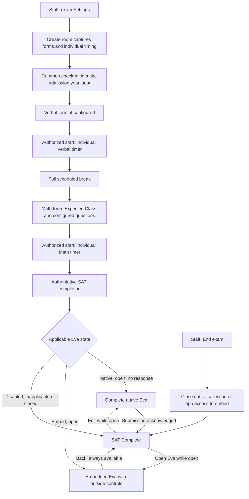

# SAT registration, separate section forms and Eva SIM: UX/UI specification

Status: design specification, amended 2026-10-24 for confirmed separate Verbal/Math forms and individual timers. Initial version 1 form components now exist locally; this task only updates documentation and performs no implementation/visual verification. The following separate-section flow is **version 2**. Version 1 rooms retain their existing scoped check-in and Eva behavior. This supplements the [implementation plan](/Users/rd-cream/Downloads/remix_-ielts-proctoring-system/docs/plans/SAT-configurable-forms-and-eva-sim.md).

## Design direction and flow

Extend the existing SAT interface: neutral canvas, white surfaces, clear labels, existing blue action tokens, and one primary action per task group. Keep the student experience calm and the staff experience practical. Reuse the current staff and student skins in their respective contexts rather than inventing a second palette, font stack or component library.



This diagram shows a full SAT. Math-only goes from common check-in to its Math form without a fabricated Verbal/break step. Verbal-only finishes after Verbal without Math/Eva. Disabled or empty section forms skip; nonempty forms require explicit submission, even when their questions are optional. Module 2 never repeats its section form. Staff/code release still controls whether starting is authorized.

The two Eva return arrows apply to their configured modes only. Native Eva remains separate from SAT answer saving; embedded Eva has no in-app submission status. A native Eva closed before its first response must also allow SAT Complete. Common details are collected once; Expected Class moves to the Math form rather than appearing at initial check-in.

## 1. Staff: configure forms in exam Settings

Use the existing Settings page/content width with a **Forms** group containing Common registration, Verbal form, Math form and Eva SIM, before Results & scoring. Give each editor a short timing description and independent save. Verbal and Math each have an Enable switch; turning one off keeps its questions for later and skips the form for students in new rooms. Keep the exam header/Create room action. Quick settings links to the full-page Forms group rather than fitting a builder into the sheet.

```text
Exam title                      Existing exam header / Create room
Questions   Rooms   Responses   Settings

Common registration — collected once at check-in
Changes apply to newly created rooms. Existing rooms keep their version.
System details                  Student ID/WCODE, full name, email
                                Collected according to access mode

Admission year (ค.ศ.)            Number · Required                  Edit
Seat number                     Text · Required                    Edit
Add question                                         Save registration form

Verbal form — before Reading & Writing starts
No questions yet. Add questions to show a form before Verbal.
Add question                                               Save Verbal form

Math form — after the break, before Math starts
Expected Class                  Single choice · Required           Edit
Add question                                                 Save Math form
Individual timers: students' working time starts after their form and start authorization.

Eva SIM                                      Enable Eva SIM [toggle]
Form type                       ( ) Native form  ( ) Embedded link
Show after Math is completed. Staff End exam closes access here.
[Fields editor OR HTTPS URL + explicit Preview / Open in new tab]
                                                            Save Eva SIM
```

- **Field editing:** each question expands inline into label, type, required and type-specific settings. Only single choice reveals options; number reveals integer/bounds; text reveals its limit. The owning form defines timing/applicability, so omit a contradictory per-field scope control. Questions are added to the chosen editor; moving a question to another form explicitly changes its collection point only for future rooms. System identity remains a read-only summary.
- **Ordering and deletion:** provide named Move up / Move down controls; dragging may be an additional shortcut. Keep focus on the moved question and announce its new position. Confirm deletion with the question label before removing it. Deleting or changing type never migrates earlier room responses.
- **Scope preview:** Preview forms uses the shared renderer and lets staff choose Full SAT, Math only or Verbal only, then the applicable step: Check-in, Before Verbal, Before Math or After Math. Label it Draft preview, show when that step occurs, submit nothing and return focus to its trigger. Do not imply it is an existing room's captured configuration.
- **Embed setup:** accept a URL in a labeled input, with the destination hostname visible. Preview is explicitly initiated, uses the delivery renderer, and is labeled “Preview — opening this external form may allow real submissions.” Never silently contact a provider just because Settings loaded. Retain Open in new tab in preview; no “Verified” badge based on iframe loading.
- **Saving:** each form section saves independently, matching Settings conventions. States are Unsaved changes → Saving… → Saved after acknowledgement. Keep input on validation/network/revision errors. A revision conflict offers to load the latest version with a discard confirmation; do not automatically replace local edits or invent a merge workflow.
- **Save ownership:** the proposed endpoint accepts the whole `forms` value. Combine the submitted editor snapshot with all other editors' last confirmed values, never their unsaved input. Serialize form saves through one mutation/revision owner. Apply acknowledgement only to its snapshot, retaining other/newer dirty edits. Saving registration must neither commit nor discard unfinished Verbal/Math/Eva changes.
- **Mode changes:** selecting a different mode with dirty Eva content opens a clear discard confirmation. Cancel retains the selection and input. Switching only changes the local draft until Save Eva SIM succeeds; explain that the saved active branch replaces the previous branch for future rooms. Do not retain hidden inactive content in the persisted union.
- **Readiness:** an enabled blank native form or blank embedded URL can remain an incomplete saved draft as specified in the implementation plan. Show the concrete issue next to the section and in existing room readiness; prevent room creation through the existing readiness flow. A nonblank unsafe URL is a save error, beside the URL field.
- **Navigation:** contribute independent dirty state from all four editors to Settings' leave guard. Use “Your settings have not been saved.” Saving delivery or one editor cannot clear another editor's changes; the header must not label unsaved changes Saved.
- **Permissions and versions:** show read-only captured content/version when editing is unavailable. Unconfigured drafts offer Add standard SAT forms; version 1 drafts offer Use separate section forms with a preview of each scoped question's new collection point. Preserve IDs/options/help and the Eva mode. Save the whole version 2 conversion atomically before using the four independent editors; show the current v1 editors until that acknowledgement. Merely opening Settings changes nothing, and published rooms/old answers never move. Only authorized authors edit. Version 2 rooms require individual timing; an incompatible rollout setting shows a clear creation issue rather than changing a live shared-clock room.

## 2. Student: common check-in once

Retain the SAT entry portal: identity controls, common Exam details, then Continue. Admission year and seat number are collected once here, through the same renderer on direct and access-link entry. Explain that any section-specific questions appear before that section starts. Expected Class is absent from this card, including initial Math-only check-in; it appears on the next Math form.

| Default field | Presentation | Help and behavior |
| --- | --- | --- |
| Admission year (ค.ศ.) | Numeric input, no prefilled answer | “Expected university admission year, e.g. 2027.” Four digits; do not silently convert calendar or year length. |
| Seat number | Text input | “Enter the seat assigned by your proctor, e.g. A-007.” Preserve letters and leading zeros. No duplicate-seat error. |

Honor staff-edited labels, order and requirements. Keep a short required-field legend and visible required/optional treatment; placeholders do not replace labels. Custom answers have no default selection. Open links omit the code control. Update the entry portal’s fixed “What happens next” check-in sentence so it reflects the access mode and added exam details; it must not tell open-link students to supply a code.

Validate on Continue and focus the first invalid field after its inline error renders. Keep the action available before submission so it can explain errors; disable duplicate requests while submitting or waiting in the existing queue. Preserve values through retry and queue recovery. For a changed version, explain “The registration form changed. Review your details and continue,” retain only compatible answers and require review before resubmitting. Do not reset the whole card on a failed request or silently submit a refreshed definition.

## 3. Student: separate forms before Verbal and Math

Use one shared section-entry screen with a clear section-specific heading: **Before Verbal** or **Before Math**. These are independent forms/responses. They use the existing student skin and native field renderer, a readable single-column width and normal page scrolling; do not show a running or fake paused exam timer.

```text
Digital SAT · Before Math
Your break is complete.
Complete these details before starting Math. Your Math timer has not started.

Expected Class  Required
[Select expected class                                      v]
[Other questions configured for the Math form]

                                                   Submit and continue
Need help? Ask your proctor.
```

Use the break-complete sentence only when this sitting actually had a break. For Math-only, say “Math is your first section.” Expected Class has an empty initial option followed by Unenroll, Rank 4, Rank 3, Rank 2, Rank 1. No answer is preselected. Verbal displays its own configured questions; no invented default questions.

- **When shown:** common admission → eligible first-section form. For full SAT, Math appears only after Verbal finalization and the entire personal break. Break copy becomes “After your break, complete the Math form before starting Math” when configured; the countdown remains unchanged. Empty forms retain normal progression.
- **Start behavior:** Submit and continue validates/seals this form first, then uses the ordinary authorized start. Before initial staff/code release, acceptance leads to the existing waiting/code screen; it starts no clock. After the break, acceptance proceeds to the explicit Math start. No worker or automatic UI entry effect may start a gated section in the background.
- **Accepted but not started:** show “Math form submitted” and the actual reason, such as waiting for proctor or Retry starting Math. Only say the timer has not started when authoritative module state confirms that. If a start response is lost, show Checking start status and reconcile before claiming started/not started.
- **Recovery:** a confirmed form survives refresh/reconnect, and is not asked again for Module 2. Native section forms are sealed after acceptance; unlike Eva, they have no later edit action. Unsent input is a draft, with a discard warning on intentional navigation; no offline-submission or indefinite local-storage promise is added.
- **Errors and closure:** inline required/type errors retain input and focus the first invalid field. Loading/error is not permission to skip a configured form. Pause, code/admission expiry, individual termination and End Exam use their actual waiting/closed/recovery messages; no new start right, clock reset or Eva eligibility is granted.

| State | Student sees | Next action |
| --- | --- | --- |
| Break active | Existing break screen/countdown; next-step copy mentions Math form | Wait for the authoritative break end; no premature form submission. |
| Form required | Named section form and untimed explanation | Submit and continue; all-optional nonempty forms still require an explicit submission. |
| Saving form | Same values; busy action and duplicate-request prevention | Wait or recover acknowledgement; do not claim work has started. |
| Accepted, module not started | Form submitted plus waiting/code/start status | Ordinary authorization or Retry starting section; do not recollect answers. |
| Start outcome unknown | Form submitted; Checking start status / Retry check | Reconcile existing entry state; resume original deadline if it started. |
| Module already active | Existing exam surface and server timer | Resume; ignore stale pending-form responses. |
| Session/attempt closed | Actual closed/terminated reason; accepted answers remain recorded | Existing terminal navigation; no Submit/Start or fake Math-complete/Eva action. |

## 4. Student: Eva after SAT completion

Always place a persistent **SAT submission confirmed** message above Eva after authoritative finalization. Existing recovery exceptions remain visible and keep their accurate wording; Eva must not hide them or upgrade a recovery outcome to an unqualified success. Do not bring the exam timer, answer navigation or active-exam controls onto Eva.

### Embedded mode

```text
Digital SAT
SAT submission confirmed

Eva SIM
Complete the form below. Responses are collected by forms.example.org.
This SAT system does not track submission of this external form.

Back to SAT Complete                      Open form in new tab ↗

┌─────────────────────────────────────────────────────────────┐
│ External form, rendered in the isolated iframe              │
│ Its questions, submit button and confirmation belong to     │
│ the external provider.                                     │
└─────────────────────────────────────────────────────────────┘
If the form is blank or unavailable, open it in a new tab.
```

`forms.example.org` is illustrative copy only, not a configured provider. Show the real validated hostname. The app owns the surrounding layout and controls; do not promise to restyle or resize the provider’s internal document.

Use the existing student page shell with a wider content region for the embed, rather than squeezing it into the check-in card. The iframe fills available width and has enough viewport-relative height to be usable; the outside page remains scrollable. Keep Back before the frame in DOM order and both outside actions visible above it. On narrow screens, stack actions without clipping; do not pin a footer over the frame or virtual keyboard.

Back works immediately, regardless of iframe loading or apparent submission. It changes only the completion subview. New-tab access is a clearly labeled link; it never marks completion. No “Submit Eva,” “Done,” success tick or percentage is inferred from visiting, waiting, a load event or a provider message. Polling must not reopen the form after Back.

Do not cover the iframe with an indefinite spinner. A short loading hint may become “If the form is blank or unavailable, open it in a new tab”; that hint does not diagnose a frame failure. The fallback is present from the beginning. On observed closure or failed authoritative access revalidation, remove the frame and launch controls as defined in the main plan; keep Back and an accurate closed/retry message.

### Native mode

Use a single-column form with a readable maximum width, labeled questions, required markers and the primary **Submit Eva SIM** action. Above it, explain “Submit Eva SIM to continue. You can edit your response until your proctor ends the exam.” Before the first accepted response while open, keep a visible explanation of the return requirement instead of an unexplained disabled Back button.

After an acknowledged submission, show SAT Complete with the accepted status and Edit Eva SIM. Editing preloads the latest accepted answers, uses **Save changes** as primary, and provides Back to SAT Complete. If edits are dirty, Back confirms discarding only those unsent changes. If acknowledgement is uncertain, say “Unable to confirm your submission. Check status or retry”; keep answers and reconcile/retry the same operation. Do not claim the response failed or succeeded without evidence.

| State | Student sees | Available next action |
| --- | --- | --- |
| Initial Eva state loading | SAT confirmation plus Checking Eva SIM… | No frame or premature native submit; bounded loading transitions to retry help. |
| Initial state cannot load | “Unable to load Eva SIM. Your SAT submission is recorded.” | Retry; ask proctor. Do not silently skip an unknown mandatory native form. If embed mode is already established, Back remains available. |
| Native open, no accepted response | Questions and first-submission requirement | Submit Eva SIM; errors identify the affected question. |
| Native saving | Same answers and action label with busy indicator | Prevent duplicate requests; preserve input. |
| Native revision conflict | “This response changed in another tab. Load the latest response before editing.” | Explicit reload with unsent-change warning; no silent overwrite. |
| Native closed before first response | “Eva SIM is closed. No response was submitted.” | Back to SAT Complete; no impossible submit requirement. |
| Native closed after a response | Accepted response status, read-only answers where opened, closure time | Back to SAT Complete; no Save or Edit. Unsent edits are not shown as accepted answers. |
| Embed open | External frame, hostname, not-tracked notice | Back to SAT Complete; Open form in new tab. |
| Embed access closed | “Eva SIM access is closed here. External submission is not tracked.” | Back to SAT Complete; no iframe, new-tab or reopen action. |
| Embed access cannot be revalidated | “Unable to check Eva SIM access. Try again.” | Retry; Back to SAT Complete. Do not claim the provider has closed. |

## 5. Student: SAT Complete

Keep the existing completion-only and released-score-report layouts. Add the same small Eva status/action group to both; do not make Eva a new exam stage or gate a score release differently.

| Captured mode / state | Status and action on Complete |
| --- | --- |
| Native submitted, open | “Eva SIM submitted” with accepted timestamp; Edit Eva SIM. |
| Native submitted, closed | “Eva SIM submitted · collection closed”; no editing action. |
| Native not submitted, closed | “Eva SIM closed · not submitted”; no resubmit action. |
| Embed open | “External Eva SIM · submission not tracked”; Open Eva SIM. |
| Embed closed | “Eva SIM access closed · submission not tracked”; no launch action. |
| Disabled, legacy or inapplicable | Existing completion without an irrelevant Eva card. |

Back to dashboard remains the existing exit action on Complete. Open/Edit Eva stays visually secondary to the completion page’s primary task. Restore focus to the Eva action when returning if it still exists, or to the completion heading if closure removed it. Returning from Eva must not sign out, leave the attempt or reopen its writer lease.

## 6. Staff: form responses and End exam

Use the existing staff page/list primitives for a separate **Form responses** destination at the proposed `/sat/forms`, with permitted room shortcuts that preselect that room. The existing exam Responses tab continues to show exam results. Preserve the selected filters and list position when returning from a response detail.

Filters: exam, room/version, form, mode and relevant status. Form choices are Common registration, Verbal entry, Math entry and Eva SIM. Before a section is available, its form is Waiting, not falsely Not submitted. An accepted section form does not mean its exam started/completed. Only show relevant native/external statuses. Collapse additional filters at narrow widths, retaining an active-filter summary. Do not add a dashboard or analytics feature.

Rows show identity, exam/room/version context, form, mode, truthful status and last accepted native update where present. Detail reads pinned questions/answers; narrow screens stack labeled rows without hiding identity/status. External Eva has the not-tracked explanation and no fake answer, submitted time or native controls. Common, Verbal and Math answers remain separately readable even when Eva is external.

Distinguish No form responses in this scope from No matches for these filters, with appropriate orientation or Clear filters. Use existing list skeleton and Retry error states. Do not substitute empty rows for a failed load. Never include external not-tracked attempts in a native submission count or imply unsubmitted native rows are failed exams.

In the room, show runtime and Eva as distinct text statuses, for example **Exam completed · Eva SIM open** after automatic completion. End exam remains available to authorized staff until explicit closure; completed rooms do not regain Pause or Extend. Show mode-specific confirmation text:

- Native: “This ends the exam for everyone in this room and closes Eva SIM. Students can no longer submit or edit Eva SIM. Recorded responses remain available.”
- Embed: “This ends the exam for everyone in this room and closes Eva SIM access here. External tabs or previously opened links may still accept responses.”
- Already completed runtime: describe the remaining Eva closure directly instead of implying SAT answers will be submitted again. Keep the existing irreversible-action warning and End exam / Cancel labels.

Disable repeat confirmation while pending and show progress without declaring closure early. On failure, keep a clear retry path and the last confirmed status; on success show the server closure time. Return focus to a surviving room control or status heading when the End trigger disappears. No Reopen collection action is included.

## Shared visual and accessibility acceptance criteria

These are implementation checks, not claims of a currently rendered pass.

| ID | Contract | Evidence required during implementation |
| --- | --- | --- |
| UX-01 | Preserve staff `.sat-product` / `--sat-staff-*`, student `.sat-ui` / `--sat-*`, shared controls, existing fonts, spacing and surface roles. Match existing radii and structural borders; no one-off palette or motion system. | Source review and browser comparison with adjacent Settings, entry and completion screens. |
| UX-02 | Work at 320 CSS px and 200% zoom with no clipped app content, horizontal page overflow or hidden primary action. Long custom labels, Thai/English text and URLs wrap. Iframe content stays externally owned; the fallback remains usable if it cannot reflow. | Browser checks at 320, 768 and 1440 px, plus 200% zoom; on-screen keyboard and representative long text. |
| UX-03 | Keep existing student input sizing (`--sat-type-input`, currently 1.125rem) and existing staff mobile controls at least 16px. Use the current type scale, readable line-height and tabular timestamps/counts. Never truncate question/error text. | Computed sizes, zoom/reflow checks, actual configured content. No font or size migration. |
| UX-04 | Complete every app-controlled path by keyboard: selection, reorder, save, errors, preview, native submit/edit, iframe entry/exit, Back, fallback and confirmation. Use native inputs/selects/buttons/links and existing dialog primitives. | Keyboard walkthrough; visible focus; modal focus containment/restore; meaningful iframe title and no app-created frame trap. Provider usability tested separately with the actual URL. |
| UX-05 | Every control has a visible/accessibly associated label; every icon-only control has a name. Errors use `aria-invalid` and described text; first invalid field receives focus. Announce saves, reorder and closure once without noisy polling announcements. On closure while focused in a removed frame/form, move focus to the closed-state heading. | Component assertions plus browser/screen-reader checks; no inaccessible drag-only ordering. |
| UX-06 | Aim for the established 44px touch targets without overlapping hit areas. Respect safe areas and preserve scrolling; no sticky action bar obscures inputs or provider controls. | Pointer/keyboard and narrow-screen checks with the software keyboard open. |
| UX-07 | Measure rendered text/background contrast in supported appearances: 4.5:1 normal text, 3:1 large text, and 3:1 for required UI boundaries/focus indicators where applicable. Use role-specific status tokens and explicit text, not color alone. | Actual computed foreground/background pairs, including hover, focus, error, high contrast and forced colors; token names alone do not prove compliance. |
| UX-08 | Use existing press/focus feedback and reduced-motion handling; no celebration, recurring entrance animation, timer, or forced scroll when polling. A disabled/busy control retains its meaning and label. | Reduced-motion/browser check and loading/error/closed-state walkthrough. |
| UX-09 | State exactly what is saved, open or closed. Common/Verbal/Math forms, section starts, native Eva and external Eva have distinct statuses. Expose useful retry/empty states and acknowledge native writes only after server confirmation. | State-fixture tests covering the tables above and copy review in both completion branches. |
| UX-10 | Shared definition, validation and renderer underpin preview, both common entry routes and section forms with explicit v1/v2 compatibility; one completion Eva action group serves both report branches. Keep provider-specific behavior in the isolated external view. | Component/contract tests and source ownership review; no hardcoded parallel questionnaire or provider-completion guesses. |
| UX-11 | Common details once, distinct Verbal/Math forms at their authorized boundaries, and individual clocks after form acceptance plus explicit authorized start. No section form repeats at M2; loading, ambiguity, recovery, closed and accepted-but-not-started states are truthful. | TC-36–TC-44, real server/DB clock assertions and browser walkthrough. No running clock hidden underneath a form; no preparation allowance consumed by filling it. |

Use the English copy style of the existing SAT screens, retaining approved labels such as Expected Class and Unenroll; Admission year explicitly includes ค.ศ. These examples are implementation copy, not a new app-wide localization system. Test Thai content entered by staff without clipping.

## Review record

### Scope and Coverage

Full **design/specification** review of Settings → common check-in → separate Verbal/Math entry → completion Eva → SAT Complete, plus staff response/closure tasks. Stack inspected: React 19, Tailwind 4, Radix, React Hook Form, Zod, React Query, Lucide and existing Motion. Project guidance: [AGENTS.md](/Users/rd-cream/Downloads/remix_-ielts-proctoring-system/AGENTS.md), [index.css](/Users/rd-cream/Downloads/remix_-ielts-proctoring-system/src/index.css:1490), nearby component comments and [.storybook/preview.ts](/Users/rd-cream/Downloads/remix_-ielts-proctoring-system/.storybook/preview.ts). No separate project-owned SAT design guide was found in the scoped docs; unrelated bundled skill-pack guides do not define this app’s conventions.

| Domain | Evidence inspected | Result |
| --- | --- | --- |
| Accessibility | [SatEntryControls.tsx](/Users/rd-cream/Downloads/remix_-ielts-proctoring-system/src/features/student-delivery/ui/entry/SatEntryControls.tsx:9), current focus/error conventions, UX-04/05/06/11 and section/closure states | Clear in specified interaction contract; runtime not verified. |
| Layout | [ExamSettingsPage.tsx](/Users/rd-cream/Downloads/remix_-ielts-proctoring-system/src/features/exam-authoring/ui/settings/ExamSettingsPage.tsx:73), [SatEntryPortal.tsx](/Users/rd-cream/Downloads/remix_-ielts-proctoring-system/src/features/student-delivery/ui/entry/SatEntryPortal.tsx:71), screen layouts and UX-02 | Clear in specified layout contract; viewport behavior not verified. |
| Writing | [SatSessionRoomConfirmDialog.tsx](/Users/rd-cream/Downloads/remix_-ielts-proctoring-system/src/products/sat/ui/SatSessionRoomConfirmDialog.tsx:26), current entry copy, mode/closure/error/status tables | Clear in specified copy contract; implementation must update existing context text. |
| Typography | [index.css](/Users/rd-cream/Downloads/remix_-ielts-proctoring-system/src/index.css:1792), existing entry sizing, UX-03 | Reuse specified; rendered sizing/wrapping not verified. |
| Colors | [index.css](/Users/rd-cream/Downloads/remix_-ielts-proctoring-system/src/index.css:3070), semantic status roles and UX-07 | Token reuse specified; rendered contrast not verified. |
| UI | [SatSectionCard](/Users/rd-cream/Downloads/remix_-ielts-proctoring-system/src/products/sat/ui/SatPage.tsx:787), existing press/motion rules and UX-01/08 | Reuse specified; implemented visual polish not verified. |

### Findings

No actionable interface findings remain in the specified interaction contract. This is document-level review, not approval of existing version 1 screens or an implemented section-entry amendment. Layouts, navigation guards, version-upgrade behavior, section/native/external states and visual criteria are specified above and mapped to planned tests.

### Considered but Rejected

| Location | Candidate | Rejected because |
| --- | --- | --- |
| Settings layout, section 1; existing [ExamWorkspaceHeader.tsx](/Users/rd-cream/Downloads/remix_-ielts-proctoring-system/src/features/exam-authoring/ui/shell/ExamWorkspaceHeader.tsx:86) | Add a Forms authoring tab and manual Publish step | Existing Settings and Create room already own configuration/version capture; a new navigation/lifecycle adds work without satisfying an additional requirement. |
| Check-in, section 2; existing [SatEntryPortal.tsx](/Users/rd-cream/Downloads/remix_-ielts-proctoring-system/src/features/student-delivery/ui/entry/SatEntryPortal.tsx:59) | Repeat common identity/year/seat fields before each section | Collecting common details once preserves admission/queue recovery; independent section forms collect only their own questions at the newly confirmed boundaries. |
| Embedded Eva, section 4; main plan’s browser boundary | Infer submission from iframe loading and show a success check | Loading/visiting cannot establish an external submission; it would mislead students and staff. |

### Verification

- Passed: source inspection of the linked integration points, existing tokens/primitives, access-mode copy, dirty guards, section/worker/start boundaries and both completion branches; specification checked against confirmed product rules.
- Passed: document structure, local link targets and acceptance/test traceability checked with a Python script through `functions.exec` / `exec_command`; `git diff --check -- docs/plans/SAT-configurable-forms-and-eva-sim.md docs/plans/SAT-configurable-forms-and-eva-sim-ux.md` also returned success. Both files are untracked, so explicit whitespace/content checks supply the document evidence.
- **Not verified:** rendered screens, viewport/zoom behavior, computed contrast, keyboard/screen-reader behavior, actual-provider iframe/login behavior and E2E tests. They require implementation and the actual destination URL. Main-plan TC-23/28/29/30 and TC-33–TC-44 define the relevant execution checks.

### Verdict

Approve
