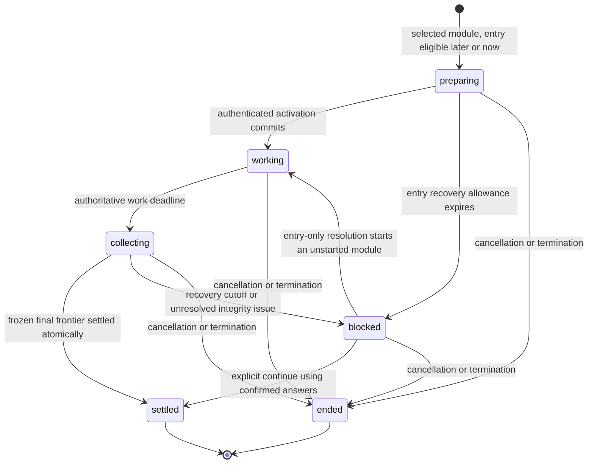

# SAT delivery: specification and implementation plan

- Local SAT browser verification (2026-10-23): the 13-scenario transition suite passed, and its final completion-focus regression passed again after the Eva gate fix. The accessibility suite passed 119 tests with 7 configured skips; the Eva SIM/forms suite passed 44 tests across Chromium and WebKit; and the SAT access-code start suite passed both scenarios after its fixture began completing the sample's required admission year, seat number, and expected class. `bun run typecheck`, targeted ESLint, and `git diff --check` passed. The formatter still reports broad style differences in the two touched files; their new lines follow the local file style. Manual screen-reader review remains open. All checks used local fixtures and services.
- Real-MySQL integration verification (2026-10-23): after applying the complete migration lineage to a disposable MySQL 9.6 schema, `GOMAXPROCS=2 go test -p=1 -tags integration ./integration/... ./cmd/api/... -count=1` passed both packages (`integration` 5.58 s; `cmd/api` 23.40 s). This closes the real-MySQL test-harness gap for these packages, not the outstanding target-topology load qualification, hard latency gates, 2,000-browser first-answerable timing, or manual screen-reader review. The disposable instance was isolated from shared Homebrew MySQL.
- Fresh local 2,000-student close/recovery diagnostics (2026-10-23; synthetic k6, MySQL 9.6, durable commits, 1 GiB buffer pool, 512 MiB redo, two API processes × 100 connections, one room, `GOMAXPROCS=8`): all 2,000 iterations and MySQL reconciliation assertions passed in both practice and classroom modes, with zero lost frozen answers, close/replay failures, or unexpected 5xx. Practice save p99 was 1.459 s and healthy transition p95/p99 was 11.458/11.661 s; offline recovery and delayed entry max were 51.406/60.207 s. Classroom save p99 was 1.984 s and healthy transition p95/p99 was 10.893/10.991 s; offline recovery and delayed entry max were 50.752/60.277 s. Both modes miss the hard save and transition gates. Practice recovered 664 retryable 503s; classroom recovered 637 retryable 503s and 312 transport resets (3.19% of individual HTTP attempts). Queued-close admission wait averaged 2.74/2.81 s in practice/classroom, with 8/6 admission timeouts. These are local diagnostics only, not capacity qualification; the 2,000-browser first-answerable-frame gate and manual screen-reader review remain open. Raw logs: `/tmp/sat-e2edd-2k-practice.log` and `/tmp/sat-e2edd-2k-classroom.log`.
- Fresh local 2,000-student multi-room close/recovery diagnostics (2026-10-23; synthetic k6, MySQL 9.6, durable commits, 1 GiB buffer pool, 512 MiB redo, two API processes × 100 connections, 100 schedules, `GOMAXPROCS=8`): all 2,000 iterations and MySQL reconciliation assertions passed in both practice and classroom modes, with zero lost frozen answers, close/replay failures, or unexpected 5xx. Practice save p99 was 1.765 s and healthy transition p95/p99 was 10.980/11.204 s; offline recovery and delayed entry max were 51.009/60.348 s. Classroom save p99 was 2.034 s and healthy transition p95/p99 was 11.610/11.782 s; offline recovery and delayed entry max were 50.825/60.248 s. Both modes still miss the hard gates, so spreading users across schedules did not resolve the synchronized-wave latency. Classroom recovered 621 retryable 503s and 121 transport resets (1.26% of HTTP attempts); practice recovered 664 retryable 503s. These co-resident local runs are diagnostics only, not target-fleet qualification. Raw logs: `/tmp/sat-e2edd-2k-practice-100rooms.log` and `/tmp/sat-e2edd-2k-classroom-100rooms.log`.

- New 2,000-student mode diagnostics after wiring SQL/transaction histograms through the production MySQL pool (2026-10-22; isolated MySQL 9.6, durable commits, 1 GiB buffer pool, 512 MiB redo, two API instances × 100 connections, `GOMAXPROCS=8`, one shared room): both practice and classroom waves completed all 2,000 k6 iterations and post-wave MySQL reconciliation with zero lost frozen answers, replay failures, or unexpected 5xx. Practice save p99 was 1.278 s and healthy transition p95/p99 was 13.326/14.585 s; recovery/entry maxima were 49.609/60.378 s. The wave recovered 372 snapshot transport resets and 776 retryable 503s. Classroom save p99 was 6.684 s and healthy transition p95/p99 was 12.025/12.303 s; recovery/entry maxima were 60.294/60.270 s. It recovered 100 snapshot transport resets, 13 retryable 502s, and 790 retryable 503s. Both modes pass the answer-integrity checks and recovery limits but miss both hard latency gates; these co-located local runs are diagnostics, not capacity qualification. The API metrics now expose bounded `db_query_duration_seconds` and `db_tx_duration_seconds` histograms from each child process. Raw outputs: `/tmp/sat-close-instrumented-practice-20261022.log` and `/tmp/sat-close-instrumented-classroom-20261022.log`. The disposable MySQL instance was stopped and its data directory removed; 6.4 GiB is free and the shared Homebrew MySQL was untouched.
- Verification after SQL metric wiring (2026-10-22): `GOMAXPROCS=2 go test -p=1 ./... -count=1`, `GOMAXPROCS=2 go vet -p=1 ./...`, `GOMAXPROCS=2 go test -race -p=1 ./internal/platform/db -count=1`, and `git diff --check` passed. The repository-wide Go suite ran without `TEST_MYSQL_DSN`, so the isolated MySQL diagnostics above provide the new production-pool path evidence; opt-in MySQL integration suites are not implied by the no-DSN run.
- Latest 2,000-student close diagnostics (2026-10-22; isolated MySQL 9.6, durable commits, 1 GiB buffer pool, 512 MiB redo, two API instances × 100 DB connections): a zero-client-jitter run with `GOMAXPROCS=2` reconciled the full cohort with zero close failures, lost frozen answers, replay failures, or unexpected 5xx; recovery and entry maxima were 50.494/61.445 s. Save p99 was 5.108 s and healthy transition p95/p99 was 9.719/9.884 s, both above the hard gates; 432 retryable 503s recovered. A client-shaped repeat with `GOMAXPROCS=8` kept the browser's 0–2 s close jitter: all scenarios and SQL reconciliation passed, with three transient snapshot-read transport resets retried and zero integrity failures or unexpected 5xx. Save p99 was 2.830 s and transition p95/p99 was 11.698/11.771 s; deadline-wake p95 improved to 333 ms, while close-dispatch p95 was 2.800 s. Neither run meets the release gates. The zero-jitter profile is a stricter stress comparison, not the product's actual dispatch behavior; both are single-host diagnostics, not target-fleet qualification. Raw outputs: `/tmp/sat-close-jitter0-20261022.log` and `/tmp/sat-close-8cpu-20261022.log`. Both isolated MySQL datadirs were stopped and removed; 7.7 GiB is free and the shared Homebrew MySQL was untouched.
- Latest 2,000-student local close diagnostics after propagating expired request contexts into retryable API errors (2026-10-22): at the original two-API × 100-connection pool, all 2,000 iterations and SQL reconciliation passed with zero close failures, unexpected 5xx, lost frozen answers, or replay failures. Save p99 was 2.916 s and healthy transition p95/p99 was 13.703/13.917 s; the hard gates still fail. The run saw 902 retryable 503 responses, deadline-wake p95 1.108 s, close-dispatch p95 2.861 s, and MySQL COMMIT average 33.98 ms. A same-host topology sweep did not improve the gate: four APIs × 100 had save p99 14.713 s, transition p95/p99 24.746/25.040 s, three activation failures, and COMMIT average 44.42 ms; two APIs × 200 had save p99 3.639 s, transition p95/p99 17.190/17.217 s, four admission timeouts, and COMMIT average 51.29 ms. Both pool increases increased database time and still failed latency; keep the existing close-admission policy unchanged. These are diagnostics on one local MySQL host, not target-fleet capacity evidence. Raw outputs: `/tmp/sat-close-retry-20261022-test.log`, `/tmp/sat-close-four-api-20261022-test.log`, and `/tmp/sat-close-pool200-20261022-test.log`. The isolated MySQL data was stopped and removed; 8.6 GiB is free and the shared Homebrew instance was untouched. This workspace cannot start the synchronized 2,000-browser run as-is: `SAT_JOIN_URL`, `USERS_FILE`, and a local app listener are absent; the host has 8 GiB RAM. Manual screen-reader review is also open.
- Prior close-load diagnostic (2026-10-22): deterministic manifest hashing now runs before the deadline, with its cost reported separately (`sat_close_manifest_preparation_ms` p95 2 ms, max 485 ms). A 20-student isolated-MySQL E2E smoke passed with no close failures, unexpected 5xx, or lost frozen answers; healthy transition p95 was 1.84 s. The 2,000-student practice diagnostic completed all iterations but failed the release gates: save p99 1.636 s, healthy transition p95/p99 13.449/13.637 s, five unexpected HTTP 500s, and 1,995/2,000 settled boundaries (1,437/1,442 expected lower routes and 1,995/2,000 active next modules). It recorded zero lost frozen answers and zero replay failures; 806 retryable 503 responses, four admission timeouts, and 2.98 s mean admission wait across 2,267 queued closes. The local k6 deadline wake p95 was 2.282 s, so this co-located generator is diagnostic and cannot qualify capacity. Raw outputs: `/tmp/sat-close-manifest-20261022-test.log` and `/tmp/sat-close-manifest-20261022-smoke.log`. The isolated MySQL scratch data was removed; 4.1 GiB was free at that cleanup and the shared Homebrew MySQL was untouched.
- Prior stage-instrumented 2,000-student practice diagnostic (2026-10-22; isolated durable MySQL 9.6, 1 GiB buffer pool, 512 MiB redo, two API processes × 100 DB connections): the clean rerun completed all 2,000 scenarios and SQL reconciliation with zero lost frozen answers, replay failures, or unexpected 5xx. The k6 command exited nonzero on hard latency gates: save p99 was 1.906 s; healthy deadline-to-start p95/p99 was 10.840/10.973 s. Offline recovery and delayed-entry maxima were 50.840/64.561 s. Stage trends localize the delay before close acknowledgment: deadline wake p95 was 151 ms, deadline-to-close-ack p95 10.275 s, close-to-start dispatch p95 909 ms, and activation-ack p95 3.239 s. The close-dispatch p95 was 5.353 s and includes the configured 0–2 s jitter plus local k6 scheduling; it cannot be attributed entirely to API time. Across both APIs, close/start service averaged about 0.333/0.404 s, queued-close wait averaged 1.257 s across 858 requests, DB-pool waits totaled 3m12.8s, and MySQL COMMIT averaged 23.80 ms; InnoDB reported no buffer-pool, redo-log, or row-lock waits. A preceding run had one unexpected close 500 and reconciled 1,999 students; the clean rerun had no 5xx. Both fail the hard save/transition targets, and local k6 dispatch jitter makes the transition measurement noisy. This is diagnostic evidence only; it does not qualify release capacity or support raising the close-admission cap. The 2,000-browser first-answerable timing and manual screen-reader review remain open. Raw clean-rerun output: `/tmp/sat-stage-metrics-retest-20261022.log`.
- Diagnostic cleanup (2026-10-22): the isolated MySQL 9.6 instance was shut down and its scratch data removed after the rerun; only its small log files remain. The shared Homebrew MySQL was not used or changed. `df -h .` reports 5.6 GiB free, above the requested 2 GiB reserve.
- Latest isolated 2,000-student practice diagnostic with close-error capture (2026-10-22, local MySQL 9.6, durable commits, 1 GiB buffer pool, 512 MiB redo, two API processes × 100 connections): all 2,000 k6 iterations completed and MySQL reconciliation assertions reported no mismatches. There were zero lost frozen answers, close failures, or replay failures. Save p99 was 799 ms (pass); offline recovery max was 48.995 s and delayed-entry max 63.055 s (both within 120 s); healthy transition p95/p99 was 8.539/8.699 s (fail). The run recorded three unexpected 502s from the local round-robin proxy's connection resets, 1,482 response-snapshot transport resets that retried, and 17 retryable 503s. The dedicated handler-error log was empty, so this run did not reproduce or explain the prior application 500. API DB pools recorded 6,635 waits totaling 6m43.755s; queued-close wait averaged 1.11/1.46 s across the two APIs, while close/start service averaged about 0.32/0.45 s. MySQL COMMIT averaged 25.11 ms; InnoDB reported no buffer-pool reads or redo-log waits and seven row-lock waits (52 ms total). The diagnostic fails the transition and unexpected-5xx gates and is not a capacity qualification. Higher close admission remains unjustified by prior local regressions. The temporary error logger was removed; focused close-timeout/error-mapping tests and `git diff --check` passed. Raw output: `/tmp/sat-close-diagnostic-run.log` (empty handler-error capture: `/tmp/sat-close-diagnostic-errors.log`). The disposable MySQL instance was stopped and removed without touching shared Homebrew MySQL; 6.1 GiB is free, above the required 2 GiB reserve.
- Date: 2026-10-22, Asia/Bangkok.
- Latest local verification (2026-10-22): `bun run test:run` passed 809 files (6,964 passed, 2 skipped); typecheck, production build, changed-file ESLint, `GOMAXPROCS=2 go test -p=1 ./... -count=1`, `GOMAXPROCS=2 go vet -p=1 ./...`, and `GOMAXPROCS=2 go test -race -p=1 ./internal/delivery -count=1` passed. Against isolated local MySQL 9.6, the SAT transition suite reported 10 passed and 3 expected skips when `SAT_HANDOFF_MODE` was unset; the three opt-in `client_start` scenarios then passed separately. The full SAT accessibility profile passed 119 tests with 7 configured skips using one worker. Its initial three-worker run had two 30-second timeouts; both tests passed in isolation on Chromium and WebKit, and the serialized full run passed. `git diff --check` passed. The disposable database was stopped and removed; 4.8 GiB is free, above the required 2 GiB reserve. The shared Homebrew MySQL was not used. These are local diagnostic/correctness results only: transition p95/p99 still miss the 3/5-second gates, 2,000-browser first-answerable timing is unmeasured, and manual screen-reader review remains open.
- Latest repository verification before the diagnostic (2026-10-22): `bun run test:run` passed 809 files (6,964 passed, 2 skipped); `bun run typecheck`, `bun run build`, `go test ./cmd/api ./internal/platform/httpx -count=1`, `go vet ./cmd/api ./internal/platform/httpx`, and `git diff --check` passed. Current local free space after diagnostic cleanup is 6.1 GiB, above the requested 2 GiB reserve. This verifies the current frontend and the final MySQL transient-error classification change; it does not close the 2,000-student transition gate or substitute for the full MySQL-backed E2E evidence below.
- Latest uncapped-proxy 2,000-student practice and classroom retest after retryable-MySQL error mapping (2026-10-22, fresh isolated durable MySQL 9.6 per mode, two API instances × 100 connections): both modes completed all 2,000 k6 scenarios and passed MySQL reconciliation with zero lost frozen answers, replay failures, or unexpected 5xx; all 8,820 HTTP requests succeeded in each run. Practice save p99 was 611 ms; classroom was 850 ms, both within the 1 s gate. Healthy deadline-to-next-module-start p95/p99 remained over target: practice 8.579/8.661 s and classroom 7.232/7.309 s. Offline recovery maxima were 48.251/48.937 s and delayed-entry maxima 64.571/61.493 s, inside 120 s. Practice API-pool waits totaled 2.1 s and COMMIT averaged 30.60 ms; classroom pool waits totaled 2m42.6s and COMMIT averaged 19.38 ms. These local results pass answer integrity and save latency but fail the hard transition gate, so neither qualifies capacity. The earlier 37-HTTP-500 run had no captured underlying error class; the new synthetic process hook logs untyped errors, but neither fresh retest produced an untyped 500, so the classification fix is covered by focused tests without claiming causal proof for that earlier run. Both disposable MySQL instances were removed; 5.2 GiB remains free, above the requested reserve, and the shared Homebrew MySQL was not used.
- Prior uncapped-proxy 2,000-student practice diagnostic (2026-10-22, isolated durable MySQL 9.6, two APIs × 100 DB connections): the proxy now allows up to the VU count per API, removing the earlier 128-connection test cap so application admission and database pressure are visible. All 2,000 k6 iterations ran, save p99 was 693 ms, but healthy transition p95/p99 was 9.705/10.432 s. The run exposed 37 unexpected HTTP 500s and failed reconciliation: 1,990/2,000 boundaries settled, 1,432/1,442 expected lower routes, and 1,963/2,000 next modules active; no frozen-answer loss or close-replay failures were observed. Queued close admission averaged 2.46 s; core close/start service averages were 0.34–0.46 s, and the two API pools accumulated 4m51s of wait. Those measurements show substantial pressure but do not identify all end-to-end time. We fixed HTTP classification for MySQL lock-wait timeout/deadlock errors after the transaction retry budget is exhausted, and added test-process-only untyped-error detail for the next synthetic run. The error class in those 37 responses has not yet been attributed, so this run is a failed diagnostic and does not qualify the 2,000-student gates. Fresh isolated post-fix practice and classroom reruns are recorded above; the shared Homebrew MySQL was not used.
- Latest practice/classroom close diagnostics (2026-10-22, fresh isolated MySQL 9.6 per run, durable commits, two API instances × 100 connections, one schedule, 2,000 synthetic students): all k6 scenario checks and post-wave MySQL reconciliation assertions passed in both modes with zero lost frozen answers, replay failures, or unexpected 5xx. Practice save p99 was 1.220 s; healthy deadline-to-start-ack p95/p99 was 8.113/8.241 s. Classroom save p99 was 2.699 s; transition p95/p99 was 9.568/9.607 s. Both miss the confirmed hard gates. Offline recovery and delayed entry remained within 120 seconds (practice max 49.140/61.145 s; classroom 51.964/63.404 s). The new `sat_close_admission_wait_seconds` histogram showed 98.2% of queued practice closes admitted within 1 s, and 87.4% of queued classroom closes within 1 s (its p95 lies between 1 and 2 s). Admission queueing is therefore only part of the end-to-end delay; do not raise the cap based on this evidence, especially given earlier overload regressions. API-pool wait totaled 13.50 s / 42.46 s and MySQL COMMIT averaged 37.85 ms / 46.11 ms for practice/classroom. Classroom also recovered 31 transient snapshot-read resets and 26 retryable 503 responses; no scenario or SQL-integrity assertion failed. These local co-resident diagnostics do not qualify deployment capacity. Free disk after both scratch databases were removed: 4.4 GiB (above the 2 GiB reserve).
- Latest E2EDD verification (2026-10-22): the isolated MySQL-backed SAT transition suite passed 13/13 after installing answerable-frame capture in the recovery-expiry scenario before reload, so its measured transition assertion observes the student page. `GOMAXPROCS=2 go test -p=1 ./... -count=1`, `GOMAXPROCS=2 go vet -p=1 ./...`, and `GOMAXPROCS=2 go test -race -p=1 ./internal/delivery -count=1` passed. The live-runner suite passed 37 tests; typecheck and targeted ESLint passed; the SAT accessibility profile passed 119 tests with 7 configured skips. Temporary MySQL was stopped and deleted; 5.5 GiB remained free, and the shared Homebrew MySQL was not used. Release gates remain open: local 2,000-student transition diagnostics miss the hard p95/p99 targets, 2,000-browser first-answerable timing is unmeasured, and manual screen-reader review remains outstanding.
- Latest start/close snapshot reuse and 2,000-user diagnostics (2026-10-22): `StartModule` now reads runtime status, schedule recovery policy, and pending-break state in one locked snapshot; close reads the same runtime/policy snapshot without paying for the start-only break check. `go test ./... -count=1`, `go test -race ./internal/delivery -count=1`, `go vet ./...`, and `git diff --check` passed; real-MySQL load scenarios exercise both query shapes. On isolated MySQL 9.6 (`innodb_flush_log_at_trx_commit=1`, 1 GiB buffer pool, 512 MiB redo) with two API processes and 100 connections each, the 2,000-user practice wave (one schedule) reconciled every scenario with zero lost frozen answers, close-replay failures, or unexpected 5xx; three transient response-snapshot resets retried. Save p99 was 650 ms, offline recovery max 49.064 s, delayed entry max 64.326 s, and healthy transition p95/p99 9.055/9.088 s. MySQL COMMIT averaged 24.44 ms; InnoDB reported no row-lock, redo-log, buffer-read, or free-page waits; API pool wait totaled 17.11 s. The 2,000-user classroom recovery wave across 100 schedules likewise reconciled all data with zero integrity failures; four transient snapshot resets retried. Save p99 was 822 ms, offline recovery max 49.620 s, delayed entry max 63.764 s, and transition p95/p99 9.496/9.583 s. COMMIT averaged 42.10 ms with no InnoDB lock or log waits; API pool wait totaled 12.53 s. A separate 2,000-user classroom Module 1 entry wave passed all 2,000 per-student state checks with no wrong/duplicate branches or unexpected 5xx, but protocol p95 was 3.311 s (p99 3.342 s), narrowly missing the 3-second p95 gate. Each k6 run exits nonzero only for the crossed latency threshold; these are local diagnostics, not production-capacity evidence. The 2,000-browser first-answerable-frame gate remains unmeasured. The scratch MySQL instance was stopped and removed; 3.6 GiB is free, above the 2 GiB reserve.
- Latest recovery-close hot-path optimization (2026-10-22): recovery close ACKs previously loaded the next module's full immutable content and question revisions, then removed the questions before storing the receipt. `closeAck` now reads only the selected section/module shell and tool policy in one indexed query, enforces the published section scope, and marks content withheld; authenticated `StartModule` remains the only path that loads next-module questions. A real-MySQL 4-student smoke wave through two API processes passed all scenario and reconciliation checks with zero lost frozen answers, close-replay failures, or unexpected 5xx; save p99 was 135 ms and healthy transition p95/p99 was 1.141/1.211 s. This validates the current metadata query and route flow only, not 2,000-student capacity. `go test -race ./internal/delivery`, `go vet ./internal/delivery`, and `git diff --check` passed.
- Latest 2,000-student diagnostic after the metadata-only close ACK (2026-10-22): one-room practice on isolated local MySQL 9.6 with durable commits, 1 GiB buffer pool, 512 MiB redo, and two API processes with 100 connections each. All 2,000 scenario and SQL reconciliation checks passed with zero lost frozen answers, close-replay failures, or unexpected 5xx; 23 transient response-snapshot connection resets recovered on retry (23/8,843 requests). Offline recovery max was 49.158 s and delayed-entry max was 60.318 s, both within 120 seconds. Save-confirmation p99 was 761 ms, meeting the 1-second gate; healthy transition p95/p99 was 8.757/8.765 s, still missing the 3/5-second gates. API pool wait totaled 38.61 s and COMMIT averaged 34.26 ms; InnoDB showed no log, buffer-pool, or row-lock waits. The k6 run exits nonzero for the transition latency threshold, not failed integrity assertions. This ran after an earlier wave against the same disposable database, so cache warmth was not controlled; treat it as diagnostic evidence only. A later small query refinement stopped reading the unused module-instructions field and was validated by the MySQL smoke above. The 2,000-browser timing gate remains unmeasured.
- Latest isolated 2,000-student close/recovery diagnostic (2026-10-22): one-room practice on a temporary local MySQL 9.6 instance (1 GiB buffer pool, 512 MiB redo, durable commits) with two API processes and 100 connections each. All 2,000 scenario and SQL reconciliation checks passed: zero scenario failures, lost frozen answers, replay failures, or unexpected 5xx; two transient connection resets recovered (2/8,822 requests). Offline recovery max was 49.827 s and delayed entry max 62.078 s, within 120 seconds. Save p99 was 1.453 s and healthy transition start-ack p95/p99 was 11.185/11.271 s, missing both hard gates. MySQL digests showed 7,259 COMMITs averaging 44.95 ms; InnoDB reported no log or buffer-pool waits and seven row-lock waits. The Go test exits nonzero for the latency thresholds, not failed integrity assertions. This remains local diagnostic evidence; 2,000-browser timing is unmeasured. The disposable database was removed afterward; 3.8 GiB remains free, above the requested 2 GiB reserve.
- Latest synchronized browser-gate integrity check (2026-10-22): the prior coverage-only rule could collect 2,000 transition samples from a runner limited to 20 concurrent browsers, so it did not prove a simultaneous 2,000-student cohort. Gate mode now requires exactly the configured cohort (2,000 by default), enough workers, an exam-ready barrier, and a timed-frame barrier; it records each first timed answerable frame against every student's active interval. It exits before completing the full SAT; dashboard and failure screenshots are disabled and a 90-minute frame timeout bounds a missing transition. Smaller diagnostic cohorts cannot report the 2,000-student release gate as passed. The summary records both barrier results and minimum active students. The full live-runner suite passed 37 tests; three isolated Chromium frame-capture/initial-frame/early-exit tests passed; `bun run typecheck`, targeted ESLint, and `git diff --check` passed. Preflight checks rejected a short roster and an undersized worker pool before starting browsers. Disk free space is 4.8 GiB (above the requested 2 GiB reserve). The 2,000-browser timing gate remains unmeasured; the backend hard latency gates remain open.
- Latest transition-gate coverage hardening (2026-10-22): the live SAT runner reports measured versus expected students and only passes the deadline-to-answerable gate when every requested student completed and contributed at least one timed transition, with p95 <= 3 seconds / p99 <= 5 seconds. This coverage check has since been strengthened to prove simultaneous cohort activity using the exam-ready barrier and browser frame timestamps. The recovery-to-entry browser E2E captures a real timed frame and verifies one observed student cannot pass a 2,000-student coverage gate. `bunx playwright test --config playwright.sat-transition.config.ts --grep 'keeps a disconnected final answer'` passed against isolated local MySQL 9.6; `bun run typecheck`, targeted ESLint, and `git diff --check` passed. This remains local correctness evidence: target-scale browser latency is unmeasured and the 2,000-student release gate remains open.
- Latest SQL-profile retry (2026-10-22, local MySQL 9.6, durable commits, practice, one room, two APIs with 100 connections each): the 2,000-VU k6 run ended with connection resets and exit code 99, so it is not a passing load or integrity result. MySQL statement digests recorded 7,415 COMMITs averaging 51.48 ms (381.7 seconds cumulative server time), 1,996 attempt control/phase updates averaging 17.61 ms, and 3,996 two-row live-update inserts averaging 5.45 ms; the pools accumulated 30.43 seconds of wait. The profile points to commit and lifecycle transaction cost for further investigation, but this single-host run does not justify weakening durability or changing production settings.
- Latest real-process recovery regression (2026-10-22, isolated MySQL 9.6): `TEST_MYSQL_DSN=... go test -race -p=1 ./cmd/api -run '^TestSATRecoveryTwoAPITwoWorkerProcessesRecoverLostAndDuplicateHintsMySQL$' -count=1` passed. Two separately built API binaries and two worker binaries converged an expired SAT boundary through MySQL; after committed live hints were dropped, both APIs returned the same blocked lifecycle state, and two duplicate revision hints did not alter either read or create a route. This closes the TC-31 cross-process correctness case locally; it is diagnostic evidence, not load or production-capacity qualification.
- Concurrent recovery-worker service regression (2026-10-22, isolated MySQL 9.6): `TEST_MYSQL_DSN=... SAT_RECOVERY_K6_API_POOL=2 go test -race ./cmd/api -run '^TestSATRecoveryTwoWorkerBoundarySweepIsIdempotentMySQL$' -count=1` passed. Two delivery-service instances on separate pools reconciled the same due boundary once, kept Module 1 active during recovery, emitted exactly one durable attempt/schedule-roster hint pair, and treated replay sweeps as no-ops. This remains complementary same-process race coverage.
- Status: SAT delivery implementation, recovery telemetry, support runbook, and regression evidence are recorded. Earlier fresh uncapped-proxy 2,000-student practice and classroom diagnostics passed their scenario and MySQL integrity checks with zero lost answers or unexpected 5xx; save p99 was 611/850 ms and recovery/entry stayed inside 120 seconds. A later instrumented practice diagnostic still passed answer, close, and replay reconciliation and the save p99 gate (799 ms), but reported three local-proxy 502s and transition p95/p99 of 8.539/8.699 seconds. The earlier classroom/practice transition results were 7.232/7.309 and 8.579/8.661 seconds. The mapping for exhausted MySQL deadlock/lock-wait retries now returns 503; focused API/HTTP tests and Go vet pass, though earlier application 500 causes remain unverified. Local diagnostics do not qualify release capacity; representative deployment qualification, the real 2,000-browser first-answerable-frame measurement, and manual screen-reader review remain open.
- Latest local verification (2026-10-22, isolated MySQL 9.6): serial `SAT_HANDOFF_MODE=client_start bun run e2e:sat-transition` passed all 11 scenarios, including the recovery-exception-to-module-entry heading-focus assertion; the focused recovery-expiry scenario also passed independently. `bunx playwright test --config playwright.sat-code-start.config.ts` passed both access-code start scenarios; focused `e2e/student-durability.spec.ts` storage-failure fault injection passed and confirmed an explicit save error, no false “Saved” state, and retained typed input when IndexedDB and the local checkpoint fallback both fail; `bun run e2e:sat-a11y` passed 119 with 7 configured skips; and `TEST_MYSQL_DSN=... go test -p=1 -tags integration ./integration/... ./cmd/api/... -count=1` passed. One transition attempt overlapped the three-project accessibility run and showed a start-path 500; the exact scenario then passed alone, and the complete serial transition suite passed. This is local correctness/accessibility evidence only. The hard 2,000-student latency gates and manual screen-reader review remain open.
- Latest target-size close/recovery diagnostic (2026-10-22, after the bounded close queue): one-room local practice wave, 2,000 synthetic students, MySQL 9.6 with 1 GiB buffer pool, 512 MiB redo capacity, durable commits, and two API processes with 100 connections each. The client-shaped workload used 20% offline for 45 seconds, 1% delayed entry at 60 seconds, 10% final edits, and 1% close replay. Data integrity passed with zero scenario failures, lost frozen answers, replay failures, or unexpected 5xx; nine retryable 503 responses recovered. Offline recovery max was 53.766 s and delayed-entry max 67.113 s, both within the 120-second limits. Save-confirmation p99 was 2.333 s and healthy transition p95/p99 was 11.416/11.532 s, so both hard latency gates remain missed. The two API pools recorded 7,466 waits totaling 56.7 seconds; MySQL digests showed COMMIT averaging 40.81 ms and distributed rate-limit upserts averaging 24.65 ms. The Go test exits nonzero because k6 enforces the missed latency thresholds, not because reconciliation or integrity assertions failed. This is local diagnostic evidence only.
- Latest start-path diagnostic (2026-10-22, local MySQL 9.6, `VERSION_CACHE=true`, 2,000 synthetic students): after consolidating the personal timing runtime read, practice at API pool 100 completed all iterations and reconciliation checks with zero lost answers, route/replay failures, or unexpected 5xx; three transient reads reset and recovered. Save p99 was 1.160 s and transition p95/p99 was 9.645/9.655 s. After the joined content-start preflight, classroom at pool 100 also passed all SQL reconciliation checks with zero lost answers, route/replay failures, or unexpected 5xx; 11 transient reads reset and recovered. Save p99 was 1.937 s and transition p95/p99 was 8.583/8.595 s. A pool-120 classroom repeat had zero failed HTTP requests and passed reconciliation, but transition p95/p99 worsened to 11.336/11.452 s while save p99 was 1.00037 s. Accumulated API pool wait fell from 71.8 s at pool 100 to 9.4 s at pool 120, but this did not improve end-to-end latency; COMMIT averaged 30–31 ms and distributed rate-limit upserts 21–25 ms. All profiles remained inside the 120-second recovery and entry limits. The local results miss the hard save/transition gates and do not justify changing the cache or pool shipping defaults. These runs are diagnostics, not capacity qualification.
- Latest runtime-snapshot reuse diagnostic (2026-10-22, local MySQL 9.6, `VERSION_CACHE=true`, two API processes with 100 DB connections each, 2,000 students): practice (one schedule) completed all 2,000 scenarios and SQL reconciliation checks with zero lost frozen answers, route/replay failures, or unexpected 5xx; save p99 was 1.408 s, healthy transition p95/p99 was 9.937/10.131 s, offline recovery max was 48.850 s, and delayed-entry max was 64.652 s. Classroom (100 schedules) also reconciled all 2,000 attempts with zero lost answers, route/replay failures, or unexpected 5xx; save p99 was 1.014 s, transition p95/p99 was 10.602/10.786 s, offline recovery max was 49.142 s, and delayed-entry max was 62.878 s. Classroom response-snapshot reads saw 1,792 transient connection resets that recovered, plus two retryable 503s; the strict raw HTTP failure counter was 16.88% even though every scenario and SQL assertion completed. The two API pools accumulated 99.65 s of wait in practice and 102.65 s in classroom. Both modes miss the confirmed save p99 <=1 s and transition p95 <=3 s / p99 <=5 s gates. These local runs are diagnostic evidence only and do not qualify release capacity.
- Latest bounded rate-limit batch diagnostic (2026-10-22, local MySQL 9.6, `VERSION_CACHE=true`, two API processes with 100 DB connections each, 2,000 students): practice (one schedule) completed all scenario and SQL reconciliation checks with zero lost answers, replay failures, or unexpected 5xx; save p99 was 855 ms, healthy transition p95/p99 was 9.851/9.887 s, offline recovery max was 48.800 s, and delayed-entry max was 62.281 s. There was one retryable 503 and no failed HTTP request. Classroom (100 schedules) also completed all scenario and SQL checks with zero lost answers, replay failures, or unexpected 5xx; save p99 was 1.286 s, transition p95/p99 was 9.540/9.558 s, offline recovery max was 49.371 s, and delayed-entry max was 60.578 s. Its 980 initial response-snapshot connection resets (10% raw HTTP failures) recovered on retry. API-pool wait totaled 36.93 s in practice and 33.65 s in classroom; COMMIT averaged 26.62 ms and 15.88 ms, respectively. Both modes still miss the hard save and transition gates; k6 exits nonzero for those latency thresholds, while scenario and SQL integrity assertions pass. This remains local diagnostic evidence only.
- Latest query-fold classroom diagnostic (2026-10-22, local MySQL 9.6, `VERSION_CACHE=true`, 2,000 students across 100 schedules, two API processes with 20 DB connections each): all 2,000 scenarios and SQL reconciliation assertions passed, including 2,000 settled boundaries and active next modules, 558 higher / 1,442 lower route decisions, and 1,116 canonical frozen answers. There were zero scenario failures, lost frozen answers, close-replay failures, or unexpected 5xx; 221 transient response-snapshot connection resets recovered on retry. Save-confirmation p99 was 1.827 s and healthy transition p95/p99 was 9.172/9.239 s, missing both hard latency gates. Offline recovery max was 49.656 s and delayed-entry max 60.272 s, within their 120-second limits. The two API pools recorded 18,664 waits totaling 7m34.764s; MySQL reported zero row-lock waits and COMMIT averaged 2.63 ms. k6 exited nonzero for the latency thresholds. This is local diagnostic evidence only; the pool setting is not capacity qualification and does not justify changing production defaults. Raw output: `/tmp/sat-classroom-2k-queryfold.log`.
- Latest query-fold classroom pool-size repeat (2026-10-22, local MySQL 9.6, 2,000 students across 100 schedules, two API processes with 100 DB connections each): all 2,000 scenarios and SQL reconciliation assertions passed with zero failed HTTP requests, lost frozen answers, close-replay failures, or unexpected 5xx. Save-confirmation p99 was 1.419 s and healthy transition p95/p99 was 11.130/11.311 s, missing both hard gates. Offline recovery max was 49.025 s and delayed-entry max 66.887 s. API-pool waits fell to 1,988 totaling 16.199 s, while COMMIT averaged 38.72 ms and InnoDB reported 5 row-lock waits. The larger pool reduced pool waiting but did not improve end-to-end transition latency; this remains local diagnostic evidence only. Raw output: `/tmp/sat-classroom-2k-pool100-queryfold.log`.
- Latest focused MySQL regression run (2026-10-22): `TEST_MYSQL_DSN=... go test -p=1 ./internal/attempts ./internal/delivery ./cmd/api -count=1` passed, including stale control-epoch close rejection and receipt/recovery regressions. `go test -race -p=1 ./internal/attempts ./internal/delivery ./cmd/api -count=1`, `go vet ./internal/attempts ./internal/delivery ./cmd/api`, and `git diff --check` also passed.
- Latest SAT completion-boundary regression (2026-10-22, isolated MySQL 9.6): `go test -race -p=1 ./cmd/api -run '^(TestSATV2SubmitWithoutScoringPolicySealsWithProductionSealer|TestSATV2SubmitAndTimeoutReconcileRaceWithProductionSealer|TestSATTimeoutSealFailureRollsBackFinalModule|TestSATBlockedFinalRecoveryBoundaryBlocksCleanCompletionAndPreservesAuthorizedRoomEndMySQL)$' -count=1` passed. It verifies V2 submit and timeout reconciliation cannot create a clean completion while the final recovery boundary remains blocked. An authorized room end still gets its explicit forced-auto-submit receipt while the SAT result remains pending and unscored.
- Latest full local verification (2026-10-22): `bun run test:run --maxWorkers=4 --minWorkers=1` passed all 809 files (6,964 passed, 2 skipped); two tests that timed out or failed under the default full-suite worker load both passed in isolation and did not recur. `bun run typecheck`, `bun run build`, and `go test ./... -count=1` passed; `bun run lint` reported zero errors and 1,093 warnings. `bun run e2e:sat-a11y` passed 119 with 7 configured skips. `SAT_HANDOFF_MODE=client_start bun run e2e:sat-transition` passed all 11 scenarios against a fresh isolated MySQL 9.6 instance, and `TEST_MYSQL_DSN=... go test -p=1 -tags integration ./integration/... ./cmd/api/... -count=1` passed. This confirms local functional and automated accessibility behavior; manual spoken screen-reader review and production-like 2,000-student qualification remain open.
- Target: classroom and independent practice, up to 2,000 simultaneous students.
- Scope: module transitions, answer durability, reconnect recovery, and submission confirmation.

### Current implementation evidence

The implementation pins `sat_recovery_v1`, freezes the answer frontier at the module deadline, accepts the exact frozen answers during the confirmed 120-second recovery window, and keeps the next module unstarted until explicit entry. The confirmed entry allowance is also 120 seconds from eligibility. An uncertain resolution response triggers an immediate lifecycle-state probe; if it committed, the student proceeds, and if it remains unresolved, the same operation ID is safe to retry. After recovery expiry, practice students can choose to continue with confirmed answers; classroom staff can resolve from the existing room inspector with a required reason. Resolution receipts are durable and replayable, and submission copy distinguishes a confirmed recovery exception from an ordinary completion. Lifecycle snapshot comparison includes the independently versioned boundary, so a blocked entry or recovery state cannot be mistaken for an unchanged module attempt or discarded as stale. Mutation edges verify token signature and expiry, then the owning MySQL transaction locks and checks the live token row, schedule/attempt/session binding, expiry, and writer lease; read paths retain session-bound verification because they have no transaction fence. This removes the separate pre-transaction session lookup without weakening revocation handling. The `needContent` start path now resolves schedule/provider/attempt binding, selected-module ownership and state, and version/access-link scope in one indexed preflight; no-row fallback preserves existing validation errors, while the transaction still checks mutable writer, epoch, runtime, module, and timing gates. For module start, `ensureAttemptCanWorkTx` reads runtime status/model/stage/handoff under one shared lock and passes that snapshot to the timing gate; authoritative database time is still read after module and section locks. The shared MySQL rate limiter reserves up to four permits per API instance/key, then coalesces concurrent distinct-key reservations into bounded, sorted MySQL transactions; a single-key fallback preserves exact shared quotas when the queue is full. Caller cancellation is isolated per request, so one deadline cannot cancel other students' reservation batch. The k6 cross-instance test verifies exact quota under concurrent reservation; the close/recovery k6 client retries transient lifecycle snapshot reads, while keeping retries bounded and idempotent.

SAT module close now has a bounded FIFO process-local bulkhead sized to half a finite API DB pool (16 when the pool is unbounded/unknown), reserving the other half for saves, lifecycle reads, and staff controls. Its queue is capped at 20 requests per active slot. Queued requests hold no DB connection; the five-second request deadline bounds waiting, and a full queue returns HTTP 429 with `Retry-After: 1`. Browser and k6 clients honor the retry floor and replay the same idempotent close envelope. The half-pool setting is a local diagnostic tuning point, not a capacity-qualified value; release gates still require passing representative 2,000-user evidence.

Transition-measurement follow-up (2026-10-21, hardened 2026-10-22): the browser runner now records request-to-frame latency separately from deadline-to-answerable latency. For a timed transition, the latter starts at the previous module's server deadline, adjusted by the observed server-clock offset, and ends when an enabled, visible SAT answer control has a visible interaction surface. The probe selects only marked SAT answer inputs, so shell text controls such as notes cannot count as the first answerable frame; visually hidden choice radios count only when their labelled option row is visible. Its 2,000-student gate requires every requested student to complete and contribute at least one timed transition, plus p95 <= 3 seconds and p99 <= 5 seconds; the run summary reports measured versus expected students. The `needContent` path uses a joined content/ownership preflight; transaction-time writer, epoch, runtime, module, and timing checks remain authoritative. After the four-permit lease change, `go test -race ./internal/platform/httpx -count=1`, `go test ./internal/delivery ./cmd/api -count=1`, `bun run typecheck`, `bun run build`, the 31 live-runner tests, 20 SAT domain/handoff tests, targeted ESLint (0 errors, 4 existing warnings), and `git diff --check` passed. The answer-control probe follow-up then passed 30 renderer tests, `bun run test:live-runner` (31 tests), `bun run typecheck`, targeted ESLint, and `git diff --check`. Local 2,000-user close/recovery diagnostics still miss save and transition gates; target-scale browser deadline-to-answerable timing remains unmeasured.

Fresh end-to-end verification (2026-10-21): `SAT_HANDOFF_MODE=client_start bun run e2e:sat-transition` passed all 10 scenarios in 3.2 minutes against a fresh isolated MySQL 9.6 schema with the API and worker active. A follow-up run against another fresh schema passed the recovery scenario with an added browser assertion that the marked answer input is enabled and its associated option row is visible. The latest full run passed all 11 scenarios in 3.9 minutes on a fresh isolated MySQL 9.6 schema; its browser probe confirms that deadline-to-answerable timing ignores incidental text inputs and waits for an enabled answer control with a visible interaction surface. After the writer-fence optimization, another full browser run passed all 11 scenarios in 4.0 minutes; the MySQL start-code HTTP wave and entry-expiry/revocation-fence API test also passed. After batching the transactional attempt and schedule-roster wakeups into one two-row insert, the real-MySQL cross-instance ordering/commit test passed and another full transition run passed all 11 scenarios in 3.8 minutes. A final rerun after restoring the four-permit limiter passed all 11 scenarios in 3.0 minutes against the isolated MySQL 9.6 schema. These runs verify user-visible recovery, entry, handoff, and browser measurement behavior; they do not qualify 2,000-user latency or replace manual screen-reader review.

Previously recorded broad local verification: `bun run typecheck`, `bun run build`, and `bun run lint` (0 errors; 1,093 warnings) passed. The repository-wide Vitest run passed with 808 files, 6,961 tests passed, and 2 skipped. `env -u TEST_MYSQL_DSN -u DATABASE_URL go test ./...` passed, and the full Go suite also passed serially with the isolated MySQL 8.4 DSN enabled. The earlier full SAT transition matrix passed all 10 scenarios against isolated MySQL: seven default-mode cases and three opt-in `client_start` handoff cases. A fresh-schema recovery smoke also passed; the Playwright API server now migrates before its startup guard so an empty `TEST_DATABASE_URL` works without a manual migration step. The real-MySQL `./integration/...` package passed, and the full `./cmd/api/...` suite passed in a standalone run against the isolated scratch database after correcting two stale test fixtures and avoiding package-level database overlap. The API run also covered oversized manifests, bounded chunk upload beyond 256 KiB, out-of-frontier/altered-content rejection, idempotent close and receipt replay, legacy-writer fences, compatible next-module activation, and proctor termination. Shared Go/TypeScript response-hash vectors passed.

Current local re-verification (2026-10-21, isolated MySQL 9.6): `SAT_HANDOFF_MODE=client_start bun run e2e:sat-transition` passed all 11 browser scenarios in 4.1 minutes with the API and worker active. `bun run e2e:sat-a11y` passed 119 tests with 7 skipped across Chromium, WebKit, and touch Chromium. Focused Vitest passed 165 files (1,672 passed, 2 skipped); `bun run typecheck`, `bun run build`, and `go test ./... -count=1` passed. The MySQL-backed `go test -p=1 -tags integration ./integration/... ./cmd/api/... -count=1` passed. `bun run lint` reported 0 errors and 1,093 warnings; `git diff --check` passed. This is local functional, database, and browser accessibility evidence only; the 2,000-user hard latency gates and manual spoken screen-reader review remain open.

Latest browser verification (2026-10-21): the final `bun run e2e:sat-a11y` rerun passed 119 tests with 7 skipped in 1.9 minutes across Chromium, WebKit, and touch Chromium. This accessibility config starts the Vite-only SAT harness without the Go API, so it provides browser interaction, keyboard, and axe evidence; it does not prove backend recovery or spoken screen-reader output. Manual screen-reader review remains open.

After adding committed recovery-boundary/resolution telemetry, `go test ./internal/platform/telemetry -count=1`, `go test ./internal/delivery -count=1`, and the API boundary-process compile check passed. `node --check k6/sat-recovery-close-2000.js` and `git diff --check` also passed. The full local transition E2E result above predates this telemetry-only change.

Autosave hot-path follow-up (2026-10-21): two-or-more-answer requests now use the existing set-based batch I/O path; single-answer saves retain their per-command path. A two-answer save equivalence test compares acknowledgments and response revisions across both strategies. The personal-module entry timestamp is updated once per module per batch transaction instead of once per answer. The focused batch tests, `go test ./... -count=1`, and the real-MySQL integration/API suite passed after these changes. These changes preserve transaction boundaries and idempotency receipts while avoiding repeated per-answer SQL work.

Focused follow-up on 2026-10-21: independent-practice entry recovery now explains that the student may start the module and that its timer begins only after confirmation; classroom entry recovery continues to direct the student to the proctor. Keyboard tests cover dialog focus trapping and returning focus to the actual opener. Five targeted Vitest files passed (88 tests), along with Go telemetry/delivery tests, `bun run typecheck`, targeted ESLint, Prettier, k6 syntax validation, and `git diff --check`. Automated browser accessibility evidence remains recorded above; manual screen-reader review is still open.

Latest focus follow-up (2026-10-21): the stage host now focuses the incoming SAT heading once when the stage or active module attempt changes, clears focus from an outgoing inert surface when a transient stage has no heading, and leaves focus unchanged during same-stage polls. Focusable targets cover module questions, waiting/entry, recovery, break, error, finalization, start-code, route, termination, and completion surfaces; the focus indicator uses the SAT focus token. Recovery retry remains keyboard-focused while its lifecycle read is in flight, with `aria-disabled` and an in-flight guard preventing duplicate requests. The first full 10-scenario local transition run passed 9 and exposed one stale test matcher for updated entry-confirmation wording; after aligning the matcher with screen copy, the complete rerun passed all 10 scenarios on fresh isolated MySQL 8.4.9. The recovery E2E asserts focus on the recovery heading, across the held retry/poll, and on Question 1 after next-module activation. The complete local browser evidence still does not satisfy the 2,000-student latency/cohort gates or replace manual screen-reader review.

One additional 2,000-user, 100-room local run with SQL-digest capture did not produce a valid application measurement. The scratch volume was already tight before seeding; MySQL then failed to extend an InnoDB redo file with OS error 28 (no space), aborted during rollback, and caused API 500s. `performance_schema` statement digests were unavailable. Exclude that run from latency and correctness conclusions. A later isolated MySQL 8.4.9 run completed its load generator but did not complete the cohort; its partial measurements and the harness issue found there are recorded below. No production-capacity claim is made.

The 120-second next-module entry cutoff is now enforced on every normal start with MySQL time; a late/replayed request durably blocks the boundary and leaves the attempt unstarted. The real-MySQL API regression and a Chromium transition E2E both cover the expired request; the browser path immediately refreshes to the existing recovery screen and sends one start request. The practice entry-recovery resolution E2E also passes. A one-student k6 smoke confirms delayed-entry timing is measured from the server's `startedAt` acknowledgment; it is a wiring check, not scale evidence.

After the latest rate-limit lease/query change, `go test -race -count=1 ./internal/platform/httpx`, the real-MySQL `TestDBRateLimiterFreshKeyMySQL`, the SAT Go package regression set, and an integration-tagged API compile all pass. A fresh migrated-scratch 2,000-user attempt against the query-optimized code did not complete; its partial results are recorded below and do not qualify the release gates.

The in-transaction writer-token fence now preserves the lease-epoch check while moving it off the edge query. A real-MySQL regression confirms a stale session epoch is rejected and a concurrent revocation waits for a transaction holding the token row `FOR SHARE`; the database-timeout case remains a retryable 503. The two newest load rows below predate this final explicit lease-epoch comparison. The synthetic load fixture leaves `attempt_sessions.lease_epoch` NULL, so those rows diagnose the synchronized traffic path but do not exercise stale-epoch rejection.

For policy-pinned sessions, `/state` reads mutable lifecycle facts without reconciling, assembling the question tree, or scanning answer rows; the browser retains its cached content and response projection. Lifecycle polling uses 30–60 seconds with a healthy socket, 10–20 seconds over reachable HTTP without one, and jittered backoff to 60 seconds honoring Retry-After. Lifecycle and parent-session snapshot reads have separate attempt-scoped coalescers; the focused browser regression verifies that a blocked lifecycle read serializes one follow-up. Legacy sessions keep the established Bootstrap behavior. The latest serial accessibility run passed 119 tests with 7 skipped; manual screen-reader review remains outstanding. The opt-in close/recovery runner provisions synthetic MySQL attempts, starts two local API processes behind a round-robin proxy, and verifies persisted answers, settled boundaries, routes, and M2 activation. A 10-user smoke passed the end-to-end and SQL checks. The k6 runner uses a shared credential array, retries `CONTROL_EPOCH_STALE` with the server-reported control epoch, schedules baseline writes before the deadline, and measures regular save acknowledgments separately from the atomic close acknowledgment.

The close/recovery `sat_close_healthy_transition_start_ack_ms` percentiles below measure the API start acknowledgment from the server deadline; they do not measure the browser's first visible, enabled answer control. A missed API budget proves the end-to-end budget cannot pass, but an API-only pass would not satisfy NFR-2. The 2,000-browser deadline-to-answerable-frame gate remains unmeasured.

Three local 2,000-user waves used one room, then 100 rooms before and after adding small shared-MySQL rate-limit permit leases. Each used 20% reconnecting after 45 seconds and 1% entering after 119 seconds. They ran on one host with local MySQL and two API processes, so they are diagnostic rather than production-capacity certification. Every wave missed the confirmed save and healthy-transition latency gates and failed to complete the cohort. The one-room wave persisted all 2,000 settled boundaries, route decisions, and 4,000 frozen answers, but only 946 M2 attempts were active at completion. The earlier 100-room wave persisted 1,829 boundaries/routes and 3,658 response projections, with 947 M2 attempts active; 171 attempts had not reached close completion. The latest 100-room wave used a 60-connection pool in each API process; it persisted 1,920 boundaries/routes and 3,840 response projections/frozen answers, with 887 M2 attempts active. All three runs recorded zero frozen-answer mismatches among acknowledged writes. The exact measurements are:

| 2,000-user layout               | Save-ack p99 | Healthy transition p95 / p99 | Offline recovery max | Delayed entry max | Additional outcome                                                                                                                                                                                                                                        |
| ------------------------------- | -----------: | ---------------------------: | -------------------: | ----------------: | --------------------------------------------------------------------------------------------------------------------------------------------------------------------------------------------------------------------------------------------------------- |
| One room                        |     13.906 s |            36.931 / 37.060 s |             63.497 s |         120.218 s | 0 unexpected 5xx; 9.17% HTTP requests failed; all answer/route projections persisted; 946 M2 attempts active                                                                                                                                              |
| 100 rooms, before permit leases |     12.513 s |            34.263 / 34.372 s |             56.590 s |         123.836 s | 1 unexpected 5xx; 10.86% HTTP requests failed; 325/400 close registrations and 947 M2 attempts active                                                                                                                                                     |
| 100 rooms, with permit leases   |     19.810 s |            32.004 / 32.416 s |             59.250 s |         119.698 s | 9.84% HTTP requests failed (1,214/12,332); 1,253 k6 scenario failures; 384/400 close registrations; 1,920/2,000 boundaries/routes; 3,840/4,000 response projections and frozen answers; 887 M2 attempts active; zero mismatches among acknowledged writes |

A further isolated MySQL 8.4 run used a 1 GiB InnoDB buffer pool, 300 maximum connections, 100 pooled connections per API process, and 100 rooms. It also failed full-cohort verification: 357/400 recovery registrations, 1,840/2,000 settled boundaries/routes, 3,680/4,000 confirmed projections, and 1,318/2,000 active next-module attempts. k6 reported failed next-module activations and delayed-entry acknowledgments beyond 120 seconds. The aggregate save/transition percentiles were not retained in the captured output, so no latency values are claimed. The scratch MySQL instance was removed after the run; these partial counts do not qualify a release gate.

The earlier SQL profile counted 9,043 distributed rate-counter upserts and 6,960 commits; the permit-lease optimization did not qualify the 2,000-user latency gates. After the final `LastInsertId` change, fresh migrated scratch runs configured 2,000 VUs at pools of 60 and 120 connections per API process, but k6 reached only 240 and 148 peak active VUs. They recorded 1,840 and 1,857 scenario failures and settled only 165 and 146 boundaries. At pool 60, save p99 was 1.744 s and healthy-transition p95/p99 were 4.678/4.690 s among the small successful subset; at pool 120, save p99 was 1.629 s and transition p95/p99 were 1.371/1.383 s. Those partial samples cannot qualify either gate. API child logs showed writes-tier 429s and no unexpected 5xx; SQL digest profiling was unavailable on the scratch server. Both scratch schemas were dropped after the runs. Earlier 200- and 500-user measurements used an incorrect all-offline/chunked workload and are excluded from qualification. The measured full-cohort waves still leave save and transition gates release-blocking; the latest completed entry samples stayed within 120 seconds, but their cohorts were incomplete. A load generator and MySQL topology that can sustain the full synchronized cohort are required for final qualification.

### New local diagnostic runs (2026-10-21)

After correcting edge-auth and in-transaction writer-token database failures to return retryable 503s while keeping missing/revoked credentials at 401, I reran the real-MySQL close/recovery scenario against isolated MySQL 8.4.9, two local API processes, and one synchronized room. The 2,000-user run used the full 60-second save lead, 20% reconnecting after 45 seconds, and 1% delayed entry at 119 seconds. Every run below is local diagnostic evidence only; none is a production-capacity qualification.

| Cohort / posture                                   |     Save p99 | Healthy transition p95 / p99 | Persisted / activated outcome                                                                                                                                                                                   | Result                                                                                                                                                      |
| -------------------------------------------------- | -----------: | ---------------------------: | --------------------------------------------------------------------------------------------------------------------------------------------------------------------------------------------------------------- | ----------------------------------------------------------------------------------------------------------------------------------------------------------- |
| 500, pool 20, dual rate limit                      |      1.217 s |              4.515 / 4.963 s | 500/500 active; all scenario and HTTP checks passed                                                                                                                                                             | Missed save and transition p95 gates                                                                                                                        |
| 500, pool 60, dual rate limit                      |      1.011 s |              3.401 / 3.882 s | 498/500 active; two VUs hit connection resets before reading response epochs                                                                                                                                    | Missed save p99 and transition p95 narrowly; incomplete cohort                                                                                              |
| 500, pool 20, local-only rate limit                |      2.539 s |            13.953 / 14.502 s | 493/500 active; 32 scenario failures; no frozen-answer loss reported                                                                                                                                            | Failed; local-only posture is not a capacity fix                                                                                                            |
| 500, pool 20, one room, final retry/auth path      |      1.883 s |              8.991 / 9.208 s | 500/500 persisted and active; 3,071/3,071 HTTP requests succeeded; zero lost answers, replay failures, or unexpected 5xx; offline max 48.288 s; entry max 119.374 s                                             | Failed latency gates; full cohort and timing bounds passed locally                                                                                          |
| 2,000, pool 20, dual rate limit                    |     20.142 s |            36.358 / 36.972 s | All 2,000 boundaries, route decisions, response projections, and frozen answers persisted; 959/2,000 next modules active; 1,160 scenario failures                                                               | Failed hard latency and cohort-completion gates; zero lost frozen answers or close-replay failures; 39/15,664 HTTP requests failed, no unexpected 5xx       |
| 2,000, pool 60, dual rate limit                    | Not retained |                 Not retained | 393/400 close registrations; 1,982/2,000 boundaries/routes; 3,964/4,000 projections/frozen answers; 1,820/2,000 next modules active                                                                             | Incomplete; COMMIT averaged 142 ms, so a larger API pool was not promoted                                                                                   |
| 2,000, pool 20, 100 rooms, final retry/auth path   | Not retained |                 Not retained | All 400 expected close registrations, 2,000 boundaries/routes, and 4,000 answer projections/frozen answers persisted; 1,004/2,000 next modules active; transient resets/503s and entry-window expiries observed | Failed completion and hard-gate run; exact percentiles were not preserved in the captured output                                                            |
| 2,000, pool 20, 100 rooms, final writer-lease code |      7.629 s |            33.577 / 33.855 s | 400/400 registrations; 2,000/2,000 settled boundaries/routes; 4,000/4,000 projections and canonical M1 answers; 1,277/2,000 M2 attempts active; offline max 55.915 s; entry max 119.426 s                       | Failed hard gates and full activation; 802 scenario failures; 155/14,919 HTTP requests failed; zero lost frozen answers, replay failures, or unexpected 5xx |

Final local verification after the writer-lease refinement: `go test ./internal/delivery -count=1`, the focused MySQL timeout/entry-expiry/revocation/lease tests, and the full `go test ./cmd/api -count=1` package passed against isolated MySQL 8.4. `git diff --check` is clean. The 500-user latency thresholds and 2,000-user completion/transition thresholds remain release-blocking; these local runs are diagnostic only.

The pool-20 2,000-user SQL profile recorded 6,746 COMMIT statements averaging 49.78 ms with zero reported row-lock wait. The pool-60 2,000-user profile recorded 9,021 COMMIT statements averaging 142.16 ms, alongside additional incomplete writes. These single-host figures describe this local MySQL fixture, not the production database ceiling. The pool sweep did not establish a safe or faster production setting; keep the configured pool unchanged until target-topology tests include database pool-wait, commit, fsync, and API queue metrics.

The latest 100-room run used an isolated MySQL 8.4.9 datadir with a 512 MiB InnoDB buffer pool and 300 connection limit, two local API processes, 20 DB connections per API, a 2,000-key rate-limit cap, 20% delayed reconnects, and 1% module entry at 119 seconds. SQL digests recorded 6,311 COMMITs averaging 34.94 ms, with zero reported row-lock wait. k6 completed all 2,000 iterations, but 802 scenarios failed and only 1,277 attempts reached active Module 2. Although all frozen answer and route reconciliation checks passed, save and healthy-transition latency missed the hard gates. This is a local diagnostic result only; it does not establish production capacity or satisfy the release gates.

The latest isolated MySQL 8.4.9 run used 2,000 VUs, 100 rooms, two local API processes, a 60-second save lead, 20% offline recovery after 45 seconds, and 1% delayed entry at 119 seconds. It ran before the close-replay sampling correction with a 5,000-key local limiter cap, so every student replayed the close receipt during the main wave. Save p99 was 5.825 s and healthy transition p95/p99 was 26.459/26.673 s; offline recovery max was 56.092 s and successful delayed-entry max was 119.290 s. The DB profile recorded 7,453 commits averaging 27.13 ms with zero reported lock wait. The cohort was incomplete: only 1,308 next modules were active and k6 reported 874 scenario failures, including expected 409 `SAT_ENTRY_WINDOW_EXPIRED` responses. It reported zero frozen-answer loss, zero close-replay failures, and zero unexpected 5xx. Because the all-student replay load doubled receipt reads/writes around the transition and the cohort was incomplete, this is a diagnostic profile, not a representative healthy-gate measurement.

A corrected 2,000-VU local rerun used MySQL 8.4.9, 100 rooms, a 20-connection API pool, a 5,000-key limiter cap, and the default 1% replay sample. It was stopped after 84 seconds when the disposable MySQL datadir reached 408 MiB and the shared volume had only 74 MiB free. MySQL failed writes to `distributed_rate_limit_counters` with OS error 28, emitted 500s, and crashed before a valid load summary or integrity reconciliation. This attempt is excluded from latency and correctness conclusions; its scratch database was removed. After the user authorized clearing rebuildable Go build cache, a later full 2,000-user local diagnostic completed and is recorded above. It still missed the save, healthy-transition, and full-activation gates, so target-topology qualification remains open. No production load was run.

To isolate application-pool waiting from MySQL work, the test-only API process exposed loopback `database/sql` pool statistics during two further 2,000-user, 100-room local diagnostics. With 20 connections per API, save p99 was 6.752 s and healthy-transition p95/p99 was 31.206/31.473 s; 1,481/2,000 next modules became active. There were 64,934 aggregate pool waits and 10h44m13s of accumulated wait duration across the two API pools; COMMIT averaged 33.41 ms with no reported row-lock wait. Frozen-answer and route reconciliation passed, but 588 scenarios failed, including one unexpected 5xx, so this missed both hard gates and full-cohort completion.

At 120 connections per API against the same 300-connection MySQL limit, the pool recorded 15,260 aggregate waits and 4h46m29s of accumulated wait duration. COMMIT averaged 106.99 ms across 7,146 commits with no reported row-lock wait; healthy-transition p95/p99 worsened to 48.671/52.678 s, and 1,973/2,000 next modules became active. Save p99 was not retained. Some delayed entrants reached the 120-second entry cutoff before activation. The larger pool reduced application wait but shifted more work into MySQL and made the transition tail worse; keep production pool settings unchanged. These measurements are single-host diagnostics, not a production capacity claim, and both local runs leave release gates open.

After combining module-start ownership and schedule validation into one successful-path query, `go test ./internal/delivery -count=1` passed. A post-change 2,000-user, 100-room, pool-20 run was then stopped when free space fell to 188 MiB with the scratch database at 432 MiB. k6 reported next-module activation errors and reconciliation found only 962/2,000 active next-module attempts. The API pools recorded 50,798 aggregate waits and 15h31m28s accumulated wait duration; 5,915 COMMITs averaged 59.03 ms with no reported row-lock wait. The run did not retain save or transition percentiles and is not a valid performance comparison or release-gate result. Its scratch database and rebuilt Go cache were removed; disk space returned to 2.2 GiB. No production load was run.

A subsequent isolated MySQL 8.4.9 diagnostic used 2,000 VUs, 100 rooms, two local API processes, and 40 DB connections per API. It completed all 2,000 k6 iterations but missed every hard latency target: save p99 was 5.987 s and healthy-transition p95/p99 was 51.140/52.599 s. Only 1,977 next-module attempts became active; k6 recorded 23 scenario failures, including entry-window-expired responses, and 3 unexpected 5xx. Offline recovery acknowledgment max was 68.633 s; lost frozen answers and close-replay failures were both zero. The API pools accumulated 26,758 waits and 95m46.658s of wait duration; 7,191 COMMITs averaged 68.46 ms with no reported row-lock wait. This remains a single-host diagnostic and does not qualify the release gates or establish that a 40-connection pool is preferable. Keep production pool settings unchanged.

To isolate local commit-flush cost, two further 2,000-user/100-room runs used a disposable MySQL 8.4.9 instance with `innodb_flush_log_at_trx_commit=2`; this setting weakens crash durability and is diagnostic only. At 20 API connections per process, save p99 was 8.464 s and transition p95/p99 was 34.094/34.644 s; 1,254/2,000 next modules activated, with 820 scenario failures. At 40 connections, save p99 was 10.350 s and transition p95/p99 was 26.756/26.846 s; 1,506/2,000 activated, with 605 scenario failures. Both runs completed 2,000 k6 iterations and recorded zero lost frozen answers, zero close-replay failures, and zero unexpected 5xx; offline recovery max was 52.245/52.838 s and delayed-entry max was 119.443/119.875 s, respectively. COMMIT averaged 30.75 ms (20 pool) and 46.47 ms (40 pool), with zero reported row-lock wait. Aggregate API pool waits were 55,222 / 48,539, with 10h02m24s / 7h22m26s accumulated wait duration. Neither run met the hard save/transition gates or completed Module 2 for the cohort. The 40-connection pool traded a faster transition tail and more activations for slower saves and commits; the local relaxed-flush setting is not durable enough to qualify release behavior. No production pool or database setting changed.

### Latest durable 2,000-user diagnostics (2026-10-21)

After the two-answer batching change, I ran the same synthetic close/recovery wave on isolated local MySQL 9.6.0 with `innodb_flush_log_at_trx_commit=1`, a 1 GiB buffer pool, 512 MiB redo capacity, and a 300-connection limit. Each run used two API processes, 2,000 VUs, a 60-second save lead, 20% reconnecting after 45 seconds, and 1% entering at 119 seconds. Cache and pool values below are per-run environment overrides; production defaults were not changed. These measurements are local diagnostics, not production qualification.

| Layout / posture                                   | Save p99 | Healthy transition p95 / p99 | Activated Module 2 | Additional outcome                                                                 |
| -------------------------------------------------- | -------: | ---------------------------: | -----------------: | ---------------------------------------------------------------------------------- |
| 100 rooms, cache on, pool 20, distributed limiter  |  5.207 s |            16.861 / 17.200 s |      1,973 / 2,000 | 142 scenario failures; 1 unexpected 5xx; 0 lost frozen answers; 0 replay failures  |
| 100 rooms, cache on, pool 100, distributed limiter |  3.958 s |            15.346 / 16.051 s |      1,987 / 2,000 | 107 scenario failures; 15 unexpected 5xx; 0 lost frozen answers; 0 replay failures |
| 1 room, cache on, pool 100, distributed limiter    |  4.765 s |            22.899 / 22.941 s |      1,719 / 2,000 | 467 scenario failures; 12 unexpected 5xx; 0 lost frozen answers; 0 replay failures |

Every distributed-limiter run missed the save p99 ≤1 second gate, healthy-transition p95 ≤3 seconds / p99 ≤5 seconds gates, and complete activation. Frozen answers, settled boundaries, route decisions, and response projections reconciled; only Module 2 activation counts were short. Reconnect acknowledgments stayed below 52 seconds and observed delayed entries below 120 seconds. Raising the API pool from 20 to 100 improved the 100-room save and transition percentiles, but did not approach the release targets. The pool-100 SQL profile still showed 42,462 aggregate pool waits totaling 4h17m18s, 7,542 commits averaging 39.37 ms, and 9,297 distributed rate-limit counter updates averaging 29.54 ms. In the one-room run, 43,130 pool waits totaled 5h50m24s, commits averaged 50.22 ms, and the synchronized transition tail was slower.

One 100-room isolation run used `RATE_LIMIT_MODE=local` with pool 100 to remove distributed limiter queries while retaining MySQL for answer and lifecycle transactions. Save p99 was 3.533 seconds, transition p95/p99 was 16.863/17.406 seconds, and only 1,674 modules activated; k6 recorded 478 scenario failures, 88/13,801 failed HTTP requests, and zero lost frozen answers. This does not qualify multi-instance rate-limit behavior and did not improve the transition gate; the distributed limiter remains unchanged. After the runs, the scratch disk still had 8.3 GiB free, above the requested 2 GiB minimum. No durability, pool, cache, or rate-limit default was weakened to make the local numbers look better.

After reusing the attempt-owned binding read on cold-content starts, a fresh local 2,000-VU/100-room MySQL 9.6.0 diagnostic used two APIs with 100 connections each, durable flush (`innodb_flush_log_at_trx_commit=1`), 20% reconnecting after 45 seconds, and 1% delayed entry at 119 seconds. Save p99 was 4.486 s and healthy deadline-to-start-ack p95/p99 was 30.298/30.452 s. Module 2 activated for 1,978/2,000 attempts; 22 scenarios failed, including entry-window expiries, and 2 unexpected 5xx occurred. Frozen-answer loss and close-replay failures were zero. The pools accumulated 17,869 waits totaling 93m26s; COMMIT averaged 59.92 ms across 7,208 commits, and distributed rate-limit updates averaged 46.41 ms across 8,395 statements. This single-host diagnostic missed all latency gates and full activation and does not demonstrate a benefit from the binding-query reuse. The separate 2,000-browser frame gate remains unmeasured. The isolated server is stopped; 8.1 GiB remains free, above the requested 2 GiB minimum. No production load or database-setting change was made.

I then increased the shared rate-limit lease from two to four permits and repeated the same 2,000-VU/100-room local profile. Save p99 was 4.164 s and healthy deadline-to-start-ack p95/p99 was 19.931/20.251 s; 1,985/2,000 attempts activated, with 16 scenario failures and 2 unexpected 5xx. Frozen-answer loss and close-replay failures remained zero, and observed delayed entry maxed at 119.912 s. The two API pools accumulated 27,764 waits totaling 3h21m49s; COMMIT averaged 49.40 ms across 6,996 commits, and rate-limit updates fell to 7,601 at 24.35 ms average. Compared with the immediately preceding local run, transition latency and database counter cost improved, but the save gate, transition gate, full activation, and unexpected-5xx gate remain unmet. Treat this as directional single-host evidence only. Race-tested limiter quota tests and delivery/API package suites passed with the new lease. The isolated server is stopped and 7.9 GiB remains free, above the requested 2 GiB minimum; no production load was run.

After tuning the test-only local proxy to retain an upstream pool sized for the two API DB pools, another fresh MySQL 9.6.0 2,000-VU/100-room run completed all k6 iterations. Save p99 was 3.297 s and healthy deadline-to-start-ack p95/p99 was 14.841/14.863 s. All 4,000 canonical frozen answers and route/boundary receipts reconciled; zero lost-answer, close-replay, and unexpected-5xx failures occurred. Offline recovery max was 49.016 s. Twelve of the 20 students entering at 119 seconds started before the fixed 120-second cutoff (latest at 119.969 s); eight correctly received `SAT_ENTRY_WINDOW_EXPIRED`, leaving 1,992/2,000 Module 2 attempts active. The initial authoritative-epoch reads had 25 transient local socket resets and recovered through bounded retries. The two API pools recorded 26,424 waits totaling 12m13s; COMMIT averaged 62.64 ms across 6,851 commits and distributed rate-limit updates averaged 35.60 ms across 7,412 statements. This diagnostic still misses both latency gates and full activation; it is not production-capacity evidence. The 2,000-browser first-answerable-frame gate remains unmeasured. The isolated server is stopped and 7.3 GiB remains free, above the requested 2 GiB minimum; no production load or database-setting change was made.

After making the mutation fence skip its conditional `active_client_session_id` update when the attempt is already bound to the same writer, I repeated the one-room 2,000-VU profile on isolated durable MySQL 9.6.0 with two API processes, a 100-connection pool per process, and the same 20% offline / 1% late-entry cohorts. Save p99 was 4.277 s and healthy transition p95/p99 was 14.855/14.944 s, so both hard latency gates remain missed. All 2,000 boundaries settled, all 2,000 route decisions matched, all 4,000 response projections and canonical frozen answers reconciled, and all 400 close registrations were present; lost-answer, replay-failure, and unexpected-5xx counters were zero. Offline recovery max was 49.908 s. Six of 20 delayed entrants reached the server after the fixed 120-second cutoff and were correctly rejected, leaving 1,994/2,000 next modules active; successful entry delay max was 119.988 s. The two API pools recorded 27,374 waits totaling 12m53.9s. COMMIT averaged 58.61 ms across 6,861 statements with no reported lock wait; distributed rate-limit upserts averaged 38.93 ms across 7,148 statements. The active-writer update no longer appeared among the load wave's top SQL waits, but the latency profile did not improve and remains diagnostic only. A real-MySQL start-code HTTP wave passed after the change, preserving first-writer claim behavior. k6 also reported transient local connection resets under the wave; synthetic database reconciliation passed except for the expected late-entry cutoff cases. The server retained 6.7 GiB free, above the requested 2 GiB minimum. No production load or database-setting change was made.

After batching each module transition's attempt and schedule-roster notifications into one transactional two-row `live_update_events` insert, another one-room 2,000-VU diagnostic used the same isolated durable MySQL 9.6.0 profile and cohorts. Save p99 was 4.259 s and healthy transition p95/p99 was 15.235/15.252 s; neither hard latency gate passed. All 2,000 boundaries settled, all 2,000 route decisions matched, all 4,000 response projections and canonical frozen answers reconciled, and all 400 close registrations were present. Lost frozen answers, close-replay failures, and unexpected 5xx remained zero; offline recovery max was 49.564 s. Eighteen of the 20 students dispatched at 119 seconds reached the server after the fixed 120-second entry cutoff and were correctly rejected, leaving 1,982/2,000 next modules active; successful entry delay max was 119.990 s. The two API pools recorded 28,935 waits totaling 12m58.0s; COMMIT averaged 59.47 ms across 6,812 statements and distributed rate-limit updates averaged 42.45 ms across 7,114 statements. The batching preserved atomic cross-instance fan-out and passed its real-MySQL and browser regressions, but this profile shows no latency improvement. The 119-second cohort deliberately stresses the cutoff; expiry after server receipt is the specified outcome, and it is not a false successful activation. This remains a local diagnostic, not capacity qualification; the scratch database and server are removed after the run.

A follow-up one-room trial raised the local rate-limit reservation lease from four to eight permits per key and API process. Save p99 was 15.077 s; healthy transition p95/p99 was 13.275/13.463 s. Seventeen of 20 near-cutoff entries correctly expired, leaving 1,983/2,000 next modules active; lost answers, replay failures, and unexpected 5xx remained zero. Aggregate API pool waits fell to 20,001 totaling 5m31.4s, and COMMIT averaged 48.11 ms across 6,811 statements, but distributed rate-limit upserts did not fall (7,149 versus 7,114 in the four-permit run). The measurements are mixed and neither latency gate passed; the change was reverted to retain the smaller restart-denial bound without evidence of a save-latency benefit. The real-MySQL multi-instance quota test now also exercises a 10-request shared budget under interleaved reservations.

To locate the one-room capacity knee, three valid local waves used durable MySQL 9.6, two API processes with 100 connections each, the same 20% offline cohort, a 10-second pre-deadline save lead, and a 60-second entry delay. At 200 students, save p99 was 316 ms and healthy transition p95/p99 was 917/927 ms; all 200 activated with zero lost answers, replay failures, or unexpected 5xx. At 500, save p99 was 441 ms and transition p95/p99 was 2.043/2.057 s; all 500 activated with the same zero integrity failures. At 1,000, save p99 was 1.173 s and transition p95/p99 was 4.570/4.696 s; all 1,000 activated and integrity/replay/5xx counters remained clean, but the save and transition p95 gates failed. A second 1,000-user run with 50 connections per API was worse: save p99 1.378 s and transition p95/p99 4.792/4.793 s, with 16,857 pool waits totaling 13m49.8s versus 13,168 waits totaling 3m48.6s at pool 100. This local curve places the knee between 500 and 1,000 students under this host profile; it does not project a production capacity number. The load harness now logs the configured save lead in milliseconds so non-default profiles remain auditable.

A local `ROW_FIRST_WRITES` diagnostic used the same durable MySQL 9.6 one-room profile, two API processes with 100 open/idle connections each, 20% offline recovery, a 10-second save lead, and a 60-second next-module entry delay. With row-first off, two 500-user repeats varied from save p99 493 ms to 2.729 s; transition p95/p99 varied from 2.425/2.440 s to 2.626/2.627 s, and the slower save run failed its gate. One row-first-on 500-user run passed all thresholds (save p99 735 ms; transition p95/p99 2.047/2.065 s), with zero scenario failures, lost answers, replay failures, or unexpected 5xx. Its SQL profile omitted the legacy `student_attempts.answers` update; COMMIT averaged 21.15 ms and rate-limit upserts 22.35 ms. Two 1,000-user row-first-on runs still failed the save and transition p95 gates: save p99 was 1.353/1.447 s and transition p95/p99 was 5.020/5.021 s and 4.857/4.859 s. The second run recorded zero scenario failures, lost answers, replay failures, and unexpected 5xx; COMMIT averaged 20.13 ms and rate-limit upserts 31.41 ms. These local samples are noisy and do not show a consistent enough gain to change the flag default; row-first alone does not meet the agreed gates at 1,000 users and has not been qualified at 2,000.

Two row-first-on 2,000-user one-room diagnostics used the same durable local MySQL 9.6 profile and pool settings, with the 1% delayed-entry cohort entering at 60 seconds. The first measured save p99 4.684 s and healthy transition p95/p99 18.541/18.635 s; three next-module activations returned unexpected 500s, leaving 1,997/2,000 active, while answer-loss and replay-failure counters stayed at zero. The repeat measured save p99 3.133 s and transition p95/p99 16.126/16.278 s; all 2,000 activated with zero scenario failures, answer loss, replay failures, or unexpected 5xx. Both runs missed the hard latency gates. In the first run, MySQL statement profiling recorded 7,128 COMMITs averaging 54.11 ms and 5,740 distributed rate-limit upserts averaging 25.60 ms; the two API pools accumulated 30,850 waits totaling 16m50.98s. This repeats the high run-to-run variance and shows row-first alone does not qualify the 2,000-student profile. The three 500s were not reproduced, but they remain a load-diagnostic failure to investigate before release.

A fresh one-room 2,000-student row-first-on diagnostic used the intended mix explicitly: 20% offline for 45 seconds, 1% delayed entrants at 60 seconds, a 10-second save lead, two local API processes with 100 connections each, and durable local MySQL 9.6. All 2,000 attempts settled and activated; all route decisions, 4,000 confirmed response projections, and 4,000 canonical frozen answers reconciled. All 8,973 HTTP requests succeeded, with zero scenario failures, lost answers, replay failures, or unexpected 5xx. Offline recovery max was 59.251 s and delayed-entry max was 72.125 s, both within their fixed 120-second limits. Save p99 was 3.164 s and healthy transition p95/p99 was 20.379/20.428 s, so both confirmed latency gates remain missed. The API pools recorded 20,184 waits totaling 11m11.068s; MySQL recorded 6,975 COMMITs averaging 71.98 ms and 6,957 distributed rate-limit upserts averaging 59.97 ms. This is full-cohort local diagnostic evidence only, not a production-capacity qualification. After cleanup, 5.5 GiB remained free, above the requested 2 GiB minimum.

Latest local row-first diagnostic (2026-10-22): a first attempt used the isolated MySQL server's 120-connection ceiling with two API pools configured for 100 each; it produced unexpected 500s and incomplete reconciliation, so exclude it from application conclusions. The repeat raised the disposable server limit to 300 and used MySQL 9.6 with a 256 MiB buffer pool, one practice schedule, 2,000 VUs, two API processes, a 60-second save lead, 20% reconnecting after 45 seconds, and 1% entering at 119 seconds. All 2,000 k6 iterations completed and 8,824 HTTP requests returned success; there were zero unexpected 5xx, lost frozen answers, or replay failures. One near-cutoff entrant received the enforced `SAT_ENTRY_WINDOW_EXPIRED` response, leaving 1,999/2,000 Module 2 attempts active; all other settlement, routing, and response-projection checks passed. Save p99 was 5.084 s and healthy transition p95/p99 was 9.802/9.805 s, both above the hard gates. Successful delayed entries took up to 119.501 s and offline recovery up to 50.610 s. The API pools accumulated 25,879 waits totaling 8m23.221s; SQL profiling recorded 6,789 COMMITs averaging 38.22 ms and 7,206 distributed rate-limit upserts averaging 38.57 ms. This local diagnostic is incomplete and misses the hard gates; row-first remains off by default and unqualified. The earlier 120-connection attempt is retained only as a harness-capacity warning, not performance evidence.

2026-10-22 classroom recovery diagnostic used the default dual-write path (`ROW_FIRST_WRITES` unset), 2,000 VUs across 100 synthetic schedules, two API processes with 100 connections each, and isolated MySQL 9.6 with a 1 GiB buffer pool, 512 MiB redo capacity, `innodb_flush_log_at_trx_commit=1`, and 300 maximum connections. The scenario used a 60-second save lead, 20% reconnecting after 45 seconds, 1% entering after 60 seconds, 10% final edits, and 1% close replays. All 2,000 iterations completed; all 8,853 HTTP requests succeeded and every database reconciliation assertion passed: 400/400 frozen-close registrations, 2,000 settled boundaries/routes (558 higher, 1,442 lower), 2,000 active next-module attempts, 4,000 response projections, and 1,116 canonical frozen answers. There were zero scenario failures, lost answers, replay failures, or unexpected 5xx. Save p99 was 4.909 s and healthy transition p95/p99 was 12.134/12.259 s, missing both hard gates; offline recovery max was 50.817 s and entry delay max was 64.184 s. API pools accumulated 18,825 waits totaling 8m44.821s. The SQL profile recorded 6,834 COMMITs averaging 28.20 ms, 7,116 distributed rate-limit upserts averaging 16.66 ms, and 3,997 live-update event inserts averaging 7.74 ms. This is complete-cohort local classroom evidence, not release qualification.

A repeat of that same 2,000-user classroom profile with InnoDB status capture completed all iterations and database reconciliation checks. All 8,824 HTTP requests succeeded; there were zero failed scenarios, lost answers, replay failures, or unexpected 5xx. Save p99 was 4.668 s and healthy transition API-ack p95/p99 was 9.828/10.003 s, so both hard gates still fail. Offline recovery max was 50.041 s and entry delay max was 61.554 s. The API pools recorded 21,577 waits totaling 5m33.877s. Statement digests recorded 6,804 COMMITs averaging 24.73 ms, 7,120 distributed rate-limit upserts averaging 14.25 ms, and 3,995 live-update event inserts averaging 8.82 ms. Global counter deltas showed 14,293 InnoDB redo fsyncs, 16,192 data fsyncs, 24,474 log writes, 73,108,480 redo bytes written, zero log waits, zero row-lock waits, zero buffer-pool reads, and zero buffer-pool free-page waits. This narrows the local evidence away from buffer-pool misses, row-lock contention, and redo-log waits; it does not measure fsync latency or prove storage is not limiting. The test exits nonzero on the confirmed latency gates despite passing integrity checks. The isolated server was stopped and its data removed; 13 GiB remained free. See `/tmp/sat-sql-profile-2k-20261022.log` for the raw local run.

Close-admission follow-up (2026-10-22): a fresh 2,000-user classroom run with the half-pool close bulkhead completed all iterations and SQL reconciliation. In the synchronized burst profile, save p99 was 4.365 s and healthy transition p95/p99 was 11.199/11.273 s; there were zero scenario, lost-answer, replay, or unexpected-5xx failures. API pool waits fell to 6,622 totaling 43.1 s, compared with 21,577 totaling 5m33.9s in the prior run, but the hard latency gates remained unmet. The client-shaped repeat spread 2,000 baseline writes over 10 seconds (200 requests/s) and jittered close starts over 0–2 seconds to match the browser. All 2,000 iterations and 9,456 HTTP requests completed; 634 retryable responses were recovered. The 400 close registrations, 2,000 settled boundaries/routes, 2,000 active next-module attempts, 4,000 response projections, and 1,116 canonical frozen answers reconciled, with zero scenario failures, answer loss, replay failures, or unexpected 5xx. Save p99 improved to 1.432 s but still missed the one-second gate; healthy transition p95/p99 remained 11.033/11.167 s. Offline recovery and delayed entry maxed at 50.523 s and 65.836 s. The API pools recorded 14,681 waits totaling 3m05.953s. SQL profiling showed 6,796 commits averaging 16.71 ms and 7,344 distributed rate-limit upserts averaging 8.97 ms; InnoDB reported zero log waits, row-lock waits, or buffer-pool free-page waits. Both runs used local durable MySQL 9.6 and two API processes, so these results are diagnostic only. The isolated database was removed and 13 GiB remained free.

The bounded FIFO close queue was then exercised with the same 2,000-user client-shaped classroom profile. All 2,000 iterations and 8,853 HTTP requests completed; answer integrity, close replay, entry/recovery limits, and zero unexpected-5xx checks passed. Save acknowledgment p99 was 786 ms and offline recovery/next-entry maxima were 48.906/62.769 s, within their limits. Healthy transition p95/p99 remained 11.558/11.664 s, failing the hard 3/5-second gates; close request p95 was 4.955 s and next-module activation p95 was 4.545 s. The profile recorded 21 retryable 503 responses while queued, zero lost frozen answers, and zero unexpected 5xx. API pools accumulated 14,790 waits totaling 2m47.112s; SQL profiling showed 6,815 commits averaging 26.63 ms and 7,112 distributed rate-limit upserts averaging 12.61 ms, with zero InnoDB log waits, row-lock waits, or buffer-pool free-page waits. This is local diagnostic evidence only. It shows the queue recovers correctly and the save gate passes in this run, while transition latency remains unqualified; raw output is `/tmp/sat-close-queue-2k-20261022.log`.

Final-code repeats used fresh durable MySQL 9.6 instances for both classroom and independent-practice modes. Each completed all 2,000 iterations with zero scenario failures, lost frozen answers, replay failures, or unexpected 5xx; both stayed within the recovery and entry allowances. Classroom save p99 was 1.222 s and transition p95/p99 12.117/12.130 s; practice save p99 was 1.207 s and transition p95/p99 10.841/10.872 s. Both missed the one-second save and 3/5-second transition gates. The runs had 5 and 10 retryable 503s while queued. API-pool waits totaled 13,079 / 2m57.338s for classroom and 13,026 / 2m25.750s for practice; MySQL recorded zero log waits, row-lock waits, or buffer-pool free-page waits. Together with the earlier 786 ms save p99 result, these local observations show save latency varies around its hard threshold; transition latency is consistently well above target in both modes. They remain diagnostic only and do not qualify release capacity. Raw output: `/tmp/sat-close-final-2k-20261022.log` and `/tmp/sat-practice-2k-20261022.log`.

Admission-capacity diagnostic: I briefly raised the close limit from 50% to 80% of each API's 100-connection pool and ran the same 2,000-student classroom profile. It regressed: 23 scenario failures, 3 unexpected 5xx, 13.57% failed HTTP requests, transition p95/p99 37.079/37.731 s, and 1,977/2,000 next modules active. Save p99 was 755 ms and offline recovery max 53.157 s; no frozen answers were lost. COMMIT averaged 42.46 ms and rate-limit upserts 35.17 ms, with 11m04s of accumulated API pool wait. I reverted the higher limit and retained the half-pool reserve. This local run shows that more simultaneous close transactions overload this MySQL/API setup and does not qualify another topology.

A matched practice-mode pair compared a 75% close limit with the restored 50% limit using 2,000 VUs, one room, cache off, two 100-connection API pools, and fresh durable MySQL 9.6 instances (300 max connections, 1 GiB buffer pool). At 75%, all k6 iterations completed, but 4 start requests returned unexpected 500s, 294 requests were retried after 503s, and only 1,996/2,000 next modules activated. Save p99 was 1.757 s and healthy-transition p95/p99 was 25.528/26.412 s; frozen-answer loss and close-replay failures remained zero. The API pools accumulated 8,265 waits totaling 3m28s. At 50%, all 2,000 attempts activated with zero scenario, lost-answer, replay, or unexpected-5xx failures; save p99 was 914 ms and healthy-transition p95/p99 was 14.477/14.489 s, with one retryable 503 and 3,760 pool waits totaling 32.1 s. This pair favors retaining the 50% cap on this local setup, though it misses both transition gates and does not qualify capacity. The 75% error logs identify `/modules/start` but do not preserve enough request-level detail to attribute the 500s; treat them as unresolved diagnostic failures. The isolated server was removed; 6.3 GiB remained free, above the requested 2 GiB minimum.

Verification for the bounded-queue implementation (2026-10-22): `go test ./internal/delivery ./cmd/api -count=1`, `go vet ./internal/delivery ./cmd/api`, and the focused race run for close-admission/backpressure passed. The five targeted frontend durability, recovery, save-status, and transition test files passed 29 tests; `bun run typecheck`, targeted ESLint, and `git diff --check` passed. The full SAT accessibility profile passed 119 browser tests with 7 configured skips. That profile checks axe, keyboard, viewport, touch, and reduced-motion behavior; manual screen-reader review remains open. These checks do not change the 2,000-user latency-gate result above.

The opt-in MySQL load runner logs server version, maximum connections, buffer-pool size, and `innodb_flush_log_at_trx_commit` for each run. With `SAT_RECOVERY_K6_SQL_PROFILE=1`, it also captures statement digests and before/after deltas for the InnoDB fsync, redo, buffer-pool, and row-lock counters, alongside each API process's connection-pool waits. These global counter deltas help classify pressure but do not measure fsync duration. The runner rejects a scratch server whose connection ceiling cannot support both configured API pools plus fixture/verification headroom. `TestSATRecoveryK6ConnectionCapacity` covers the previously observed 120-connection/200-API-connection mismatch and the exact minimum boundary.

Close-receipt projection follow-up (2026-10-21): MySQL now returns the module-attempt projection, personal-entry metadata, control epoch, route audit, and authoritative time in one attempt-scoped query. The close path drops from six SQL reads to two while keeping selected-module ownership and scope validation. The real-MySQL client-start handoff regression passed and asserts the routed module remains content-withheld with its entry metadata intact.

A cache-enabled, one-room 2,000-student repeat on isolated durable MySQL 9.6 used two local API processes with 100 connections each, a 1 GiB buffer pool, 512 MiB redo capacity, 20% reconnecting after 45 seconds, and 1% entry after 60 seconds. All 2,000 scenarios and 8,832 HTTP requests completed; all attempts settled and activated, with zero lost frozen answers, close-replay failures, or unexpected 5xx. Offline recovery max was 57.583 s and entry delay max was 70.154 s. Save p99 was 5.272 s and healthy transition p95/p99 was 15.444/15.451 s, so both hard latency gates remain missed. The API pools recorded 10,425 waits totaling 8m14.213s; MySQL recorded 6,816 COMMITs averaging 37.31 ms and 7,168 distributed rate-limit upserts averaging 31.27 ms. The SQL profile shows durable commits and distributed limiter writes remain material costs after the close-read consolidation. This is local diagnostic evidence only; it does not qualify release or production capacity.

Latest client-shaped close/recovery diagnostic (2026-10-21): the 2,000-user one-room run used the same isolated MySQL 9.6 profile and pool settings, with 20% offline for 45 seconds, 1% delayed entry at 60 seconds, and 10% of connected candidates making a final edit. Unchanged candidates reused their confirmed write IDs. All 2,000 boundaries settled and routed (558 higher / 1,442 lower branches as expected), all next modules activated, and the 4,000 confirmed response projections plus 1,116 canonical frozen B answers matched database assertions. There were zero scenario failures, lost frozen answers, close-replay failures, or unexpected 5xx; one of 8,821 HTTP requests hit a transient connection reset and its retry succeeded. Offline recovery max was 55.126 s and delayed-entry max was 65.587 s, both inside 120 seconds. Save acknowledgment p99 was 3.227 s and healthy transition p95/p99 was 12.224/12.253 s, missing both hard gates. API pools recorded 12,352 waits totaling 7m14.216s; MySQL recorded 6,786 COMMITs averaging 86.45 ms and 5,876 distributed rate-limit upserts averaging 37.25 ms. This is local synthetic diagnostic evidence only, not release qualification. After stopping and removing the isolated scratch database, 6.1 GiB remained free, above the requested 2 GiB minimum.

After consolidating close/registration preflight into one schedule-provider-attempt read and correcting the fixture to include the active Module 1 boundary created by normal admission, the same 2,000-user local profile completed all scenarios with zero failed HTTP requests, lost answers, replay failures, or unexpected 5xx. All 2,000 boundaries settled, branch counts matched the expected 558 higher / 1,442 lower split, all 2,000 next modules were active, and the response-projection/frozen-answer database assertions passed. Offline recovery max was 50.051 s and delayed-entry max was 61.248 s. Save acknowledgment p99 was 4.781 s and healthy transition p95/p99 was 8.912/9.046 s, still missing both hard gates. The API pools recorded 22,327 waits totaling 6m54.583s; MySQL statement digests reported 5,909 distributed rate-limit upserts averaging 30.11 ms and 1,999 next-module boundary inserts. This is local diagnostic evidence only; save and transition latency vary significantly between local runs and still need target-topology qualification. The 10-student real-MySQL smoke with offline recovery, delayed entry, final edits, and full close replay also passed after the fixture correction.

A separate earlier 2,000-VU wave sent the entire cohort through the disconnected-client branch and got HTTP 401 on all frozen-frontier registrations before any recovery transition. That was not the agreed 20% offline profile: a one-student offline smoke and the 400-student offline slice in the full 2,000-student run above both passed. The all-offline-at-once stress case remains unresolved and is not evidence for or against the specified 20% case.

### Entry and lifecycle E2E runners (2026-10-22)

Added opt-in MySQL-backed tests `TestSATModuleEntryK6LoadWaveMySQL` and `TestSATRecoveryLifecycleK6LoadWaveMySQL` in `backend/go/cmd/api/sat_recovery_load_mysql_test.go`. Each provisions a separate synthetic exam/cohort, runs two local API processes behind a round-robin proxy, and checks persisted state after k6. Entry supports per-credential schedules for multi-room runs, seeds the fixed 120-second preparing boundary, and verifies exactly one active module and working boundary per attempt with no premature route or answer rows. Lifecycle verifies the recovery-policy projection, rejects section/response leakage in every `/state` response, and fingerprints attempt, module, boundary, and writer-session rows before and after polling. The entry client now treats `state=active` plus authoritative `startedAt` as the current atomic personal-entry acknowledgment; it no longer expects the retired armed/confirmed handshake. It also records API protocol completion separately from browser first-answerable-frame timing. The entry, lifecycle, and handoff k6 scripts use `SharedArray` so the 2,000-record synthetic credential fixture is parsed and validated once instead of once per VU. The healthy entry path trusts the committed start/visible acknowledgment; lost-response modes still read authoritative entry state.

Two local one-room entry diagnostics used 500 synthetic students, MySQL 9.6 with a 512 MiB buffer pool and 128 MiB redo capacity, two APIs with 50 DB connections each, and durable MySQL writes. Practice completed 500/500 entry flows and all SQL invariants with 1,500/1,500 HTTP requests successful; classroom had the same 500/500 and 1,500/1,500 outcomes. Neither run had scenario failures, 5xx, duplicate modules, or route/response leakage. Practice module-start / entry-state p99 was 1.002 / 0.773 s and entry-protocol p99 was 1.143 s; classroom was 0.950 / 0.643 s and 1.195 s. Both missed the k6 diagnostic sub-gates of start p99 <500 ms and entry-state p99 <300 ms. These measurements are API-entry timings, not browser frame timings or the confirmed 2,000-student release gates.

A 500-student classroom lifecycle diagnostic polled for 30 seconds and passed: 1,213 requests, zero HTTP failures/5xx, invalid policy projections, or leaked sections/responses, and the assessment-state fingerprint was unchanged. Request p95 was 900 ms and max was 1.073 s. The separate 10-student practice and classroom entry smokes and 10-student lifecycle smoke also passed their end-to-end and MySQL checks.

After reusing the same fixture/API-proxy helpers in the close runner, a 10-student close/recovery smoke passed all 54 HTTP requests and every MySQL reconciliation assertion. It replayed all 10 close receipts, included two final edits and two offline reconnects, and recorded zero scenario failures, lost frozen answers, replay failures, or unexpected 5xx; save p99 was 19 ms and healthy transition p99 was 47 ms. This is a wiring/correctness smoke only.

The first 2,000-VU entry attempt was interrupted before its synchronized wave when the local host ran out of disk during per-VU fixture parsing; that attempt produced no valid measurement. The shared-fixture correction allowed the following target-size local diagnostics to complete. With two API processes and local MySQL 9.6, the one-schedule practice run completed all 2,000 entry checks and SQL invariants at HTTP protocol p95/p99 3.105/3.145 seconds; 75 start-response resets recovered through the entry-state read. The 100-schedule classroom run completed all 2,000 checks and SQL invariants at p95/p99 3.729/3.825 seconds, with two reset responses recovered. Both runs miss the 3-second p95 gate; their HTTP-only readings do not qualify the browser deadline-to-answerable gate. A separate two-minute, 2,000-user practice lifecycle run issued 16,844 reads; two transient resets failed the strict k6 request counter, with zero 5xx, policy errors, or projection leaks, and the before/after database fingerprint was unchanged. Its request p95/max was 1.459/2.516 seconds. These are single-host diagnostics, not production-capacity qualification.

The runners require `TEST_MYSQL_DSN` pointed at a disposable local MySQL schema and `k6` on `PATH`. Set `SAT_ENTRY_K6_USERS` or `SAT_LIFECYCLE_K6_USERS` to 1–2,000 to opt in; the corresponding `*_ROOMS` and `*_SESSION_MODE` variables select room layout and `practice`/`classroom` mode. Lifecycle duration defaults to two minutes and is overridden with `SAT_LIFECYCLE_K6_DURATION`. `SAT_RECOVERY_K6_API_POOL` selects the test API pool (default 100). Never target production or real student attempts.

Prior broad repository verification (2026-10-22): `go test ./...`, `bun run typecheck`, `bun run test:run` (809 files; 6,963 passed, 2 skipped), and `bun run build` passed. `bun run lint` exited successfully with zero errors and 1,093 warnings. `bun run e2e:sat-a11y` passed 119 browser tests with 7 skipped across Chromium, WebKit, and touch Chromium; the Vite-only harness emitted expected `/api/v1/auth/session` proxy refusals because no backend was started. These checks do not substitute for a manual spoken screen-reader review, representative 2,000-student load qualification, or passing the confirmed hard latency gates. After shutting down the disposable database, `df -h .` reports 11 GiB free, above the requested 2 GiB reserve.

Current SAT browser re-verification (2026-10-22, isolated local MySQL 9.6): the default transition suite passed 8 scenarios with the 3 opt-in `client_start` cases skipped; `SAT_HANDOFF_MODE=client_start` passed all 11 in 3.8 minutes. The Chromium answer-recovery and device-transfer specs passed all 4 scenarios; entry-epoch adoption passed 1; the dedicated access-code start/recovery config passed 2 with a local test keyring. This run corrected stale E2E paths/copy and ensured the access-code fixture uses the seeded staff session through the localhost proxy. `bun run typecheck`, ESLint on the 3 changed E2E files, and `git diff --check` passed. These runs used only synthetic local attempts; they do not change the open 2,000-student performance gates or manual screen-reader review. A fresh `df -h .` check reports 11 GiB free, above the requested 2 GiB reserve.

The default close/recovery load profile now delays the small next-module-entry cohort by 60 seconds, safely inside its 120-second allowance; exact-cutoff expiry remains an independent E2E case. A 2026-10-22 local practice diagnostic tested API pools of 120 connections per process against isolated MySQL 9.6 (`innodb_flush_log_at_trx_commit=1`, 1 GiB buffer pool, 300 maximum connections), with two APIs and 2,000 students. All 2,000 iterations completed and all database reconciliation assertions passed; there were zero scenario failures, lost frozen answers, replay failures, or unexpected 5xx. One retryable 503 recovered. Recovery and entry maxima were 49.553 / 65.912 seconds. Save p99 was 1.078 seconds and healthy transition API-ack p95/p99 was 11.594/11.609 seconds, missing the hard gates. The API pools recorded 1,607 waits totaling 8.462 seconds; InnoDB recorded zero log waits, row-lock waits, buffer reads, or buffer-pool free-page waits. This single local pool-size experiment did not improve the prior 100-connection practice sample and does not justify changing production pool settings. Raw output: `/tmp/sat-practice-pool120-default.log`.

A 75%-admission experiment against the same 120-connection-per-process practice profile completed all 2,000 iterations and database checks with zero scenario failures, lost frozen answers, replay failures, or unexpected 5xx. Save p99 passed at 884 ms, but transition p95/p99 only improved to 11.276/11.406 seconds, still far beyond the 3/5-second gates. MySQL COMMIT average rose from 15.55 ms at 50% admission to 37.55 ms; API-pool waits rose from 8.46 to 13.08 seconds, and InnoDB recorded six row-lock waits. I reverted the admission change because the small latency movement came with greater database contention and did not approach the hard target. This remains local diagnostic evidence, not a capacity result. Raw output: `/tmp/sat-practice-pool120-admit75.log`.

Focused local real-MySQL API E2E follow-up (2026-10-22) passed 3/3: a DB timeout returned retryable 503; an expired next-module entry returned the stable `SAT_ENTRY_WINDOW_EXPIRED` conflict and stale lease attempts were fenced; frozen-answer uploads rejected invalid/oversized input, settled bounded chunks, and replayed the same close receipt.

## 0. Outcome, decisions, and current behavior

Students should be able to concentrate on the exam without managing saves or technical transitions. At a module deadline, editing ends, the final local answer snapshot is retained, and the server settles that snapshot before routing. If the student is offline, the next module waits until reconnection and exact verification of the frozen answers. A complete recovery automatically continues without proctor action; an expired or incomplete recovery remains an explicit exception, never an invisible start or a false submission success.

This document is the normative product and engineering contract. Phases 1–6 have implementation evidence above. Local functional and database verification is recorded; Phase 0 production-topology baselining and Phase 7 release qualification remain open, including the confirmed 2,000-student latency gates and manual screen-reader review.

### 0.1 Decision register

| Decision                                       | Status                      | Specification                                                                                                                                                                                                                                                           |
| ---------------------------------------------- | --------------------------- | ----------------------------------------------------------------------------------------------------------------------------------------------------------------------------------------------------------------------------------------------------------------------- |
| Support classroom and independent use          | Confirmed by user           | Share correctness mechanisms; adapt admission, staff routing, and exception actions to context.                                                                                                                                                                         |
| Design target of 2,000 concurrent students     | Confirmed by user           | Test both one synchronized room and many rooms totaling 2,000 students. This is not a capacity certification.                                                                                                                                                           |
| Offline at Module 1 expiry                     | Confirmed by user           | Retain answers locally; after reconnect, verify and settle the complete frozen snapshot, then continue automatically without proctor action, subject to the recovery limit.                                                                                             |
| Recovery allowance                             | Confirmed by user           | 120 seconds from the authoritative module deadline, not from the first retry or reconnect.                                                                                                                                                                              |
| Answers arriving after the existing save grace | Confirmed by user           | Automatically include the frozen final snapshot within the 120-second allowance in both practice and classroom modes, with an audit distinction. This deliberately relaxes arrival time; it does not prove when an offline answer was edited.                           |
| After recovery allowance expires               | Confirmed by user           | Stop automatic advancement. Classroom: authorized staff resolve the exception. Independent practice: the student may explicitly continue with server-confirmed answers, after seeing the consequence. Neither action imports post-cutoff answers into the sealed score. |
| Next-module clock                              | Confirmed by user           | No timer while waiting for boundary recovery or entry. One authenticated activation starts a server-owned deadline. A lost activation acknowledgment resumes that deadline; it never resets it.                                                                         |
| Existing sessions                              | Required compatibility rule | Pin the delivery policy for each new session. Do not reinterpret existing or active sessions.                                                                                                                                                                           |

The accepted late-answer policy permits a frozen arrival window. It does not treat client timestamps as proof of edit time, and the frozen snapshot is limited by the server-pinned 120-second cutoff. Next-module entry expires 120 seconds after authoritative eligibility; polling does not renew that window.

### 0.2 Verified repository evidence

Paths link to inspected sources. Comments describe intended behavior; production settings, throughput, and incident rates remain unverified.

| ID  | Verified behavior / owner                                                                                                                                                                                                     | Source                                                                                                                                                                                                                                                                                                                                                                                                                                                                                                                                                           |
| --- | ----------------------------------------------------------------------------------------------------------------------------------------------------------------------------------------------------------------------------- | ---------------------------------------------------------------------------------------------------------------------------------------------------------------------------------------------------------------------------------------------------------------------------------------------------------------------------------------------------------------------------------------------------------------------------------------------------------------------------------------------------------------------------------------------------------------- |
| E01 | Layering and single committed-payload path; hooks wire effects, application modules own policy                                                                                                                                | [Student delivery architecture](/Users/rd-cream/Downloads/remix_-ielts-proctoring-system/src/features/student-delivery/README.md)                                                                                                                                                                                                                                                                                                                                                                                                                                |
| E02 | Local checkpoints, IndexedDB recovery, ordered writes, batching, quarantine, and scope manifests                                                                                                                              | [DurableResponseEngine](/Users/rd-cream/Downloads/remix_-ielts-proctoring-system/src/shared/durability/DurableResponseEngine.ts), [draft storage](/Users/rd-cream/Downloads/remix_-ielts-proctoring-system/src/utils/durableDraftStore.ts)                                                                                                                                                                                                                                                                                                                       |
| E03 | SAT adapts the shared engine; typing debounce is 400 ms; discrete and near-deadline edits drain immediately                                                                                                                   | [useSatResponsePersistence](/Users/rd-cream/Downloads/remix_-ielts-proctoring-system/src/features/student-delivery/hooks/useSatResponsePersistence.ts)                                                                                                                                                                                                                                                                                                                                                                                                           |
| E04 | Close budget, fallback reads, temporal boundaries, entry, and completion coordination                                                                                                                                         | [useSatExamController](/Users/rd-cream/Downloads/remix_-ielts-proctoring-system/src/features/student-delivery/hooks/useSatExamController.ts)                                                                                                                                                                                                                                                                                                                                                                                                                     |
| E05 | Lifecycle polling uses 30–60 seconds with a healthy socket, 10–20 seconds over reachable HTTP without one, and jittered backoff to 60 seconds honoring Retry-After                                                            | [satPollCadence](/Users/rd-cream/Downloads/remix_-ielts-proctoring-system/src/features/student-delivery/application/satPollCadence.ts)                                                                                                                                                                                                                                                                                                                                                                                                                           |
| E06 | Recovery-policy `/state` reads mutable lifecycle facts without Bootstrap/reconciliation/content/response assembly; legacy sessions retain the Bootstrap fallback                                                              | [handlers_delivery](/Users/rd-cream/Downloads/remix_-ielts-proctoring-system/backend/go/cmd/api/handlers_delivery.go), [lifecycle_state](/Users/rd-cream/Downloads/remix_-ielts-proctoring-system/backend/go/internal/delivery/lifecycle_state.go)                                                                                                                                                                                                                                                                                                               |
| E07 | V2 saves lock the attempt, validate session/epochs, deduplicate, and update ledger/projection                                                                                                                                 | [attempts.Service](/Users/rd-cream/Downloads/remix_-ielts-proctoring-system/backend/go/internal/attempts/service.go), [batch I/O](/Users/rd-cream/Downloads/remix_-ielts-proctoring-system/backend/go/internal/attempts/batch_io.go)                                                                                                                                                                                                                                                                                                                             |
| E08 | SAT save grace currently shares a three-second boundary; offline client timestamps are not authoritative                                                                                                                      | [save-grace constants](/Users/rd-cream/Downloads/remix_-ielts-proctoring-system/backend/go/internal/attempts/service.go:30)                                                                                                                                                                                                                                                                                                                                                                                                                                      |
| E09 | Close validates the write manifest and locks/scores/routes under an attempt transaction; lifecycle receipts bind operation identity to request content                                                                        | [CloseModule](/Users/rd-cream/Downloads/remix_-ielts-proctoring-system/backend/go/internal/delivery/close_module.go), [lifecycle receipts](/Users/rd-cream/Downloads/remix_-ielts-proctoring-system/backend/go/internal/lifecycle/receipts.go)                                                                                                                                                                                                                                                                                                                   |
| E10 | Server-start handoff charges delivery delay to Module 2; client-start has an auto-start backstop                                                                                                                              | [start and finalization](/Users/rd-cream/Downloads/remix_-ielts-proctoring-system/backend/go/internal/delivery/start_submit.go), [handoff policy](/Users/rd-cream/Downloads/remix_-ielts-proctoring-system/backend/go/internal/attempts/sat_handoff.go)                                                                                                                                                                                                                                                                                                          |
| E11 | Personal timeout worker runs on a one-second ticker; reconciliation concurrency defaults to four, bounded by the worker pool                                                                                                  | [background runner](/Users/rd-cream/Downloads/remix_-ielts-proctoring-system/backend/go/internal/background/runner.go), [composition](/Users/rd-cream/Downloads/remix_-ielts-proctoring-system/backend/go/internal/app/app.go), [configuration](/Users/rd-cream/Downloads/remix_-ielts-proctoring-system/backend/go/internal/platform/config/config.go)                                                                                                                                                                                                          |
| E12 | Completion can seal in the final module transaction; pending/unscored results are supported                                                                                                                                   | [SAT service](/Users/rd-cream/Downloads/remix_-ielts-proctoring-system/backend/go/internal/sat/service.go), [terminalization](/Users/rd-cream/Downloads/remix_-ielts-proctoring-system/backend/go/internal/terminalization/service.go)                                                                                                                                                                                                                                                                                                                           |
| E13 | Finished UI suppresses pending/quarantine notices and completion copy says all responses were submitted                                                                                                                       | [student route](/Users/rd-cream/Downloads/remix_-ielts-proctoring-system/src/features/student-delivery/routes/SatStudentSessionRoute.tsx:456), [SAT copy](/Users/rd-cream/Downloads/remix_-ielts-proctoring-system/src/features/student-delivery/domain/satCopy.ts:166)                                                                                                                                                                                                                                                                                          |
| E14 | Existing late evidence is immutable review evidence and does not change canonical answers or routing                                                                                                                          | [late evidence](/Users/rd-cream/Downloads/remix_-ielts-proctoring-system/backend/go/internal/delivery/late_evidence.go)                                                                                                                                                                                                                                                                                                                                                                                                                                          |
| E15 | Staff room already has needs-attention, routing, roster, and accessible inspector surfaces                                                                                                                                    | [Needs attention](/Users/rd-cream/Downloads/remix_-ielts-proctoring-system/src/products/sat/ui/SatRoomNeedsAttention.tsx), [room route](/Users/rd-cream/Downloads/remix_-ielts-proctoring-system/src/products/sat/routes/SatSessionRoomRoute.tsx), [inspector](/Users/rd-cream/Downloads/remix_-ielts-proctoring-system/src/products/sat/ui/SatSessionRoomInspector.tsx)                                                                                                                                                                                         |
| E16 | Real-MySQL race suites, SAT transition E2E, and 2,000-student entry/lifecycle/recovery load harnesses exist                                                                                                                   | [integration tests](/Users/rd-cream/Downloads/remix_-ielts-proctoring-system/backend/go/integration), [transition E2E](/Users/rd-cream/Downloads/remix_-ielts-proctoring-system/e2e/sat-transition-flow.spec.ts), [entry load test](/Users/rd-cream/Downloads/remix_-ielts-proctoring-system/k6/sat-module-entry-2000.js), [lifecycle load test](/Users/rd-cream/Downloads/remix_-ielts-proctoring-system/k6/sat-recovery-lifecycle-2000.js), [close/recovery load test](/Users/rd-cream/Downloads/remix_-ielts-proctoring-system/k6/sat-recovery-close-2000.js) |
| E17 | MySQL migration fences policy-pinned activation and terminal transitions; HTTP integration covers bypass rejection and compatible transitions                                                                                 | [writer-fence migration](/Users/rd-cream/Downloads/remix_-ielts-proctoring-system/backend/go/migrations/0100_sat_recovery_writer_fence.sql), [frozen-frontier MySQL scenario](/Users/rd-cream/Downloads/remix_-ielts-proctoring-system/backend/go/cmd/api/sat_frozen_chunk_mysql_test.go)                                                                                                                                                                                                                                                                        |
| E18 | Opt-in local qualification seeds up to 2,000 unique recovery attempts across configurable rooms, runs the k6 close/recovery workload through two API processes, and verifies canonical frozen answers and next-module routing | [MySQL load fixture](/Users/rd-cream/Downloads/remix_-ielts-proctoring-system/backend/go/cmd/api/sat_recovery_load_mysql_test.go), [recovery k6 workload](/Users/rd-cream/Downloads/remix_-ielts-proctoring-system/k6/sat-recovery-close-2000.js)                                                                                                                                                                                                                                                                                                                |
| E19 | Distributed rate-limit writes reserve at most four shared permits per key/window for process-local reuse; up to three unused permits can cause bounded early denial, never quota overrun                                      | [DB rate limiter](/Users/rd-cream/Downloads/remix_-ielts-proctoring-system/backend/go/internal/platform/httpx/ratelimit_fallback.go), [MySQL quota test](/Users/rd-cream/Downloads/remix_-ielts-proctoring-system/backend/go/internal/platform/httpx/ratelimit_fallback_mysql_test.go)                                                                                                                                                                                                                                                                           |
| E20 | Mutation auth verifies token signature/expiry at the edge, then checks the live session, revocation, expiry, binding, and lease in the owning MySQL transaction; `FOR SHARE` serializes revocation with the write             | [writer-session fence](/Users/rd-cream/Downloads/remix_-ielts-proctoring-system/backend/go/internal/delivery/service.go), [MySQL revocation/lease regression](/Users/rd-cream/Downloads/remix_-ielts-proctoring-system/backend/go/cmd/api/sat_entry_expiry_mysql_test.go)                                                                                                                                                                                                                                                                                        |

The shared working tree also contains IELTS changes. Preserve them when working on SAT and verify shared persistence boundaries against both products.

### 0.3 User context and current path

The student wants to finish each module with the promised working time and confidence that their answers count. The proctor wants to resolve exceptional cases without delaying the room or learning internal save terminology. Routine reconnects are automatic; staff attention is reserved for an expired or conflicting recovery.

| Moment             | Student action / information needed         | Current risk                                             | Required experience                                             |
| ------------------ | ------------------------------------------- | -------------------------------------------------------- | --------------------------------------------------------------- |
| Answering          | Select/type; know work is protected         | Local retention and server confirmation can be conflated | Quiet, accurate save status; navigation stays responsive        |
| Deadline           | Stop editing and move on                    | Flush, close, poll, and entry may overlap                | One frozen boundary and one coordinated transition              |
| Offline boundary   | Reconnect without losing the local snapshot | Old grace expires; next timer can begin elsewhere        | Clear recovery state; next content and clock remain unavailable |
| Recovery exception | Understand what needs action                | Endless spinner or optimistic success                    | Specific next step with retained evidence                       |
| Finish             | Know whether submission is confirmed        | Result existence can hide unresolved local work          | Receipt-backed outcome, independent of score processing         |

The frequency and severity of real incidents are unknown. The risks above are inferred from code paths; instrument a baseline before claiming improvements.

### 0.4 Scope and exclusions

Apply the new policy to newly created SAT personal-timing sessions in both session modes, preserving authored section scope, standalone classroom modules, adaptive/staff-selected routes, access-code admission, authorized accommodations, device ownership, and score-release settings. Legacy and cohort-timed sessions continue their pinned behavior. Their existing timing caps cannot be silently reconciled with a promise to wait offline and receive a full next-module allotment.

Do not redesign exam authoring, grading, calculators, admission identity, IELTS, or ACT. Do not add full offline adaptive progression, expose both branches, reset an active timer on reconnect, reroute a sealed module, or introduce a new queue service. A replacement attempt after an integrity incident remains an explicit existing administrative workflow.

## 1. Requirements

### 1.1 Functional requirements

| ID   | Priority | Observable behavior and acceptance criterion                                                                                                                                                                                                              |
| ---- | -------- | --------------------------------------------------------------------------------------------------------------------------------------------------------------------------------------------------------------------------------------------------------- |
| FR-1 | P0       | Every visible edit is checkpointed through the existing engine. Reload restores the latest protected draft. Storage failure blocks further unprotected entry and never displays a saved claim.                                                            |
| FR-2 | P0       | At the authoritative deadline, input freezes and the latest visible answer frontier is retained. Blocked, provisional, and uncertain in-flight writes remain accounted for; none are silently omitted from the boundary outcome.                          |
| FR-3 | P0       | Offline at a boundary, the next module remains unstarted with no question content exposed. Within the pinned allowance, reconnect automatically settles the frozen snapshot only after every entry is verified; a clean recovery needs no proctor action. |
| FR-4 | P0       | At allowance expiry, automatic acceptance/advancement stops. A persisted exception survives reload, API/worker restart, device change, and room refresh. Only the permitted explicit resolution can continue.                                             |
| FR-5 | P0       | Module final answers, raw routing score, selected branch, locked module, and close receipt commit atomically. Duplicate/lost-response retries produce one logical close and one route.                                                                    |
| FR-6 | P0       | Every next module waits for authorized entry; breaks and staff route assignment remain prerequisites. Activation is idempotent and resume preserves the original deadline. Scope-narrowed sessions finish only the modules they actually require.         |
| FR-7 | P0       | Final submission is confirmed only from a durable server receipt with an accounted-for boundary outcome. Scoring/export failure does not invalidate the receipt or reopen answers. Any excluded local work remains explicitly identified.                 |

### 1.2 Non-functional requirements

The user confirmed the latency limits below as hard release gates. Local 2,000-user runs across one and 100 rooms have missed the save and healthy-transition limits. In one earlier run, a cohort scheduled to enter at 119 seconds arrived after the exact cutoff and was correctly denied; the default diagnostic now enters at 60 seconds, while the dedicated expiry E2E covers cutoff enforcement. Capture target-scale results with production-like hardware and topology before claiming any gate passes.

| ID    | Constraint                    | Proposed target / guardrail                                                                                                     | Validation consequence                                                                                                                                          |
| ----- | ----------------------------- | ------------------------------------------------------------------------------------------------------------------------------- | --------------------------------------------------------------------------------------------------------------------------------------------------------------- |
| NFR-1 | Integrity under concurrency   | Zero missing acknowledged answers, duplicate routes, stale overwrites, unauthorized starts, or wrong-branch exposure            | Real database interleavings and post-run reconciliation                                                                                                         |
| NFR-2 | Hard release gate             | At 2,000 students, steady save confirmation p99 <= 1 s; healthy connected deadline-to-next-answerable p95 <= 3 s and p99 <= 5 s | Measure the full browser path from prior server deadline to visible enabled answer control, alongside HTTP/DB latency; do not loosen correctness to hit latency |
| NFR-3 | Recovery and overload         | Bounded requests, batches, query time, and concurrency; retries do not renew deadlines                                          | Load loss/reconnect waves; test worker backlog and Retry-After behavior                                                                                         |
| NFR-4 | Security and privacy          | Existing tenant/session/lease/control fences remain enforced; no answers in metrics or general logs                             | Cross-attempt, revoked bearer, device transfer, malformed body, and branch-content tests                                                                        |
| NFR-5 | Accessible, understandable UI | Keyboard operation, visible focus, readable status, 200% zoom, reduced motion, one announcement per meaningful state change     | Accessibility E2E plus screen-reader/manual checks of recovery paths                                                                                            |

## 2. Entities, authority, and invariants

### 2.1 Ownership

| Entity                      | Authority / responsibility                                                                                                       |
| --------------------------- | -------------------------------------------------------------------------------------------------------------------------------- |
| Schedule delivery policy    | Server-pinned version and allowance for newly created eligible SAT sessions; immutable once admission begins                     |
| Module attempt              | Existing owner of assignment, working start/deadline, pause/extension, and locked state                                          |
| Frozen local boundary       | Shared durability engine owns immutable final intent, pending writes, stable close operation ID, and local recovery after reload |
| Module boundary record      | Proposed durable per-module workflow facts: entry/recovery deadlines, final frontier binding, exception, and settlement          |
| Response ledger/projection  | Existing V2 mutation identity/version rules; only canonical server data determines scoring                                       |
| Route decision              | Existing immutable selection from the transaction's locked answer snapshot, or authorized classroom route policy                 |
| Close and terminal receipts | Existing lifecycle and terminalization stores; committed receipts establish outcomes                                             |
| Client lifecycle projection | Read-only view of server facts; realtime events merely request refresh                                                           |

The new boundary record separates a running clock, pending upload, and exception requiring action. Browser refs and worker memory cannot safely own these facts. Keep them in the existing Go/MySQL application; do not create a workflow service.

### 2.2 State machine

Proposed boundary phases are separate from the existing module state vocabulary:



`blocked -> working` is legal only for a module that never started, after a permitted entry-recovery resolution. An ended working module never reopens. `collecting` and `blocked` keep the original module unsealed until settlement/resolution; all ordinary post-deadline edits are refused. This prevents the existing all-modules-terminal completion path from declaring an unresolved boundary successful.

### 2.3 Invariants

- **INV-1 — durable intent:** queued, blocked, provisional, and uncertain visible intent cannot disappear behind an empty queue count. Boundary preparation returns either complete accounted-for intent or an explicit refusal.
- **INV-2 — authority:** database time and pinned policy decide admission, cutoffs, and activation. Client clocks and offline timestamps never grant time or prove eligibility.
- **INV-3 — atomic settlement:** the complete declared frontier must be durable before automatic settlement. Fast-path final writes, module lock, routing facts, boundary settlement, final-module terminal receipt when applicable, and lifecycle receipt commit or roll back together. Chunked recovery may acknowledge writes earlier, but cannot automatically score/route a partially uploaded frontier.
- **INV-4 — monotonic writes:** replays do not mutate twice; older versions cannot replace newer projections; one operation ID with different content conflicts.
- **INV-5 — one route:** a selected route cannot change because late evidence arrives. Unselected branch content remains unavailable.
- **INV-6 — timer preservation:** refresh, retries, duplicate activation, lost acknowledgment, and ownership transfer never restart a module or renew an allowance.
- **INV-7 — honest completion:** an unresolved boundary prevents clean completion. A resolved exclusion is disclosed; benign superseded drafts alone do not produce a false failure warning.
- **INV-8 — isolation:** one student's recovery does not hold other students' attempt locks or delay their clocks. Session controls still order correctly against writes.
- **INV-9 — pinned compatibility:** legacy clients/workers cannot execute old auto-start/auto-close behavior on a newly pinned recovery policy.
- **INV-10 — bounded admission:** expired recovery never silently reopens; exact authorized replays remain outcome lookups, while new post-cutoff content is evidence only.

## 3. Product and interaction specification

### 3.1 Working and ordinary saving

Keep the existing exam shell, design tokens, typography, responsive layout, tools, and question navigation. Retain immediate local checkpoints and the existing 400 ms typing debounce initially; flush discrete selections and the final five seconds promptly. Tune only after measurement. Do not synchronize the whole answer set on every change.

Healthy saving is quiet. Expose a compact, truthful status when useful: `Saving…`, `Saved to exam`, or `Saved on this device`. Show `Saved on this device` only after a successful local checkpoint, never for memory-only intent. Do not use a constantly flashing badge or announce every keystroke. Losing network alone does not stop work in a downloaded active module; its original deadline continues.

If all durable local storage fails, classroom copy says: “This device could not save your latest answer. Keep this page open and contact your proctor.” Independent copy says: “Your latest answer is not protected. Keep this page open and try saving again.” Retain visible data, prevent further unprotected entry, and provide a retry after storage is restored. Do not auto-refresh or clear browser data.

### 3.2 Boundary and reconnect flow

1. At 0:00, synchronously disable answer/tool mutation for the ended scope and freeze its latest local frontier. Cover the ended question content with a neutral transition surface; do not leave old questions interactive or reveal the next branch.
2. Persist boundary identity and frozen intent before scheduling network work. Await already-accepted local writes, not an unbounded network flush. Keep unknown in-flight writes in the final set using their existing IDs.
3. Connected fast path: settle using one close request carrying the small remaining final command set and the complete manifest. Merge its committed acknowledgment through the existing monotonic commit path.
4. Show a neutral “Finishing Module 1…” status for a transition lasting over roughly 800 ms. After approximately five seconds, show explicit recovery information. These are presentation thresholds, not additional exam or server time.
5. Offline: “Time ended. Your answers are saved on this device. Reconnect to continue.” Add “The next module has not started” only when authoritative/local known facts support that statement; an ambiguous activation instead says “Checking whether the next module started.”
6. Show recovery time remaining when a trustworthy server anchor is available. It is labeled “Connection recovery,” not exam time. A stale device clock is not used to claim that acceptance is guaranteed.
7. Reconnect triggers one coalesced recovery attempt. If the server verifies every frozen answer against the complete manifest within the recovery allowance, it settles the boundary automatically and continues to the scheduled break, authorized staff-route wait, or next-module entry. This clean recovery requires no proctor action. An incomplete or conflicting snapshot remains blocked for explicit exception handling. No routine student Save or Submit button is introduced.

Retry controls are single-flight and remain in the same surface. “Check connection” or “Try again” must not manufacture another close ID or restart an allowance. Repeated clicks may request one fresh read; they cannot bypass server backpressure.

### 3.3 Recovery allowance and limit

Let `D` be the module's authoritative work deadline and `R` the pinned 120-second allowance. Automatic final-snapshot admission is allowed only before `D + R`, evaluated using database time after the owning locks are acquired. At equality, new acceptance is closed. A delayed worker cannot extend it.

The allowance runs from `D` even if the browser is hidden, offline, closed, or reloaded. Detection delay does not create additional time. Before expiry, an authorized working-time extension/pause updates `D` and the scheduled boundary atomically with the existing timing operation. Once collection starts, retries or ordinary working-time extensions cannot reopen editing. An authorized pause can block advancement; it does not silently renew this nonworking recovery allowance. Operators handle a pause spanning recovery expiry through the explicit exception flow.

At expiry, persist `blocked` with `recovery_expired`; freeze new canonical answer admission and stop automatic advancement. Preserve server-confirmed responses and local drafts. For a worker outage, the next write/close/activation enforces the same cutoff even before the projection catches up.

Classroom copy: “Your answers are kept on this device. The connection recovery period ended. Ask your proctor to continue.” Independent copy: “The connection recovery period ended. Some answers are not confirmed by the exam.” Offer `Try reconnecting` and, once authoritative state is available, `Review recovery options`.

### 3.4 Explicit exception resolution

The initial resolution supports **continue with server-confirmed answers**, not manual insertion of late answers. Before confirmation, show whether unconfirmed local work is known, which module is affected, and that excluded work will not count. If its exact count is unknown, say “Unconfirmed answers may remain on the original device”; never display zero as a substitute for unknown.

- Classroom: only staff already authorized for that schedule may resolve. A reason is required, and the student receives the recorded outcome.
- Independent practice: only the owning student, in a server-verified practice session, may choose this outcome. A caller-supplied mode cannot confer permission.
- Both: preserve excluded data as evidence; atomically close/route from canonical responses; never modify a previously selected route. Do not automatically continue when the user merely reconnects after the limit.
- Entry-only expiry: staff/owning practice student may explicitly activate the still-unstarted selected module once prerequisites and readiness are satisfied. This is a new audited resolution, not a deadline reset of an active module.

A terminate/cancel action takes precedence and uses the existing terminalization rules. This plan does not add a second cancellation mechanism.

### 3.5 Next-module entry and timing fairness

For this policy, selected next modules are inserted `not_started` with no `auto_start_at`. The old server-start and auto-start backstops are not used. Break expiry makes the next module eligible; it does not activate its clock. Staff-selected classroom routing remains a separate authorized prerequisite.

Entry requires a connected authenticated request, valid ownership, no unresolved preceding boundary, completed break, allowed session state, and client readiness for local storage/rendering resources. For `sat_recovery_v1`, show one clear `Begin module` action as soon as these conditions hold. The student’s action sends the authenticated activation request; no proctor approval is needed unless the classroom's configured route policy requires staff to select a route. The 120-second entry window starts at eligibility, not when the screen appears, and polling never renews it. The screen says when the window closes and that the exam timer starts only after activation. The server validates every authoritative prerequisite. Send only the selected branch content with its activation response; do not preload both branches or expose plaintext questions before timing begins.

Activation commits `started_at = DB now` and the authored/accommodated duration once. A lost response is an uncertain outcome: query entry state and resume the original start. Never grant a fresh duration because the first visible frame was late.

**Fairness boundary:** this eliminates clock consumption during offline waiting and route discovery. It cannot guarantee zero time between activation commit and first answerable paint over an unreliable network. Measure that interval with the existing first-answerable-frame instrumentation; proposed healthy p99 budget is one second. A requirement for strict zero loss or automatic post-commit time compensation needs a separately specified admission/security protocol, not a client timestamp assertion.

Use the confirmed separate entry allowance of 120 seconds from actual eligibility: immediately after same-section settlement/route assignment, or from the authoritative break end. It is not renewed by polls. Failure to enter becomes `blocked` with `entry_expired`. A teacher taking time to select a route is not counted as a student connection failure.

Initial admission keeps its existing schedule/access-code window. Waiting for a proctor release or an unredeemed code does not start a new connection-recovery countdown. Where initial entry needs a preparation allowance, anchor it to that attempt's authorized release/code acceptance and preserve the original admission bounds; it must not grant a new admission window after closure.

### 3.6 Breaks, staff routing, and scoped sessions

Keep authored breaks and authorized pause behavior. Start the full personal break when the prior section settles; use its durable existing start/deadline on reload. At break end, permit entry without starting the next working clock in the worker. When a student is offline at that point, the entry recovery allowance applies.

Classroom `staff_selects` continues to show “Awaiting teacher assignment” after Module 1 is settled. It cannot skip an unresolved answer boundary. Forced-route and standalone-module classroom plans retain their existing fences. Math-only and single-module sessions use their published scope; do not assume every sitting has four modules or always begins in Reading and Writing.

### 3.7 Submission and proctor experience

Final module settlement should create the terminal receipt in the same transaction using the existing in-transaction SAT terminalizer. The browser completion call remains idempotent recovery, not another upload of answers. Display `Submission confirmed` from the server receipt even if scores are still processing.

If an exception was resolved with exclusions, show `Submission confirmed with a recovery exception` and a concise explanation that some device-held answers were excluded. Do not show the unconditional “All responses submitted.” If finalization failed before receipt creation, retain a retryable finishing state; if only score processing failed, retain submission success.

Persist the boundary-resolution summary in the final submission/result projection, including affected module and resolution receipt references. A different device or a later reload must receive the same disclosed outcome without relying on the original browser's quarantine list. The final response digest describes canonical accepted answers; it must not be presented as a digest of device-held excluded evidence.

Add exceptions to the existing room's Needs attention and selected-student inspector, not a new dashboard. Show student, module, server-confirmed boundary status, recovery/entry deadline, unknown/known pending evidence, and permitted next action. Normal reconnect progress remains informational; expired recovery requires action. No per-student modal flood for a network-wide incident. Keep pagination and existing roster limits; do not fetch every student's answers to calculate a room badge.

A resolution confirmation previews its consequence and requires a reason. Audit actor, schedule/attempt/module, policy version, previous/new state, receipt ID, time, and excluded-evidence summary. Do not log answer payloads. Repeated action submissions return the same receipt.

If a resolution request times out or loses its response, immediately probe authoritative lifecycle state. When the decision committed, continue from that state without asking for another click. If the boundary remains unresolved, keep the same operation ID available for a safe retry; explain that the outcome is uncertain rather than claiming the exam did not advance.

### 3.8 Accessibility and visual behavior

- Reuse SAT shell tokens and existing accessible dialog/sheet primitives. Keep one primary action per state and optional details below it.
- Announce only meaningful changes with a polite live region; assertive feedback is reserved for actual inability to protect work. Do not announce a recovery countdown every second.
- Move focus to the new module/recovery heading once on a true stage change. Preserve focus across retries, polls, and status updates; return staff focus to the originating roster control when the inspector closes.
- Explain state with text and icons, not color alone. Support keyboard, touch, reduced motion, and 200% zoom without hiding recovery actions.
- Keep storage, lease, manifest, revision, and HTTP terminology out of student copy. Staff may expand technical details when investigating an incident.

## 4. Persistence and policy design

### 4.1 Pinned policy

Use nullable `exam_schedules.sat_delivery_policy` JSON, copied/identified in the runtime and exposed in bootstrap. A missing value means existing behavior. New policy version `sat_recovery_v1` requires personal timing and a compatible client; store `recoverySeconds`, `entryRecoverySeconds`, and `lateAnswerPolicy` alongside the version. Confirmed values are `recoverySeconds: 120`, `entryRecoverySeconds: 120`, and `lateAnswerPolicy: frozen_arrival_window`.

Session policy must be stored before admission and used by API and worker; process environment defaults select policy only for new eligible schedules. Changes to defaults never change active sessions. Existing SAT start mode, classroom/practice mode, route policy, and authored module plan remain separate facts.

### 4.2 Proposed boundary table

Create one additive table, provisionally `assessment_module_boundaries`, instead of overloading global attempt status or adding a generic workflow framework:

| Field                                        | Meaning / constraint                                                                                                                                 |
| -------------------------------------------- | ---------------------------------------------------------------------------------------------------------------------------------------------------- |
| `module_attempt_id`                          | Primary key and FK to the existing module attempt; exactly one boundary lifecycle per module attempt                                                 |
| `attempt_id`                                 | Owning attempt FK; indexed with module key for authorized lookups                                                                                    |
| `phase`                                      | Checked vocabulary: preparing, working, collecting, blocked, settled, ended                                                                          |
| `policy_version`                             | Pinned recovery contract, validated against the owning schedule                                                                                      |
| `work_deadline_at`                           | Nullable until activation; copy of authoritative module deadline for due lookup, updated by every authorized timing mutation in the same transaction |
| `entry_deadline_at`                          | Nullable until entry eligibility; absolute deadline for an unstarted module                                                                          |
| `recovery_deadline_at`                       | Nullable until work deadline is known; `work_deadline_at + recoverySeconds`                                                                          |
| `next_action_at`                             | Entry expiry, working expiry, or recovery expiry as appropriate; null for blocked/settled/ended                                                      |
| `final_manifest` / `manifest_hash`           | Nullable until frozen-frontier registration or atomic close commits; exact frontier and server-computed canonical binding, not proof of edit time    |
| `resolution` / `resolved_by` / `resolved_at` | Nullable; continue-confirmed or ended disposition, trusted actor and DB time                                                                         |
| `revision`                                   | Monotonic revision on every persisted lifecycle change                                                                                               |
| `created_at` / `updated_at`                  | Database timestamps                                                                                                                                  |

Index `(next_action_at, module_attempt_id)` for bounded due scans and `(attempt_id, module_attempt_id)` for attempt reads. Validate a new FK's type/length against the actual schema during implementation. Store bounded JSON only; do not duplicate every answer payload in this table. Existing response and evidence stores own payload retention.

Create the row when the module attempt is assigned. Activate it and assign deadlines in the same transaction as module start. All pause/resume/extension writers must maintain the due projection while the phase is working. Once collecting or blocked, ordinary timing synchronization must not resurrect the ended module or extend its recovery limit. Test that legacy module-state filters cannot accidentally reopen it.

Compute the effective phase from authoritative timestamps at each mutation, even if the worker has not yet persisted `collecting` or `blocked`. Registration/close may persist the due phase within their own transaction. Never authorize a late write just because a delayed worker left the stored phase as `working`.

The worker and guards transition a due working row into collecting, or a collecting/preparing row into blocked. The database cutoff applies regardless of whether that maintenance transition has run. Keep local boundary records until server settlement/exclusion and any necessary evidence acknowledgment are durable; do not clear them on route unmount or on a generic result payload.

### 4.3 Locking and transaction ownership

Preserve the repository's existing schedule/admission prelocks where required. For ordinary attempt mutation, preserve attempt -> runtime/section -> module ordering; acquire the new boundary row only after its owning module row. Reads of shared runtime rows must not be upgraded to exclusive locks for each student's boundary. Existing shared locks or the proven transaction-local snapshot path remain selectable under their existing correctness contracts.

Refactor the V2 answer application core into a narrow transaction-aware entry point owned by `internal/attempts`. Inject that capability into delivery at the existing composition root. It must reuse session, epoch, canonicalization, question ownership, idempotency, and version checks; do not reproduce them in the close handler. No nested transaction, second commit, network call, or scoring/export request may occur inside settlement.

The extra post-deadline allowance is server-derived, scoped to this module's final settlement operation, and unavailable to ordinary batch-save callers. Existing terminal-state and revoked-session checks remain authoritative. Never add an unrestricted `allowExpired` boolean exposed to clients.

## 5. Interfaces and critical data flow

### 5.1 Frozen-scope client boundary

Extend the shared engine only with the minimum opt-in scope-close capability. Proposed interface shape:

```ts
type PreparedScopeClose = {
  scopeId: string;
  closeId: string;
  leaseEpoch: number;
  controlEpoch: number;
  manifest: readonly FrozenScopeManifestEntry[];
  finalCommands: readonly ResponseCommandV2[];
};

type FrozenScopeManifestEntry = ScopeManifestEntry & {
  contentHash: string;
};

interface ScopeCloseCapability {
  freezeScope(scopeId: string): void;
  prepareScopeClose(scopeId: string): Promise<PreparedScopeClose>;
  applyScopeCloseAcknowledgement(scopeId: string, ack: ModuleCloseAckV2): void;
}
```

Names are proposed. The engine, not a second SAT outbox, owns this state. Freeze synchronously prevents new accepts for the scope and preserves the latest intent. Preparation waits for local version allocation/storage, captures pending and uncertain in-flight commands, accounts for blocked/provisional work, and persists the exact retry envelope. A blocked draft cannot disappear because the old `getScopeManifest` excludes it. Preparation refuses with a specific recovery outcome if it cannot safely represent the visible frontier.

Close acknowledgment installs exact response acknowledgments before sealing the scope. Engine recreation, identity rotation, and takeover cannot mix another attempt/lease's frontier. Do not delete quarantined records solely because a terminal projection appeared. IELTS/ACT behavior remains unchanged when the scope-close capability is unused.

For the opted-in policy, an ordinary save arriving after the normal grace must return a distinct `BOUNDARY_FINALIZE_REQUIRED` outcome while recovery remains available. The engine freezes/coordinates that scope instead of interpreting it as `MODULE_CLOSED` and prematurely quarantining its final writes. Once settled or expired, the structured outcome changes accordingly. Do not modify the legacy reason mapping for other providers or policy versions.

### 5.2 Extend existing module close, rather than adding another submit protocol

Keep `POST /v1/assessment-delivery/schedules/{scheduleId}/modules/close`. Add a policy-versioned request variant:

```ts
type ModuleCloseRequestV2 = {
  protocol: "sat_recovery_v1";
  moduleId: string;
  moduleAttemptId: string;
  closeId: string;
  leaseEpoch: number;
  controlEpoch: number;
  answers: readonly FrozenScopeManifestEntry[];
  finalCommands: readonly ResponseCommandV2[];
};
```

Use existing question/write identifiers, canonical response rules, limits, and lifecycle request hashing. Request actor and ownership come from trusted authentication, not the body. Validate module scope, duplicates, positive versions/epochs, entry/content eligibility, and body limits before mutation. Existing limits include 100 batch commands, a 200-entry close-manifest ceiling, and a 256 KiB student body cap; keep normal envelopes below the client's 192 KiB target.

Healthy fast path uses a small final command set. A valid multi-question backlog can exceed one bounded request, so the initial release must also support chunked recovery; do not assume typical SAT question counts or small notes make the atomic envelope sufficient.

Chunked fallback, used only when the prepared final commands cannot fit one request:

1. Add a proposed `POST .../modules/close-intent` command carrying protocol, module identities, stable registration operation ID, lease/control epochs, and the complete hash-bearing manifest. Before cutoff, validate and persist this immutable frontier on the boundary row and store its own registration receipt. The acknowledgment confirms registration only, not answer acceptance or submission.
2. Extend the existing V2 response-batch request with an opt-in `moduleClose: { moduleAttemptId, manifestHash }` context. The server derives its privileges from the registered boundary and pinned policy. After normal grace, accept only commands exactly matching registered question/write/version/content-hash entries, under the current authorized lease, before the original cutoff. A chunk cannot append another question, replace a registered answer, or renew the cutoff.
3. Send bounded chunks through the existing engine/transport. Each committed acknowledgment is durable even if a later chunk fails. At cutoff with an incomplete frontier, the boundary remains blocked and automatic routing is forbidden; any later explicit continue-confirmed resolution discloses the excluded remainder.
4. Once every entry is confirmed, call the existing close endpoint with the same frozen manifest and an empty final command set. Close rechecks the complete frontier in its transaction before scoring/routing. An uncertain acknowledgment is recovered by receipt/state, not by altering the frontier.

Both paths use the same `FrozenScopeManifestEntry` content hash: SHA-256 over the normalized canonical response representation used by the V2 server. Supply cross-language fixtures for null/empty answers, annotation optional fields, Unicode, numbers, and object-key ordering; do not assume ordinary JavaScript JSON serialization matches Go canonicalization. A confirmed entry can reuse its server content hash. Pending entry hashes are prepared locally from the frozen payload, never treated as proof of edit time. An individually unrepresentable response is a storage/validation failure handled before claiming it is saved, not a reason to drop the response at close.

Success adds acknowledgments, boundary revision/outcome, and terminal receipt when the final module completed, while preserving existing compact next-module metadata. An outcome with exclusions is typed separately. `registered`, `accepted`, and `submission confirmed` must not be interchangeable names.

Settlement sequence, one transaction:

1. Authenticate and validate envelope, then lock owning attempt/runtime/module/boundary in the established order.
2. Revalidate writer session/lease. Look up a committed receipt for the same close ID and canonical request hash; authorized exact replay returns that outcome even after cutoff.
3. Verify the pinned policy, authoritative deadline, current control fence, and nonterminal attempt. Before deadline, reject close; at or after recovery cutoff, block new content. If still paused, preserve intent and return a resumable hold rather than granting time.
4. Apply `finalCommands` through the existing transaction-aware V2 mutation core with the server-derived, module-scoped recovery policy.
5. Verify that every manifest entry matches canonical state and all visible intent supplied by the client is accounted for. Never remove already accepted answers merely because the manifest omits them.
6. Lock/score the module and select its one allowed next branch. Insert the next module as not started, or create the authored break/staff-route wait. Settle the boundary.
7. On the last required module, invoke the existing SAT in-transaction terminalizer. Write the hash-bound lifecycle receipt and persist authoritative revisions.
8. Commit, then publish existing live hints. Return the compact committed acknowledgment. A failed publication cannot roll back or invalidate the receipt.

This removes the mandatory separate final-save/close gap for the common case. It does not bypass the shared mutation rules or claim exactly-once network delivery.

### 5.3 Errors, retries, and ambiguous outcomes

New reason names below are proposed additions to existing structured error conventions:

| Outcome                            | Client behavior                                                                                                                                                  |
| ---------------------------------- | ---------------------------------------------------------------------------------------------------------------------------------------------------------------- |
| `MODULE_NOT_EXPIRED`               | Use authoritative time/deadline; hold until due, without a busy loop                                                                                             |
| `CLOSE_WRITES_PENDING`             | Reconcile named writes; do not route or generate another frontier                                                                                                |
| `BOUNDARY_RECOVERY_EXPIRED`        | Persist/show exception; retain data; no automatic restart                                                                                                        |
| `BOUNDARY_ENTRY_EXPIRED`           | Show entry recovery action; module has not started                                                                                                               |
| `BOUNDARY_UNSETTLED`               | Prevent entry/completion; refresh the current boundary                                                                                                           |
| `BOUNDARY_FINALIZE_REQUIRED`       | Ordinary save window ended but recovery remains; freeze the scope and use atomic close or registered chunks, without prematurely sealing/quarantining it         |
| `CONTROL_EPOCH_STALE`              | Fresh authoritative read; only reissue frozen content after a definite rejection, using the engine's existing guarded healing rules                              |
| Lease/session fenced               | Stop sending; preserve evidence; use existing device-transfer flow                                                                                               |
| Same close ID, different content   | Integrity conflict; do not mutate original envelope and retry it                                                                                                 |
| Timeout, connection loss, 5xx, 429 | Outcome is uncertain; retain the identical operation ID and content, immediately probe lifecycle/entry state, honor Retry-After, and replay safely within budget |

The exact wire envelope is immutable across uncertain retries. After a definitive rejected transaction and a validated epoch repair, a new transport operation may reference the same frozen logical frontier; no new answer edits are allowed. A late success from an older operation must still pass identity and monotonic commit guards.

Give each HTTP attempt an explicit timeout, proposed as six seconds or the shorter remaining recovery budget. Bound local preparation separately, proposed as five seconds; a slow preparation retains data and surfaces recovery. Awaiting `flush()` must not sit outside the advertised close budget. One coordinator owns timers and retry policy; transport, hook, and parent poll must not each run independent retries of the same operation.

### 5.4 Cheap lifecycle projection

Add an opt-in lifecycle view to existing `GET .../state`, for example `?view=lifecycle&since={opaqueRevision}`. Preserve the no-argument legacy response. New view calls a dedicated read-only assembly and **does not call Bootstrap, reconstruct question trees, load every answer, seed modules, score, or acquire mutation locks**.

Return server time, pinned policy, authenticated attempt identity, lease/control/response revisions, runtime status/revision, bounded module and break summaries, boundary facts, staff-route status, and terminal receipt/result summary. On unchanged state, return a typed `notModified` response with fresh server time and polling guidance. The cursor must represent every relevant mutable fact, including module/break/boundary/result revisions and controls; an exam-version ETag is forbidden. Derive it from a consistent primary-database snapshot, never a stale shared cache used as authorization.

The frontend adapter merges lifecycle facts with retained authorized content through `acceptPayloadAndRoute`. The answer engine remains the owner of response recovery. Fetch selected-module content only when needed and authorized; do not fetch another full bootstrap to answer an unchanged-state poll. Versioned consumers use new contract types, not unsafe casts to a full bootstrap with missing fields.

Keep reads side-effect free. The worker remains responsible for disconnected attempts; close/start commands perform bounded authoritative reconciliation for their own attempt when needed. The lifecycle read derives due display status from DB facts even if a worker is delayed. Never remove lazy reconciliation before the replacement worker and command guards are operational.

### 5.5 Recovery resolution command

Propose `POST /v1/assessment-delivery/schedules/{scheduleId}/modules/recovery/resolve` for the owning independent-practice student and `POST /v1/sat/schedules/{scheduleId}/attempts/{attemptId}/recovery/resolve` for authorized classroom staff. These are new routes, subject to the repository's existing router/auth conventions. Both call one domain resolution function; student and staff HTTP handlers must not duplicate settlement rules.

Input: stable operation ID, module attempt, expected boundary revision, `continue_confirmed` disposition, and reason for staff actions. The server derives session mode and permissions. A work-boundary resolution atomically locks/scores/routes only existing canonical answers and records exclusions. An entry-only resolution may activate an unstarted module after all prerequisites; it cannot modify a previous route or reset an existing start.

Evidence uploads must remain evidence-only. Extend the current evidence admission guard to allow a blocked recovery boundary as well as a terminal module, without permitting canonical writes. Preserve provenance, ownership, bounded bodies, retention, and per-write idempotency. Route impact is unknown before routing; do not label it harmless merely because no route decision exists yet.

## 6. Scale, failure safety, and operational design

### 6.1 Remove work before adding capacity

| Class                   | Option                                                                      | Decision                                                                            |
| ----------------------- | --------------------------------------------------------------------------- | ----------------------------------------------------------------------------------- |
| Minimal changes         | Tune existing polling, retry budgets, and queries                           | Useful immediately, but insufficient for the offline boundary promise               |
| Structural change       | One frozen boundary plus atomic final settlement and a small lifecycle read | Recommended; reduces duplicated requests and makes recovery durable                 |
| Workload/promise change | Permit less-fresh background status while realtime is healthy               | Recommended alongside structural change; authoritative mutation checks stay current |

Use existing Go services, MySQL row transactions/constraints, local draft storage, and live-update infrastructure. No Kafka, Redis lock, new microservice, or external scheduler is justified by the evidence available.

### 6.2 Capacity model and polling budget

Illustrative calculations, excluding network duration and all other traffic:

- Configured healthy-socket lifecycle polling: `2,000 / mean(30–60 s) ≈ 44 reads/s`.
- Configured reachable-HTTP polling without a live socket: `2,000 / mean(10–20 s) ≈ 133 reads/s`.
- A student generating one save batch every ten seconds gives `2,000 / 10 s = 200 save requests/s`. This is an assumption, not measured typing behavior.
- A synchronized final-save + close + entry sequence can produce roughly 6,000 requests around a boundary. Atomic final settlement + entry is approximately 4,000 common-path requests before recovery reads and retries. These are request-count estimates, not predicted latency gains.
- Worker lower-bound service time is approximately `due attempts × mean transaction time / concurrency`. At an illustrative 20 ms and concurrency four, 2,000 transactions take about ten seconds before contention/overhead. Measure before increasing concurrency.

Configured lifecycle cadence: healthy socket, 30–60 seconds; no socket but reachable HTTP, 10–20 seconds; failures, exponential backoff with jitter up to 60 seconds, honoring server Retry-After. Offline browsers wait for reconnect. The SAT lifecycle controller and parent session-snapshot owner each coalesce same-path refresh hints into one active read and at most one follow-up per attempt. They are separate endpoints and are not one shared cross-endpoint flight. The 44/133 reads-per-second estimates cover lifecycle `/state`; budget parent runtime polls and event-triggered reads separately and measure combined traffic under load.

The client coalesces hints at each read owner. Keep the room poll for facts it owns, and avoid following it with an equivalent full attempt refresh. Because the lifecycle and parent paths remain separate, measure total traffic across both before proposing a shared projection or further query reduction.

Mutation responses carry the next lifecycle state, so successful close/entry needs no immediate readback. A lost socket does not weaken authorization. Cross-instance live delivery must use the existing appropriate bus posture; process-local direct publication alone is not a multi-instance correctness mechanism.

### 6.3 Due work, overload, and restarts

Use the new due index in the existing personal timeout worker lane. Select bounded candidate IDs without changing lock order, then reconcile one owning attempt per transaction with bounded concurrency. Duplicate selection by two workers is safe through row locks/CAS and receipts. Use keyset progression so a failing candidate does not permanently occupy the first page. Do not hold one room transaction while settling 2,000 students.

At cutoff, the worker marks an unresolved boundary blocked; it does not start Module 2 or fabricate a complete result. At a successful final close, API and worker can race; only one state transition/receipt wins. Update idle/pending-work logic so recoverable due work cannot disappear when the worker parks, while action-required exceptions are not retried as a hot due loop forever.

Reserve measured database headroom for active answer saves and staff controls. The process-local close bulkhead admits at most half of a finite API DB pool (16 when unknown/unbounded) at once, then queues up to 20 requests per active slot in FIFO order. A queued request holds no DB connection and is removed on cancellation. The existing five-second request deadline bounds queue time; queue saturation returns retryable HTTP 429 with a one-second Retry-After, and a wait that exhausts the request budget returns retryable 503. This remains an initial safeguard, not a capacity-qualified value. Aggregate `sat_close_admission_total` across API processes and tune only with representative topology evidence. Bound worker concurrency by its pool. No connection-pool sizing or deployment capacity is assumed proven by this document.

### 6.4 Failure matrix

| Failure                      | Consequence                                  | Safeguard / owner                                                                      | Residual limitation                                                                     |
| ---------------------------- | -------------------------------------------- | -------------------------------------------------------------------------------------- | --------------------------------------------------------------------------------------- |
| Last edit races expiry       | Latest visible answer could be omitted       | Synchronous engine freeze and complete frontier accounting                             | A browser crash before durable checkpoint cannot be described as saved                  |
| Close commits, response lost | Duplicate close/route or unnecessary wait    | Same request hash/ID receipt replay; lifecycle recovery                                | Network outcome is uncertain until receipt/state arrives                                |
| Save races close/worker      | Route calculated from a different answer set | Existing attempt lock and one settlement transaction                                   | Long transactions must be measured and bounded                                          |
| Reconnect after cutoff       | Late new answers enter a fixed route         | DB cutoff check; blocked state; evidence-only uploads                                  | Original-device edits cannot be independently dated                                     |
| API/worker process dies      | Local refs lose workflow state               | Durable boundary/receipts; local retry envelope                                        | Deleted browser storage cannot be recovered from another device                         |
| Second device/session writes | Contradictory final snapshots                | Existing ownership/lease fencing; no silent merge                                      | Device transfer cannot recover never-uploaded original-device data                      |
| Pause/extend races expiry    | Wrong deadline or reopened module            | Same transaction updates working deadline/due projection; ended boundary never reopens | Explicit recovery may be needed after a pause spans cutoff                              |
| DB/sockets outage            | Retry amplification and stalled transitions  | Backoff, one flight, bounded admission, independent worker recovery                    | Availability still depends on the database and deployed capacity                        |
| Old binary sees new policy   | Auto-start or premature finalization         | MySQL activation/terminalization triggers plus the compatible-fleet rollout gate       | TiDB is unsupported for this rollout; full rollback to incompatible code remains unsafe |
| Result scoring/export fails  | False failed submission                      | Existing terminal receipt stays authoritative                                          | Score display can remain pending                                                        |

## 7. Ordered implementation plan

Existing source targets below were inspected. New file names are explicitly proposed; use the next migration number available at implementation time, not a number reserved by this document.

### Phase 0 — Bound the change and establish baseline

- Confirm the late-answer arrival policy before enabling it; keep the default recommendation and security trade-off visible.
- Record deployed topology, policy flags, DB pools/version, realtime bus mode, current p95/p99 timings, query counts, worker due lag, and actual module/payload size limits. Inspect shared uncommitted changes before choosing edits.
- Inventory every activation/close writer: normal start, code start, timeout sweeps, break end, staff routing, proctor end/terminate, room completion, provisional completion repair, and direct V2 submit. Map each to new-policy enforcement.
- Measure complete allowed frozen payloads against existing atomic body/command caps and establish deterministic fast-path/chunk selection. The scoped immutable-frontier chunk fallback is part of the initial release; no allowed multi-question backlog may be silently truncated or stranded by the atomic cap.
- Existing targets: E01–E16; `internal/attempts/validate.go`, `internal/background/runner.go`, `internal/background/idle.go`, `internal/schedules/service.go`, and SAT publication/session validation.
- Done when: writer/reader matrix and reproducible baseline exist; fast-path and oversized-backlog fixtures define complete transport behavior for every allowed configuration.

### Phase 1 — Contracts, additive schema, and policy fences (implemented)

- Add pinned policy and boundary table with constraints/indexes; no active-session backfill. Propose pure policy helpers in a new `backend/go/internal/attempts/sat_boundary_policy.go` and boundary persistence in a new `backend/go/internal/delivery/module_boundary.go`.
- Extend existing schedule/runtime serialization, bootstrap contracts, and frontend gateway types. Proposed frontend pure policy module: `src/features/student-delivery/application/satBoundaryPolicy.ts`.
- Add compatibility checks before admitting a recovery-policy client/session. Reject unsupported client protocol; do not silently fall back to an old runner.
- Ensure all deployed API/worker binaries understand and refuse unsafe transitions on unknown pinned policies before any session is enabled. MySQL migration `0100_sat_recovery_writer_fence.sql` rejects active inserts, activation without the matching working boundary, and terminalization without a settled/ended boundary. MySQL is the only rollout target; do not enable this policy on TiDB.
- Fence transitions rather than trusting an environment flag: a new-policy `not_started -> active` change must correspond to the same transaction's authorized working boundary; a work-module terminal transition must correspond to settled/ended boundary state. Compatible code locks the module before its boundary, updates the authorizing boundary state, and then performs the guarded module mutation in that same transaction. Verify direct old-binary SQL cannot bypass these guards, including active-row insertion and worker finalization.
- Done when: migration re-run/lineage tests pass; disabled policy preserves current sessions; incompatible writers cannot auto-start or finish a new-policy boundary.

### Phase 2 — Authoritative boundary and atomic close (implemented)

- Refactor the reusable transaction-aware answer application in existing `backend/go/internal/attempts/service.go`; preserve its validation and ledger semantics. Wire it through `backend/go/internal/app/app.go` to delivery.
- Extend `CloseModule`, its handler, lifecycle receipts, and SAT completion checks to settle final commands, route, boundary, and final receipt atomically. Leave legacy request semantics pinned to legacy sessions.
- Create/maintain due rows on every module assignment, activation, working pause/resume/extension, and termination. Touch existing `delivery/start_submit.go`, `delivery/sat_code_entry.go`, `runtime/service.go`, and `proctor/service.go` only at the owning boundaries; share policy helpers rather than duplicate guards.
- Implement frozen-frontier registration, bounded recovery batches, receipt replay, and cross-language hash fixtures alongside the atomic fast path. Keep ordinary V2 batch saves from acquiring the extended recovery privilege without registered context.
- Done when: real-MySQL save/close/worker races preserve INV-1–INV-6 and INV-10; an unresolved final boundary cannot complete through any direct endpoint.

### Phase 3 — Worker, entry, and exception resolution (implemented)

- Update existing `delivery/reconcile.go`, `delivery/personal_break.go`, `internal/background/runner.go`, and `internal/background/idle.go` for indexed due work, blocked expiry, and no automatic activation under the new policy.
- Implement the shared continue-confirmed domain command and authorized student/staff handlers; reuse receipt hashing, existing CSRF/staff access rules, and audit storage.
- Update evidence-only admission for blocked boundaries and verify device-transfer behavior. Preserve existing classroom route-policy fences and narrowed completion topology.
- Done when: a disconnected attempt reaches a durable explicit exception without HTTP activity; two API/worker instances agree; staff actions affect one attempt and cannot reroute sealed work.

### Phase 4 — Cheap reads and request coordination (implemented)

- Add read-only lifecycle assembly to `backend/go/internal/delivery/service.go` or a focused proposed `delivery/lifecycle_state.go`; route the opt-in view in existing `backend/go/cmd/api/handlers_delivery.go`.
- Extend `src/features/student-delivery/contracts/assessmentDelivery.ts`, `application/ports/SatDeliveryGateway.ts`, and `api/assessmentDeliveryApi.ts` with distinct lifecycle/close result types and bounded request behavior.
- The controller and parent route boundary each coalesce same-path refresh hints into one active read and at most one follow-up per attempt. They remain separate endpoint owners. `satPollCadence.ts` defines jittered socket/HTTP intervals and failure backoff; `satCommitRouting.ts` and the existing reducer retain routing ownership.
- Done when: unchanged lifecycle polls execute no Bootstrap/reconciliation/content/answer assembly; concurrent hints coalesce; stale results cannot regress a module or deadline.

### Phase 5 — Durable client boundary and student surfaces (implemented)

- Extend `src/shared/durability/DurableResponseEngine.ts` with opt-in frozen scope preparation/ack handling and durable boundary recovery. Update the SAT persistence adapter; do not revive the legacy SAT-specific outbox.
- Replace independent timeout drain/close retry chains in `useSatExamController.ts` with one boundary coordinator, reusing `satFinalizationGate.ts` and `acceptPayloadAndRoute`.
- Update existing `satStudentSurface.ts`, `SatStudentSessionRoute.tsx`, `SatExamShell.tsx`, `ui/transitions/SatCompleteScreen.tsx`, and `domain/satCopy.ts`; add a focused recovery surface only if the existing transition components cannot express it cleanly.
- Freeze before async work; render trustworthy save/receipt states, expiry/retry actions, and excluded-work completion. Preserve tools, frame identity, reading preferences, and bounded question rendering.
- Done when: deadline offline/reload/reconnect and ambiguous activation flows meet section 3; shared-engine IELTS/ACT regressions pass; no normal navigation waits on the network.

### Phase 6 — Staff workflow and operational visibility (implemented)

- Extend `SatRoomNeedsAttention.tsx`, `SatSessionRoomRoute.tsx`, roster attention selectors, and the existing selected-student inspector with bounded boundary summaries and the resolution command. Update existing proctor read projections/API as required.
- Keep routine automatic recovery quiet; prioritize expired/conflicting cases. Show previews and reason entry for exceptional actions, not approval dialogs for healthy saves.
- Add metrics/traces listed below and a support runbook for lost acknowledgment, expired boundary, original-device evidence, and incompatible client.
- Done when: staff can identify and resolve a case from the room without opening a different tool; all actions are authorized, idempotent, audited, and keyboard accessible.

### Phase 7 — Local verification complete; release qualification and controlled delivery remain open

- Run section 8 tests with the actual new policy enabled, API and worker both present, real database, and recorded topology.
- Compare baseline and new-policy query counts, retry amplification, acknowledgment latency, browser frame delay, worker lag, and save integrity after the run.
- Roll out to new sessions only using section 9. Remove deprecated paths in a later scoped change after compatible sessions and clients no longer require them.
- Done when: release artifacts prove correctness and agreed performance targets; a flag alone is not evidence of safe rollout.

## 8. Verification matrix and planned commands

The cases below remain the release verification plan. Regression and local load evidence are recorded above; local synthetic 2,000-user waves have run, but a representative production-like qualification has not. Use deterministic clocks/barriers for races, real MySQL for locking/constraints, and real browser/network behavior for user-visible timing.

| Case  | Setup / stimulus                                                                                       | Expected persisted and visible outcome                                                                                                              | Level                    | Coverage              |
| ----- | ------------------------------------------------------------------------------------------------------ | --------------------------------------------------------------------------------------------------------------------------------------------------- | ------------------------ | --------------------- |
| TC-01 | Edit then immediately reload; repeat with slow IndexedDB                                               | Latest protected intent restored; no false saved status for memory-only data                                                                        | Unit/browser             | FR-1, INV-1           |
| TC-02 | Local storage and IndexedDB fail                                                                       | Further unprotected input blocked; existing visible data retained; accessible recovery action                                                       | Browser                  | FR-1, NFR-5           |
| TC-03 | Last typed edit and discrete choice race 0:00                                                          | Freeze includes latest visible versions, including null clears and annotations; no post-freeze edits                                                | Unit/E2E                 | FR-2, INV-1           |
| TC-04 | Blocked/provisional draft exists with empty sendable queue                                             | Boundary cannot falsely settle; draft remains visible as unresolved/evidence                                                                        | Unit/integration         | FR-2, INV-1, INV-7    |
| TC-05 | Disconnect just before expiry; reconnect 45 s later                                                    | Same frozen snapshot retained; next timer unstarted; accepted policy settles once                                                                   | E2E/MySQL                | FR-3, INV-2, INV-5    |
| TC-06 | Retry/reload while offline until allowance ends                                                        | One fixed recovery cutoff; durable blocked status; no auto-start or success screen                                                                  | E2E/worker               | FR-4, INV-6, INV-10   |
| TC-07 | Close at cutoff minus 1 ms, equality, plus 1 ms                                                        | Only pre-cutoff new admission succeeds, based on DB time under locks                                                                                | Integration              | FR-3/4, INV-2, INV-10 |
| TC-08 | Close commits; drop its response; replay on another API instance                                       | Same committed receipt and write revisions; one branch and one terminal fact                                                                        | Integration/E2E          | FR-5, INV-3/4         |
| TC-09 | Reuse close ID with different answer content                                                           | Structured conflict; original outcome and canonical answers unchanged                                                                               | Integration              | FR-5, INV-4           |
| TC-10 | Last save races close and two workers                                                                  | Route matches locked canonical score; no lost acknowledged answer                                                                                   | MySQL barriers           | FR-5, INV-3/5/8       |
| TC-11 | Crash before/after each settlement write and after commit                                              | Full rollback or one recoverable receipt; never half-routed state                                                                                   | Integration              | FR-5/7, INV-3         |
| TC-12 | Work pause/resume/extension races deadline                                                             | One authoritative deadline; due projection agrees; collecting never reopens through a generic extension                                             | Integration              | FR-2/6, INV-2/6       |
| TC-13 | Pause spans recovery limit                                                                             | No extra working time or renewed allowance; explicit exception; no next-module activation while paused                                              | E2E/integration          | FR-4/6, INV-6         |
| TC-14 | Initial/code entry, M1->M2, break->next M1 with network loss                                           | Prerequisites enforced; new-policy worker does not activate offline students                                                                        | E2E                      | FR-3/6, INV-6         |
| TC-15 | Activation commits then acknowledgment is lost                                                         | Entry-state recovery resumes original deadline; no automatic restart or false “not started” copy                                                    | E2E                      | FR-6, INV-6           |
| TC-16 | Inspect HTTP payloads/caches during recovery and route assignment                                      | No unselected-branch questions or unauthorized pre-start content                                                                                    | Integration/load         | FR-6, INV-5           |
| TC-17 | Classroom staff-selects, forced routes, standalone M2, math-only session                               | Existing plan/route fences and actual completion scope retained                                                                                     | Integration/E2E          | FR-5/6/7              |
| TC-18 | Expired boundary, classroom student attempts self-resolution                                           | Rejected; permitted staff resolution requires reason, records receipt, excludes late content                                                        | API/E2E                  | FR-4, NFR-4           |
| TC-19 | Practice student explicitly continues with confirmed answers                                           | Disclosure/confirmation; excluded evidence retained; immutable canonical route                                                                      | API/E2E                  | FR-4/7, INV-5/7/10    |
| TC-20 | Transfer device or replay revoked/old lease token                                                      | Old writer fenced; no silent import of original-device-only drafts; trusted outcomes recovered                                                      | Integration/E2E          | FR-1/4, NFR-4         |
| TC-21 | Final boundary unresolved; invoke completion/V2 submit/repair/room completion                          | No clean completion bypass; explicit authorized end follows existing terminal rules                                                                 | Integration              | FR-7, INV-7/9         |
| TC-22 | Final receipt exists; scoring/PDF/result overlay fails                                                 | Submission remains confirmed; score/report processing may retry separately                                                                          | Integration/E2E          | FR-7, INV-7           |
| TC-23 | Superseded harmless quarantine versus genuine excluded latest answer                                   | Only genuine unresolved/excluded intent changes completion copy                                                                                     | Unit/E2E                 | FR-7, INV-7           |
| TC-24 | Lifecycle poll, repeated cursor, duplicate/reordered event and mutation responses                      | Read-only bounded queries; fresh authority; no stale module/control/deadline regression                                                             | Contract/E2E             | FR-6, NFR-3           |
| TC-25 | Parent poll, socket hint, boundary timer, and retry fire together                                      | One lifecycle flight and at most one coalesced follow-up; one mutation flight                                                                       | Unit/E2E                 | NFR-3                 |
| TC-26 | Max allowed module/annotations; backlog exceeds one request; malformed or expanded registered frontier | Bounded chunks retain exact registered identities/hashes; incomplete upload blocks routing; oversized/foreign input rejected safely before mutation | Contract/integration     | FR-2/5, NFR-4         |
| TC-27 | Mixed versions, flag disable, API/worker restart, original legacy session                              | New policy fenced from incompatible writers; existing sessions retain their policy                                                                  | Multi-binary integration | INV-9                 |
| TC-28 | Keyboard, screen reader, touch, narrow view, 200% zoom, reduced motion                                 | Usable recovery/confirmation actions; focus stable; no countdown announcement flood                                                                 | Manual/E2E               | NFR-5                 |
| TC-29 | One room of 2,000 at synchronized expiry; repeat across many rooms                                     | All acknowledged answers reconcile; zero duplicate/wrong routes; agreed p99/lag/load targets met                                                    | k6 + browsers            | NFR-1/2/3/4           |
| TC-30 | 20% offline at expiry, reconnect together; then 100% socket loss with reachable HTTP                   | No retry storm or deadline renewal; frozen/blocked outcomes match policy; staff controls remain usable                                              | Load/E2E                 | FR-3/4, NFR-3, INV-8  |
| TC-31 | Two API instances and two workers; live hints lost or duplicated                                       | DB outcomes agree; fallback recovers without sticky-session correctness                                                                             | Integration/load         | INV-3/4/8             |
| TC-32 | IELTS/ACT flows and old SAT scopes using the shared engine/gates                                       | No changed timing, saving, submission, or ownership semantics outside opted-in SAT                                                                  | Regression               | INV-9                 |
| TC-33 | Selected next module remains unstarted through eligibility + 120 s, then receives an entry request     | Start is refused at/after the DB cutoff; boundary becomes blocked/entry-expired and no exam timer starts                                            | API/MySQL                | FR-6, INV-2/6/10      |

Local 2,000-candidate E2E scenarios use synthetic MySQL cohorts and the same HTTP flows as students:

- **Entry (TC-14/15):** given eligible, unstarted personal SAT modules with a preparing boundary and a fixed 120-second entry deadline, when 2,000 candidates start together, each gets the authorized module, one stable start time/deadline, and an entered acknowledgment; retries do not reset the clock. After the wave, MySQL must show 2,000 active module attempts with working boundaries and no duplicate route or module attempt.
- **Lifecycle (TC-24):** given 2,000 active recovery-policy attempts with working boundaries and no response content, when candidates poll `/state` for two minutes, every response identifies the pinned policy and attempt modules, exposes no sections or answer rows, and leaves database state unchanged.

Reuse existing durability, SAT hook, MySQL response/close/completion, device-transfer, classroom, and browser transition suites. Add focused tests beside the policy/domain owners rather than snapshot tests of implementation details.

Planned commands, from repository root, with Bun >= 1.3.14 and Node >= 20 available:

```sh
bunx vitest run src/shared/durability src/features/student-delivery
bun run typecheck
bun run build
bun run e2e:sat-transition
bun run e2e:sat-a11y
go -C backend/go test ./internal/attempts ./internal/delivery ./internal/sat ./internal/terminalization ./internal/runtime ./internal/proctor ./internal/background
go -C backend/go test -tags integration ./integration/... ./cmd/api/...
```

Real database suites require their documented `TEST_MYSQL_DSN`/database setup; SAT transition E2E requires `TEST_DATABASE_URL`. A skipped integration suite is not a pass. Run `k6/sat-module-entry-2000.js`, `k6/sat-recovery-lifecycle-2000.js`, and `k6/sat-recovery-close-2000.js` against separate isolated synthetic cohorts for entry, lifecycle polling, and frozen-close/recovery. Provision 2,000 unique synthetic attempts and verify canonical answers/routes/receipts after traffic completes. The opt-in Go close/recovery runner is useful for local diagnosis; it does not replace target-topology qualification. Never load-test real student attempts or put credentials in committed artifacts.

## 9. Rollout, telemetry, and incident recovery

### 9.1 Deployment and compatibility

1. Apply additive schema with creation disabled; test migration lineage and index/DDL impact against a production-sized disposable copy. Do not assume every DDL is nonblocking.
2. Deploy policy-aware fences and compatible readers/writers across **all** API, worker, maintenance, and completion paths. Verify unknown-policy rejection. Old clients remain eligible only for legacy-policy sessions.
3. Deploy the capable client and lifecycle view, preserving legacy contracts. Pin protocol capability at admission before enabling a recovery-policy session.
4. Enable a new internal synthetic practice session, then small classroom/independent pilots. Observe at least one complete exam lifecycle and the deliberate fault scenarios, then progress through 200, 500, and 2,000-user synthetic waves before broad use.
5. Keep each admitted session's semantics fixed through completion. Do not migrate a live cohort to solve a rollout issue.

Turning off creation stops new policy sessions only. Existing policy sessions must stay on compatible binaries until completed/resolved. A rollback to old auto-start code is unsafe; use a compatible forward fix or route those sessions exclusively to a compatible fleet. Retain additive schema and receipts. Do not delete routes, accepted answers, or terminal facts as a rollback tactic.

### 9.2 Metrics and evidence

Aggregate the process-local Go counters across API instances. `sat_recovery_boundary_total` records committed open/settle/expiry/resolution transitions; `sat_recovery_registration_total` records frozen-frontier registration and replay outcomes; `sat_recovery_resolution_total` and `sat_recovery_exception_age_seconds` record explicit decisions and time beyond the fixed cutoff. `sat_close_admission_total` records per-process close-bulkhead immediate admissions, queued admissions, rejections, cancellations, and timeouts; `sat_close_admission_wait_seconds` records bounded-outcome queue-wait histograms for queued/rejected/cancelled close requests; `sat_transition_service_seconds{operation="close|start"}` separates close and start service time from admission waiting and HTTP response overhead. Aggregate these across API instances before tuning the cap or database pools. Existing `sat_module_close_total`, `sat_close_writes_pending_total`, `sat_route_lag_seconds`, `sat_m2_start_lag_seconds`, `sat_personal_entry_total`, `sat_personal_frame_late_total`, and `sat_late_answer_evidence_total` cover the close, route, entry, first-frame, and evidence paths.

Use `http_requests_total` and `http_request_duration_seconds` for lifecycle and mutation rates/statuses, `db_query_duration_seconds` and `db_tx_duration_seconds` for SQL/transaction work, and `db_pool_wait_count`, `db_deadlocks_total`, rate-limit counters, and worker job metrics for saturation and due-work pressure. The shared MySQL connector reports `db_query_duration_seconds{operation="prepare|exec|query",outcome="success|error"}` without SQL text; query duration includes row consumption or close. API and worker transaction runners report one `db_tx_duration_seconds{outcome=...}` sample per attempt, including pool acquisition and commit/rollback. Close replay/conflict/5xx/429 rates must be split by the bounded route template and status/outcome. Do not infer client coalescing or unchanged lifecycle renders from server request counts.

Save-ack latency, oldest unconfirmed local-intent age, retry amplification, and first-answerable-frame timing are client observations. Capture them in synthetic browser and k6 artifacts, keeping local protection distinct from server acknowledgment. Reconcile each run against accepted write hashes, one route, one close/resolution receipt, and zero branch leaks. A local observation is not a server authorization fact.

Use bounded metric labels such as policy version, session mode, phase, outcome, and reason. Attempt/student IDs belong only in access-controlled diagnostic traces when necessary; never place them or answers in metric labels. Browser observations and pending counts are diagnostic, not authorization facts. Document storage retention and evidence access using existing attempt retention rules.

Operational response steps and student/proctor copy are in [`docs/runbooks/sat-module-handoff.md`](../runbooks/sat-module-handoff.md).

### 9.3 Stop and recovery conditions

Immediately stop enabling new sessions on any acknowledged-answer loss, route divergence, branch leak, ownership bypass, premature auto-start, or false clean completion. Investigate sustained p99/worker lag or retry growth before expanding rollout. Keep affected attempts on their pinned policy, preserve local data and immutable receipts, and expose an actionable incident state.

Support recovery sequence: identify the attempt's policy and authoritative boundary; inspect receipt before retrying; determine whether the original device holds unconfirmed work; reconnect and replay the identical envelope if still eligible; otherwise record evidence and use the authorized explicit resolution. Never instruct the student to clear storage or repeatedly reload as a normal recovery step.

## 10. Review gates and completion criteria

### 10.1 Confirmed policy and release gates

| Decision                                  | Recommended value                                                                                                                        | Consequence if changed                                                                                          |
| ----------------------------------------- | ---------------------------------------------------------------------------------------------------------------------------------------- | --------------------------------------------------------------------------------------------------------------- |
| Arrival-time policy for recovered answers | Confirmed: automatic frozen-snapshot admission within 120 seconds in both modes, with an audit distinction                               | This accepts late-arriving frozen work without claiming the client timestamp proves when it was edited          |
| Recovery and entry allowances             | Confirmed: both are 120 seconds; recovery starts at the authoritative deadline and entry at eligibility; both are pinned per new session | Changes affect exception frequency and elapsed sitting length; validate entry timing under realistic conditions |
| Release targets                           | Confirmed hard gates: save confirmation p99 <= 1 second; healthy transition p95 <= 3 seconds and p99 <= 5 seconds at 2,000 students      | Do not enable until representative load evidence meets every gate                                               |
| Fleet/platform support                    | MySQL only; compatible API/worker fleet required                                                                                         | Do not enable the policy on TiDB; rollback to incompatible binaries is unsafe                                   |

### 10.2 Requirement traceability

| Requirement | Implementation phases | Verifying cases               |
| ----------- | --------------------- | ----------------------------- |
| FR-1        | 2, 5                  | TC-01, 02, 20, 32             |
| FR-2        | 1, 2, 5               | TC-03, 04, 07, 12, 26         |
| FR-3        | 2, 3, 5               | TC-05, 07, 14, 29, 30         |
| FR-4        | 1, 3, 5, 6            | TC-06, 13, 18, 19, 20         |
| FR-5        | 1, 2, 3               | TC-08, 09, 10, 11, 16, 17, 31 |
| FR-6        | 1, 3, 4, 5            | TC-12, 14, 15, 16, 17, 24     |
| FR-7        | 2, 3, 5, 6            | TC-19, 21, 22, 23             |

Implementation is complete only when these behaviors, shared-provider regressions, compatibility fences, accessibility scenarios, and agreed synthetic load gates pass with recorded evidence. An abstract model or a 2,000-VU script's existence alone does not prove the production behavior.

### 10.3 External context

College Board documents continued testing through a momentary disconnect and reconnecting to upload at the end. That supports distinguishing local retention from submission confirmation, but does not prescribe our browser architecture or authorize our late-answer policy. [Bluebook connectivity guidance](https://bluebook.collegeboard.org/help-center/does-my-device-need-connect-internet).

MySQL shared locking reads allow concurrent readers while excluding conflicting writers; exclusive reads and inconsistent lock ordering can introduce contention. Preserve the repository's proven mutation ordering and verify the actual deployed database behavior. [MySQL locking reads](https://dev.mysql.com/doc/refman/8.4/en/innodb-locking-reads.html).

Browser storage transactions provide local protection with platform-specific durability limits; local data is neither a server receipt nor independently trusted evidence of edit time. Do not promise survival after device loss, storage deletion, or every power failure. [IndexedDB transaction behavior](https://developer.mozilla.org/en-US/docs/Web/API/IDBTransaction).
