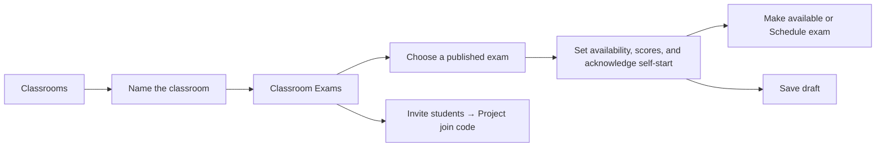
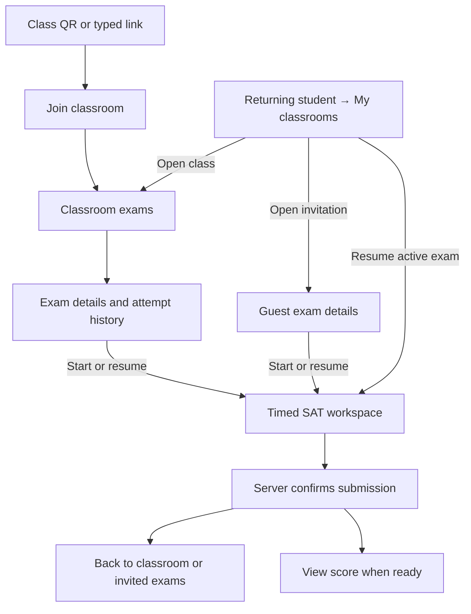

# SAT Classroom redesign proposal

The teacher’s first useful outcome is an exam students can open. The student’s first useful outcome is seeing which exam to take or resume. Make those actions prominent and put details where the user needs them. This proposal applies Apple’s guidance on hierarchy, familiarity, and recovery to the [SAT Classroom spec](sat-classroom-ux.md). [Apple Human Interface Guidelines · Design principles](https://developer.apple.com/design/human-interface-guidelines/design-principles/)

## What I would redesign first

1. **Create a class with its name.** A new teacher can land in the class immediately and choose **Add exam** or **Invite students**. Move the description and time zone to **Class settings**. Show the resolved time zone beside the first scheduling field so the teacher can catch a mismatch before committing a date.
2. **Make exam setup the review.** After choosing a published exam, show its version, schedule, score visibility, and required self-start acknowledgement together. Use **Make available** for an immediate exam and **Schedule exam** for a future one. The library author keeps **Publish version** as the action that releases the reusable content.
3. **Give the student one next action.** On **My classrooms**, put active attempts above class cards. Inside a class, use the exam row for **Resume exam**, **Open exam**, or **View results**. Place **Try again** in exam details so the student sees the deadline and attempt history before starting another timer.

## Teacher and staff experience

| Moment | Proposed screen |
| --- | --- |
| **Create the first classroom** | **Create classroom** asks for **Classroom name**. On success, open **Exams** with **“Add your first exam from the SAT library.”** Make **Add exam** primary and **Invite students** secondary. Both paths are immediately available. |
| **Configure a classroom** | Put **Settings** in the class header. Group name, description, and time zone under **Class details**. The owner manages **Teaching staff** and **Archive classroom** here. Use the archive confirmation to explain that enrollment and new starts close, active attempts can finish, and results stay available. |
| **Publish in the library** | The author sees **Draft**, validation issues beside the relevant content, and **Publish version** when ready. After publication show **Published · Version 3**. The library picker browses published versions by folder and search. For visible draft-only items, use **Needs publishing** with an authoring link where permitted. |
| **Add an exam** | Use one focused panel with two steps, **Choose exam** and **Set availability**. Carry the class name and selected exam through both steps. The second step is the final review. Keep **Save draft** available and preserve inputs when the teacher goes back. Use a sheet or full-height view appropriate to the screen size. [Apple Human Interface Guidelines · Sheets](https://developer.apple.com/design/human-interface-guidelines/sheets) |
| **Invite the class** | **Invite students** opens the projector view from the empty class or the **Students** tab. Give the class name, large QR, typed URL, **Join code**, and countdown the space they need. Show only the confirmed enrolled count. Dismiss to **Students**, where staff can **End enrollment**. The projector and join page use the same name for the code. [Apple Classroom · Nearby class enrollment](https://support.apple.com/en-au/guide/classroom/clac1c715b6a/web) |
| **Manage a student account** | Open the same student account from the staff directory or the classroom roster. Put WCODE and **Copy WCODE** beside each other. Use **Reset password** for authorized staff, followed by a single **Sign-in details** panel with **Show password**, **Copy sign-in details**, and **Done**. Confirm the reset because it signs the student out. |
| **Invite a sit-in student** | **Exam → Guests → Invite to exam** opens one sheet. Enter the exact WCODE, show the matched name, and put **Start by** directly below it. The button reads **Invite to this exam**. Confirm inline with **“Added to the student’s Invited exams.”** Keep the guest list and **End guest access** on this exam. |
| **Review submissions** | From the classroom exam, open **Submissions** for latest status, attempts, scores, and **Guest** labels. Put **Release answer review** on this screen. Confirm the consequence in plain words when students can still retake. Use inline feedback for saves and copies. [Apple Human Interface Guidelines · Alerts](https://developer.apple.com/design/human-interface-guidelines/alerts) |

### Make an exam available

```text
Add exam                                      Saturday SAT Prep

SAT Math Practice                              Change exam
Math · Version 3

Title in this classroom                        Exam 2 · Math
Opens                                          Now
Start by                                       No deadline  [Set]
Time zone                                      Bangkok (ICT)
Show scores when ready                         On

[ ] I understand students can start on their own once it opens.
    Students can retake while the exam is open.

Save draft                                      [Make available]
```

For a future opening, replace **Now** with the date and time, and use **Schedule exam**. The teacher can inspect **Source exam · Version 3** later in exam details. Each classroom exam records its version, schedule, and score setting at publication. A new library version is offered to teachers creating the next classroom exam.



## Student experience

| Moment | Proposed screen |
| --- | --- |
| **Join the first time** | Show **Join Saturday SAT Prep** above the form. The QR opens that class. Signed-in students enter **Join code** and select **Join classroom**. Signed-out students enter **WCODE**, **Password**, and **Join code**, then select **Sign in and join**. Autofocus the join code for signed-in students and let them paste the entire code in one field. |
| **Return to SAT** | **My classrooms** opens with **Continue exam** when there is an active attempt. When the system permits multiple active attempts, show each with its class and resume action. Below, show class cards with one progress line. Show **Invited exams** for exam-specific invitations and guest results. |
| **Open a class** | Show the class title and **“2 of 5 exams submitted”** above the exams in teacher order. Keep one clear action per row. Example **“Exam 2 · Math — In progress”** with **Resume exam**. Put the latest available score on a submitted row and the complete attempt history inside **View results**. |
| **Start or resume** | Show the exam name, duration, and **“Start by 5:00 PM. You’ll have 60 minutes once you start.”** Use **Start exam** or **Resume exam**, depending on the attempt. Active attempts use the server’s remaining time, including after the start window closes. |
| **Finish and see results** | After confirmed submission, show **Answers submitted** and **Back to classroom** or **Back to invited exams**. Show **View score** when that attempt’s report is ready. Keep the latest score summary and attempt dates together. Put **Review answers** beside the corresponding attempt once the teacher releases it. |
| **Retake** | Offer **Try again** from the exam’s attempt history while starts are open. Include **“This starts a new 60-minute attempt.”** The class progress counts the exam once, and each attempt keeps its own result. |

### Return to an active exam

```text
My classrooms

Continue exam
Exam 2 · Math
Saturday SAT Prep                                      [Resume exam]

Classrooms
Saturday SAT Prep                         2 of 5 exams submitted  ›

Invited exams
Exam 1 · Baseline
From Sunday SAT Prep · Start by Fri, 5 PM ICT              [Open exam]
```



## The recovery screens deserve the same care

| What happened | Copy and action |
| --- | --- |
| **Code expired** | **“This join code expired. Enter the new code your teacher is showing.”** Return focus to **Join code**. Keep the classroom context. |
| **Guest access ended** | For a fresh start, show **“Guest access has ended. Ask the host teacher if you need to take this exam.”** An active attempt shows **Resume exam**. A confirmed submission offers **View results**. |
| **A start response was lost** | Retrieve the result of the original start. Show **Resume exam** when an attempt exists and use its current time. |
| **Submission is still pending** | **“We’re still confirming your submission.”** Show the available recovery action when it applies. Use **Answers submitted** after server confirmation. |
| **Score is still processing** | Show **“Answers submitted. Your score is processing.”** Keep that attempt visible in history. |

Use one class accent, the existing SAT type hierarchy, and a clear primary action. On phones, keep the action with its exam and give the form fields enough room for large text. Put focus on the affected field after a validation error and keep recovery messages visible. Use text for availability, connection, and submission states. [Apple Human Interface Guidelines · Design principles](https://developer.apple.com/design/human-interface-guidelines/design-principles/)

## Product decisions still open

I recommend one active classroom exam at a time so the student has one place to resume. The [edge-case decisions](sat-classroom-ux.md#decisions-to-confirm) also cover how a guest’s exam counts if they later enroll and whether a host can grant access again. The credential panel follows the current proposal of displaying a newly issued password once at creation or reset.

Walk through a teacher scheduling their first exam, a signed-out student joining and resuming after reconnecting, and a guest finishing after the deadline and returning to see their score. In each scenario, check that people can tell what to do next and that the screen reflects the server-confirmed state.
