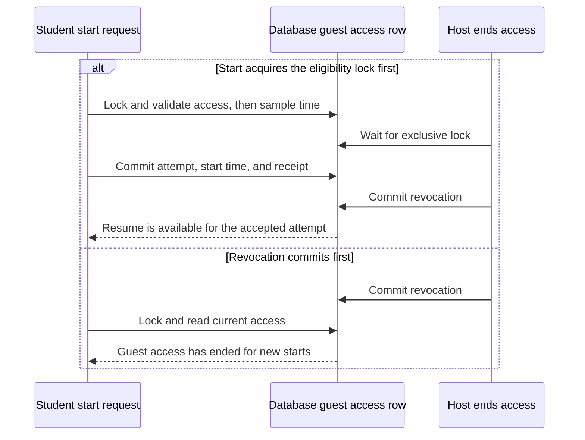

# SAT Classroom system design

Engineering proposal for the [classroom UX contract](sat-classroom-ux.md) and [redesign](sat-classroom-design-review.md). The most important boundary is **accepting a new timed attempt**. The database must make access, identity, attempt creation, and timing agree before SAT tells the student their exam has started.

## 1. Operation goal and system boundary

Use the existing Go API and transactional database as the authority for classes, access, attempts, and results. The browser presents deadlines and retains pending work using the SAT durability flow. The browser clock, WCODE, QR, and forwarded exam URL carry no authority by themselves. The student's verified account supplies identity.

| Operation | Success | Rejected or uncertain outcome |
| --- | --- | --- |
| **Provision or reset a student account** | Authorized staff creates one WCODE login or replaces its password. Reset revokes earlier sessions. Staff sees a generated password on the issuing response. | A duplicate WCODE or stale reset changes nothing. A lost response can recover the account or issuance outcome by operation ID. Staff can explicitly issue a replacement if they missed the password. |
| **Create or publish** | Creation records the class and its owner. Classroom publication commits an eligible library release, class schedule, score visibility, self-start acknowledgement, and backing SAT delivery binding together. | Invalid or stale choices leave the draft available for correction. The same publish request resolves to one classroom exam. |
| **Enroll or grant guest access** | One membership for a validated class code, or one named guest grant for a specific published classroom exam. | An expired code, unauthorized teacher, or ineligible account creates no access. A retry can find an already-committed membership or grant. |
| **Start or retake** | The server accepts the start within the permitted window, creates one sitting, and fixes the initial SAT clock. | Rejection creates no sitting. A lost response is recovered by operation ID. An explicit later retake creates a separate sitting. |
| **Resume, submit, and view results** | An authorized owner resumes the same sitting at its server state. Submission seals the accepted answer revision and returns a durable receipt. Score and review become visible under the classroom exam’s release rules. | Unconfirmed submission remains pending in the UI. An expired invitation can still lead to an owned active attempt or result. |

The working design permits one active sitting per student **per classroom exam**. A single active sitting across all classes, credit after a guest later joins the host class, and regranting expired access are [open product decisions](sat-classroom-ux.md#decisions-to-confirm). The underlying identity of a sitting is independent of those decisions.

## 2. Threats and consequences

| Failure | Consequence | Required boundary |
| --- | --- | --- |
| Forwarded URL, wrong account, or teacher looking up a student outside their scope | Exam content or results disclosed to the wrong person | Account and class/exam/attempt ownership checked at the protected operation. |
| Join or start races code expiry, host revocation, or class archive | Unauthorized access or an attempt incorrectly refused | Read database time and serialize against the corresponding access change in the transaction. |
| Two tabs, slow response, retry after timeout, or API crash after commit | Extra attempts, changed start time, or a retake charged to the wrong click | Receipt and attempt commit together. Validate the previous attempt ordinal for new intent. |
| Library changes after assignment, or the same exam is used in two classes | Students see different questions in a retake or another class’s score policy | Pin version and score visibility on the published classroom exam. |
| Student submits while timeout reconciliation or an answer write is running | Lost answers, duplicate submissions, or the wrong adaptive route | Reuse existing SAT writer, close, and terminalization fences. |
| Storage or grading fails | A false submission confirmation or a fabricated score | Return success after durable commit. Keep confirmed submission and score readiness distinct. |

## 3. Invariants and their enforcement

| ID | Invariant | Enforcement and evidence |
| --- | --- | --- |
| **I1 Identity** | Each provisioned WCODE resolves to one student ID. Class data, attempts, and results are scoped by authenticated ID and role. | Unique normalized WCODE. Server-side permission checks on both direct and in-app routes. Test wrong-account QR, guest, resume, review, and download access. |
| **I2 Access** | One membership per class/student. One guest grant per classroom exam/student. Guest access covers that exam. | Composite unique keys and scoped authorization. Race duplicate joins and forwarded links against the real DB. |
| **I3 Publication** | A published classroom exam has one eligible release at publication, one fixed delivery binding, and an explicit score policy. | Commit publication and delivery binding together. Test source archive, lost publish response, and two classes on the same version. |
| **I4 Start window** | New starts require an active account, an active class, a published exam, and membership or a valid guest grant. | Admission transaction locks the applicable gate and reads database time. `opens_at <= t` and `t < effective_start_by` when a cutoff exists. Test before, exactly at, and after cutoff and both start/revoke orderings. |
| **I5 Retakes** | At most one active sitting per `(classroom_exam_id, student_id)`. A distinct accepted retake has its own attempt ID and ordinal. | Serialize starts on a durable row for that pair and enforce unique ordinals. Fence the legacy admission and reopen paths. Race two distinct requests and repeat the race against terminalization. |
| **I6 Replay and time** | Same operation key and same intent returns the same outcome. Resume preserves the accepted start, owner, and pinned version. | Commit the start receipt with the sitting and initial clock. The current runtime supplies later module and recovery state. Test post-commit loss, replay after seal, and cross-device recovery. |
| **I7 Submission** | A confirmed result refers to a sealed attempt and its accepted answer frontier. | Existing SAT answer and terminalization transactions. Test client submission versus watchdog and final save versus close. |
| **I8 Visibility** | A student can view only their own score and released review. Class progress counts a published exam at most once per student. | Read report visibility from the classroom exam. Require a released review and an owned sealed sitting on content/download routes. Derive progress from distinct submitted classroom exams. |

For guests, `effective_start_by = min(host_start_by, guest_start_by)` over non-null values. Expiry and **End guest access** gate new starts. Resume and result reads use the owned attempt and a current account session. Account suspension is an independent authorization gate.

## 4. State machines and legal transitions

| Object | Current state → next state | Event, guard, and effect |
| --- | --- | --- |
| Classroom | `active → archived` | Authorized owner archives. Enrollment and new starts close at commit. Existing sittings and their result access follow attempt rules. |
| Enrollment code | `absent → live → expired / revoked` | Staff issues a 10-minute generation. Expiry uses database time. Rotating replaces the current generation. Committed memberships survive. |
| Guest grant | `absent → active → expired / revoked` | Authorized host grants a named student access. Effective expiry derives from both deadlines. Regrant remains a product decision. |
| Classroom exam | `draft → published` | Class staff selects a released version, validates dates and a self-start-compatible delivery plan, and acknowledges self-start. Publish pins content and the class score setting. **Upcoming**, **Available**, and **Closed** are time-derived states. |
| Sitting | `none / previously submitted → active` | An explicit Start or Try again succeeds under the admission rules. Start stores the first timed stage before returning success. |
| Sitting | `active → active` | Refresh, reconnect, or authorized device recovery reloads the same sitting. The existing SAT timing and writer-lease rules apply. |
| Sitting | `active → submitted / terminated` | The existing SAT close or terminalization boundary commits a receipt. Confirmed submissions are terminal in this proposal. Any staff reopen would need an explicit policy and the same per-student exam lock. |
| Score and review | `processing → ready`, or `hidden by policy` | A confirmed submission is available first. The grading path produces the score. Teacher release separately controls question review and answered-exam downloads. |

## 5. Data model and compatibility

The entities below are a schema sketch. Use existing ID and organization conventions. Use UTC instants for admission and exam clocks. Store the classroom’s time zone for entry and display of schedule fields.

| Record | Keys, constraints, and responsibility |
| --- | --- |
| `classroom_student_identity` | Student ID references `users`. Unique normalized WCODE and trusted program scope. Look up the existing account by ID and reuse the Argon2id password and session service. Existing `users.email` is required and unique, so email-less provisioning needs an internal address or a migration of that constraint. Choose the internal account ID as the authority. |
| `classrooms`, `classroom_staff`, `classroom_memberships` | Class records owner and program. Unique class/staff and class/student pairs. Index memberships by student for **My classrooms**. Class status is authoritative for new admissions. |
| `classroom_join_gate` | One current code generation per class. Store expiry, revocation, and derivation key ID. A keyed derivation from the class ID and random generation can reproduce the six digits for the projector. Keep the key outside the DB, preserve leading zeroes, rate-limit verification, and keep credentials out of logs. |
| `classroom_exams` | Class ID, source exam and release IDs, unique backing `schedule_id` after publication, title, `opens_at`, nullable `start_by`, score visibility, self-start acknowledgement, and answer-review release state. Check `start_by > opens_at` when set. Link the release to its source exam. Use restrictive references to protect the source and schedule from hard deletion while classroom history depends on them. |
| `classroom_exam_guests` | Unique `(classroom_exam_id, student_id)` with grant actor, deadline, and revocation. Index by student for **Invited exams**. Scope the lookup to the program. The actor needs access to the host exam. |
| `classroom_exam_students` | Unique `(classroom_exam_id, student_id)`. Stable row for serializing a student's start requests for one exam and scoping their receipts. |
| `classroom_attempts` | Primary key is the existing `student_attempts.id`. Reference the classroom exam/student pair. Unique `(classroom_exam_id, student_id, ordinal)`. Record `member` or `guest` at start for submission history. Derive active and submitted states from the existing attempt. |
| Receipts | Reuse `assessment_lifecycle_receipts` for starts, scoped to the exam/student row, with operation ID, intent digest, and attempt ID. Keep the start receipts with the attempt history. Use the repo’s idempotency pattern for creation and issuance actions outside a delivery schedule. Keep IDs and outcomes in receipts. Show a generated password on its issuing response and store only its hash for verification. |

### Fit with the existing SAT delivery engine

- **Retakes require an admission change.** Current `CreateScheduleAttempt` replays an attempt by registration. The database enforces unique `student_attempts.registration_id` and unique registration WCODE per schedule. Use one backing schedule per classroom exam and a fresh registration per classroom attempt. Scope the registration WCODE uniqueness by an explicit registration instance, using a fixed default for existing room registrations and an attempt-specific instance for classroom registrations. Use a unique attempt-specific `student_key`. Keep the actual WCODE and user ID attached to the sitting. This preserves one registration per attempt and separates history by ordinal. [Current attempt creation](../backend/go/internal/schedules/service.go) · [Attempt uniqueness](../backend/go/migrations/0006_delivery.sql) · [Registration WCODE uniqueness](../backend/go/migrations/0012_registration_fields.sql)
- **Fence classroom schedules at every entry point.** Give the backing schedule an explicit classroom self-start kind. Classroom reads, saves, recovery, and downloads resolve by explicit attempt ID plus authenticated owner. Legacy routes that mint or resolve by schedule and WCODE must reject this schedule kind. The current latest-by-`updated_at` resolver would be ambiguous across retakes. Include archive, deletion, staff reopen, and background writers in the route inventory. [Current student attempt lookup](../backend/go/cmd/api/student_context.go) · [Current SAT start modes](../backend/go/internal/satstartcode/satstartcode.go)
- **Separate admission and delivery clocks.** Use the existing personal timing engine for each sitting. Class archive and `start_by` act on admission. The backing runtime stays usable by active sittings. Legacy schedules require `end_time`; support a nullable legacy end time specifically for classroom-backed rows and adapt affected scans and scheduler predicates before enabling the mode. This avoids encoding an unlimited classroom as a fabricated date. Test the personal attempt sweep independently of the classroom start window. [Current schedule schema](../backend/go/migrations/0005_scheduling_and_access.sql) · [Personal module entry](../backend/go/internal/delivery/start_submit.go)
- **Separate grading from student score visibility.** Grade completed classroom attempts that have a supported scoring plan so authorized host staff can see the result. Use the classroom exam’s fixed score policy for student score access and answer-review eligibility. The current score gate and pending repair use the live library flag. Update materialization, repair, student results, and PDF/review authorization together. Use the pinned version for question-level review and select only delivered modules. [Current score gate](../backend/go/internal/results/service.go) · [Current materialization and repair](../backend/go/internal/terminalization/service.go) · [Answered exam projection](../backend/go/internal/delivery/answered_exam.go)

## 6. Core transactions and concurrency

Use indexed locking reads for mutable eligibility and retain existing attempt/module lock order inside the delivery service. New start transactions acquire the account/session, class, published exam, applicable access row, and exam/student serialization row in that order. Use shared locks on read-only eligibility rows. Revocation takes an exclusive lock on the guest row, code replacement takes one on the code row, and archive takes one on the class. Create the per-student serialization row with its unique key before locking it. Use a current read of the latest attempt under that lock. Keep content transfer, notifications, and client delivery outside the transaction. Bound retries to the same operation key. [MySQL locking reads](https://dev.mysql.com/doc/refman/8.4/en/innodb-locking-reads.html) · [MySQL deadlock handling](https://dev.mysql.com/doc/refman/8.4/en/innodb-deadlocks-handling.html)

### Start or retake

The intent includes a stable operation ID and the last attempt ordinal the student saw, with zero for the first start. The ordinal protects against a second tab's different operation ID arriving after the first attempt has already finished.

```text
begin transaction
  verify current account session and lock its authority rows
  bind classroom exam and account, then lock the applicable access and exam/student rows
  retain access rows for the new-attempt eligibility check
  if a receipt exists for this operation ID:
      require matching intent digest and return its existing attempt reference
  read latest owned sitting by ordinal
  if it is active:
      require observed ordinal == latest ordinal - 1
      record this operation's receipt pointing to the same sitting
      commit and return Resume
  require the observed ordinal to match the latest ordinal
  require first start or a previous confirmed submission
  read database UTC time after acquiring admission locks
  require active class, published exam, membership or active guest grant, and open start window
  create registration and attempt with the next ordinal and pinned version
  initialize the first personal module with the accepted database time
  write the start receipt and any existing outbox event
commit
return the attempt reference and authorize delivery for that sitting
```

Use the existing module initialization and timing calculations through a transaction-aware entry point. The first timed stage starts at the accepted database time. If the API response is lost, the clock is already in force and the learner can recover the receipt. Later module entry, breaks, recovery, and deadline processing use the existing engine. A replay can return its original attempt after expiry or submission, subject to current ownership and account authorization.



### Join, publish, resume, and submit

- **Join.** For a signed-out student, use the existing password authentication first and attempt enrollment with that identity in the same user action. If the code expires, the student can be signed in and asked for a fresh code. Lock the current account, class, and code generation for enrollment. Check for existing membership first, then validate the current code and expiry for a first-time join. Insert the membership once. The browser can recover from losing either the session cookie or join response by authenticating and looking up the committed membership.
- **Publish.** Lock the class and source release eligibility, then the classroom draft. Record the reviewed version and settings with the backing delivery binding in one transaction. Validate that the exam plan can progress for a self-start student, including its Module 2 routing policy. A draft requiring a staff selection needs an explicit product policy before it can be offered as self-start.
- **Resume.** Authenticate the account and authorize the explicit owned sitting. Use the existing attempt credential and writer lease. Bind each classroom attempt credential to the issuing account session ID. On mutations, check that current account/session binding within the same write boundary as the attempt lease. This makes password reset and suspension effective for previously issued classroom bearers. A new account session can establish fresh delivery authority for the same owned attempt through the existing lease or device recovery flow. [Existing attempt projection identity](../backend/go/cmd/api/handlers_attempt_access.go) · [Existing read credential verification](../backend/go/internal/auth/attemptverify_read.go)
- **Submit.** Reuse the existing SAT close, answer frontier, terminalization, and receipt logic. A duplicate submission resolves to the committed outcome. The terminalizer serializes on the attempt row and derives the final snapshot from accepted writes. Classroom admission reads that state under the pair lock. The attempt's own state supplies the active predicate. Fence legacy reopen for classroom sittings so the invariant holds across all writers. [Existing terminalization transaction](../backend/go/internal/terminalization/service.go) · [Existing timed-out reopen path](../backend/go/internal/terminalization/reopen.go)

## 7. Failure and recovery behavior

| Failure | Durable state | Recovery and visible result |
| --- | --- | --- |
| Crash during creation, publication, or start | The transaction rolls back or the whole outcome commits. | Retry the same operation key. The receipt identifies the existing class, exam, or attempt where committed. |
| Start response lost, then cutoff or guest revocation passes | The committed attempt and start receipt survive. | Recover the original sitting and current timer. **Resume exam** takes precedence for an active attempt. |
| Two starts arrive with different IDs and one finishes before the other arrives | The latest ordinal changed. | Replay known operations. A stale new intent refreshes the exam state. **Try again** from the refreshed attempt history expresses a new intent. |
| Class archive or guest revocation overlaps start | The lock order determines which action is accepted first. | Starts accepted first can finish. Later starts see **Closed** or **Guest access has ended**. |
| DB or network is unavailable during a save or submit | The last confirmed answer frontier is durable. Pending work follows the existing device journal and recovery policy. | Show **Submitting your answers…** until the receipt is confirmed. Use **Answers submitted** after confirmation. |
| Password reset commits but staff loses the response | A new hash is active and prior sessions are revoked. | Recover the reset outcome. Staff explicitly issues a new password if needed for handoff. Guard separate reset requests with the reviewed credential revision to prevent a stale form replacing a newer issuance. |
| Grading is delayed or fails | The submission remains sealed. | Show **Score processing** and retry the existing scoring/repair path for that attempt. Review availability still follows its release rule. |

## 8. Verification and release evidence

### Existing evidence collected for this design

Ran the focused delivery, attempts, and terminalization tests below. They passed. Migrated an isolated MySQL **9.6.0** instance through **121 migrations** and ran eight selected integration tests with the Go race detector. They passed, including unrelated-principal refusal, owner-only replay after a lost takeover response, client submit versus timeout, the answer cutoff, response durability, and personal break entry contention. This evidence covers the existing runtime boundaries listed here. The new classroom admission, retake schema, and per-class score gate require their own tests.

```bash
# From backend/go, with TEST_MYSQL_DSN pointing to an isolated migrated schema for integration.
go test ./internal/delivery ./internal/attempts ./internal/terminalization \
  -run 'Test(EntryState|DeliverySubmitModuleTerminalRetry|DurabilityContractExactReplay|SubmitSATResolverSeals|SameOutcomeTerminalReplay|BeginDeviceRecoveryCommits)' -count=1 -v
go test -race -tags integration ./integration \
  -run '^(TestMigrationLedgerApplies|TestAdmitRefusesUnrelatedPrincipalForUnboundAttempt|TestTakeoverReplayAfterLostResponseIsOwnerOnly|TestConcurrentSATClientSubmitAndTimeoutReconcileSealOnce|TestSATSaveBeforeFinalizationCountsTowardTheRoute|TestSATSaveAfterFinalizationIsRefused|TestSATResponseDurabilityV2BootstrapAndLegacyCompatibility|TestSATPersonalBreakEntryIsNotBlockedByAnotherCandidatesOpenSave)$' -count=1 -v
```

### Acceptance tests for the proposed changes

| Invariants | Executable acceptance case to add |
| --- | --- |
| **I1–I2** | Send the same join simultaneously from two API instances, rotate the code while a join waits, and try a named guest link with the wrong account. Assert one membership and the expected authorization outcomes. Exercise old account sessions and attempt bearers after reset/suspension against save, resume, and review routes. |
| **I3** | Archive the library entry concurrently with classroom publish. Verify either the complete publication wins first or the draft remains with an eligibility error. Publish the same version in two classes with opposite score settings and exercise both report materialization and download authorization. |
| **I4–I6** | Use transaction barriers around the eligibility read and write. Test the exact deadline, a lock wait crossing the deadline, both start/revoke and start/archive orderings, and distinct operation IDs in two tabs. Inject failure before receipt commit and drop the response after commit. Replay after seal. Assert the attempt ID, ordinal, active count, and original start timestamp. |
| **I7** | Extend existing submit-versus-watchdog and final-write-versus-close cases to a classroom retake. Confirm each sitting has its own answer frontier and receipt. Attempt to reopen a prior sealed sitting while a retake is active. |
| **I8** | Grant a guest, end access after start, and finish the sitting. Verify the guest result, host roster label, home class progress, and direct review/PDF denial before teacher release. Show a legitimate zero score distinctly from a pending result. |

Run the new concurrency cases against each deployment database engine and isolation profile. Test migration from populated legacy registrations, keep the legacy per-schedule WCODE uniqueness behavior, verify runtime routing for classroom-backed schedules, and run a mixed-binary rehearsal with classroom writes gated. Use a real browser for the signed-out join, lost-response start/resume, guest retake, and submission receipt screens. [Repository integration harness](../backend/go/integration/README.md)

## 9. Operational controls

- Record class publication, credential issuance, guest grant/revocation, and answer-review release with actor, scope, event time, and operation ID. Use the existing outbox for notifications and projections that can catch up after commit. Keep passwords, join codes, tokens, and answer contents out of logs.
- Monitor admission denials by reason, start transaction retries and latency, time from accepted start to usable exam, overdue attempt reconciliation, submission confirmation lag, and scoring backlog. Track expired-guest resume failures separately from blocked guest new starts.
- Reconcile missing published delivery bindings, duplicate active classroom attempts per pair, receipts with missing attempt links, version/owner mismatches, and released results without the required seal. Check the primary database before taking action. Include classroom records, versions, attempts, receipts, and answer data in a restore rehearsal.
- Roll out the additive schema and compatibility checks with new classroom starts gated. Install the replacement uniqueness constraint before removing the old one. Enable classroom starts once every serving binary handles the schedule discriminator. A rollback can close new starts while compatible readers and workers serve existing attempts and history.

### Runbook · Student reports a start or submission that never confirmed

1. Locate the student's class exam and attempt by authorized WCODE lookup or support reference. Read the primary database for the operation receipt, attempt ordinal, timing state, and terminal receipt.
2. If a start committed and the sitting is active, direct the student to **Resume exam**. If their session or writer lease is stale, use the existing account or device recovery flow. Retain the stored timer.
3. If submission committed, return the receipt and check scoring readiness separately. If it is pending, inspect the existing answer journal and close state, then follow the established submission recovery path for that attempt.
4. If the outcome is still unknown, keep the operation ID for retry and collect its correlation data. During a systemic admission incident, gate new classroom starts while keeping the existing delivery, resume, and submission paths available.

## 10. Residual risks and decisions

- Validate the changed registration uniqueness, schedule discriminator, nullable deadline handling, and all legacy schedule/candidate-ID readers against the deployed engine. The isolated MySQL run is evidence for the existing code. TiDB behavior and mixed-version deployment still need their own rehearsal. [Repository migration notes](../backend/go/migrations/README.md)
- Confirm the first-module transaction with the actual SAT seeder and personal runtime. Test expired or disconnected clients between durable start and first content paint. Confirm that class-backed schedules remain available for attempt-level timeout reconciliation after archive.
- Decide the global active-exam scope, later-enrollment credit, expired grant renewal, and any staff reopen policy before implementing those transitions. The current design serializes per classroom exam and uses a confirmed submission as the ordinary retake boundary.
- Set measurable start-to-content, recovery, and restore targets using a classroom-sized load rehearsal. Collect evidence for the proposed acceptance cases before enabling classroom writes in production.
