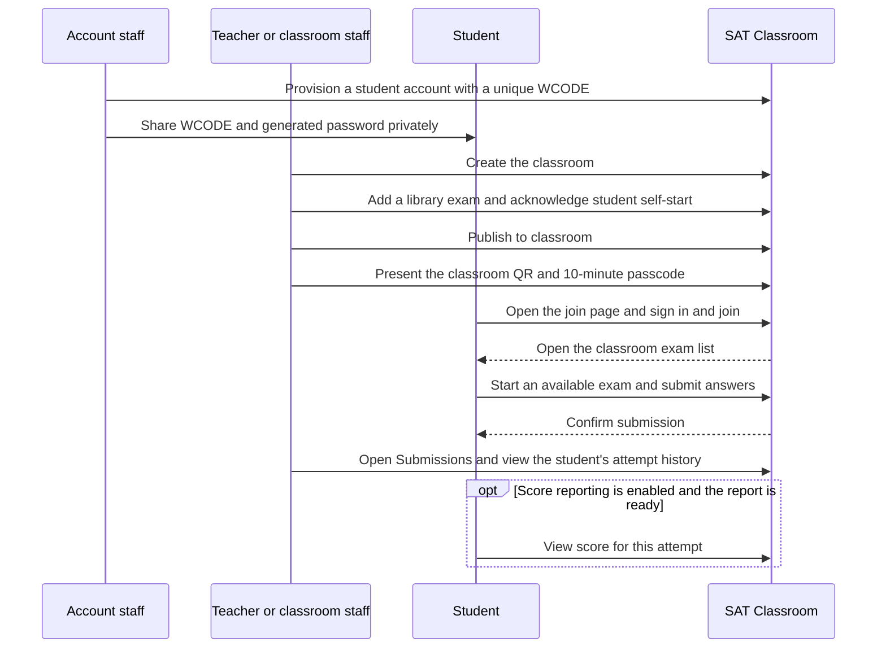
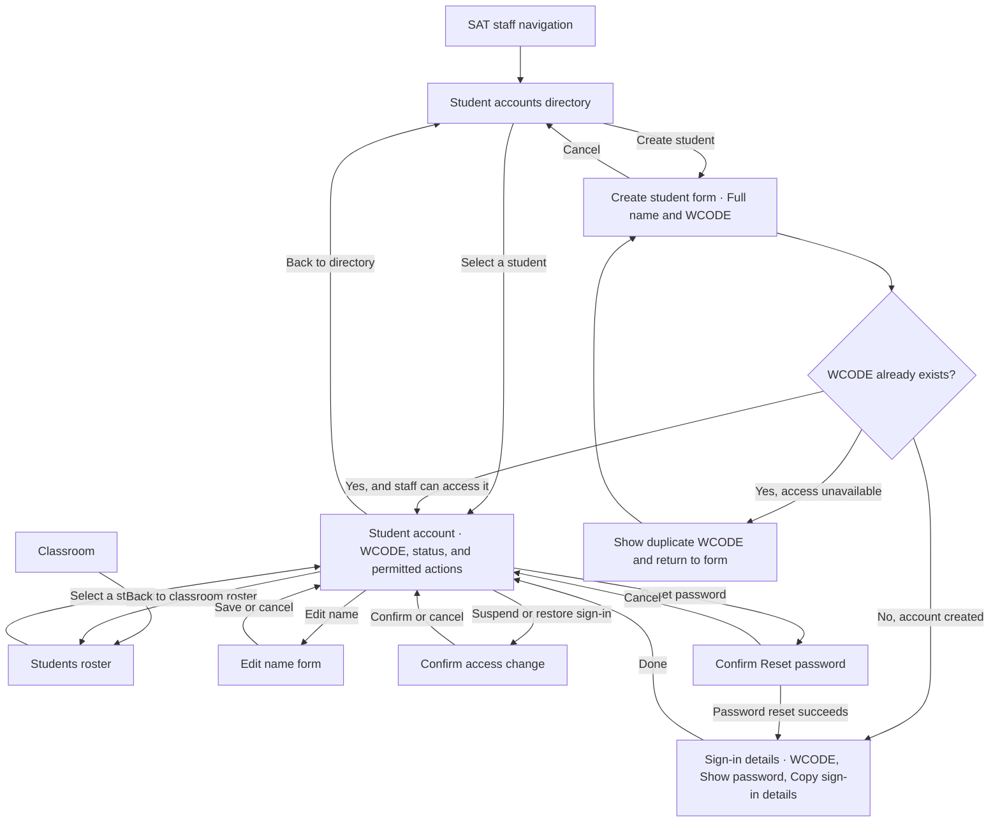
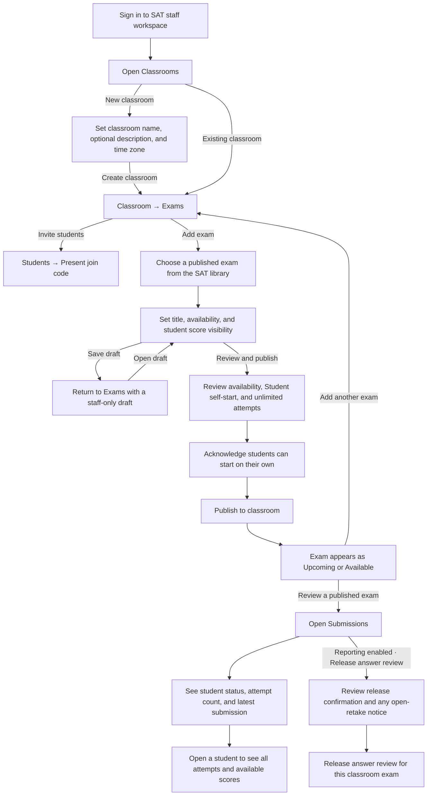
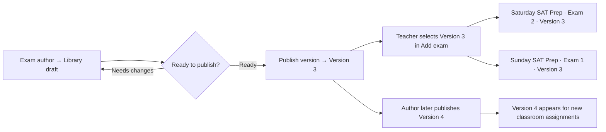
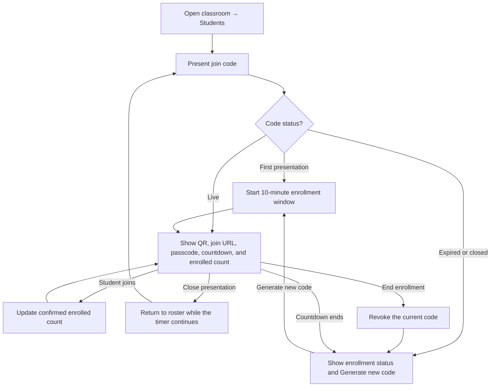
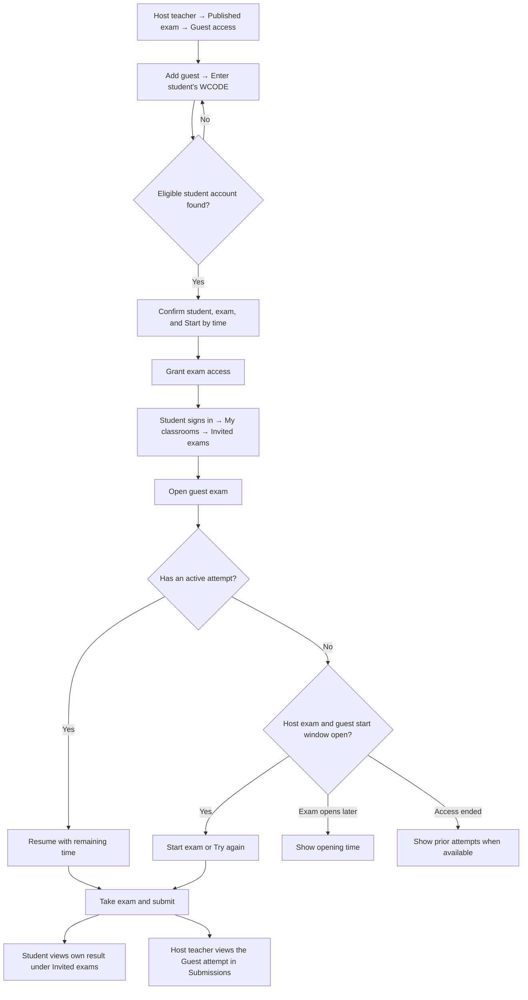
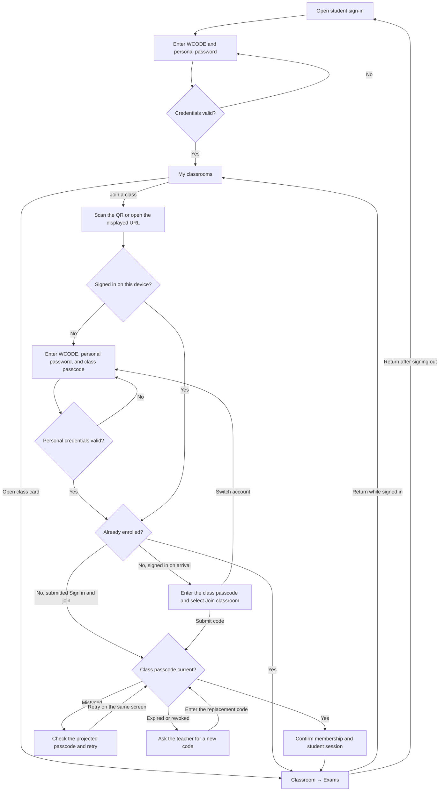
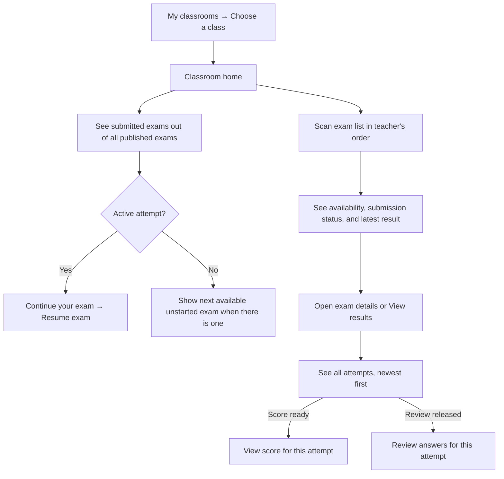
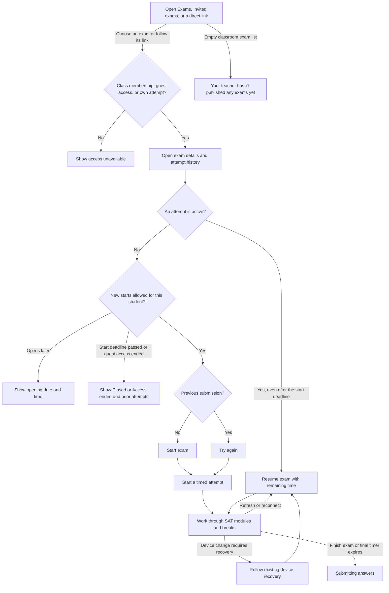
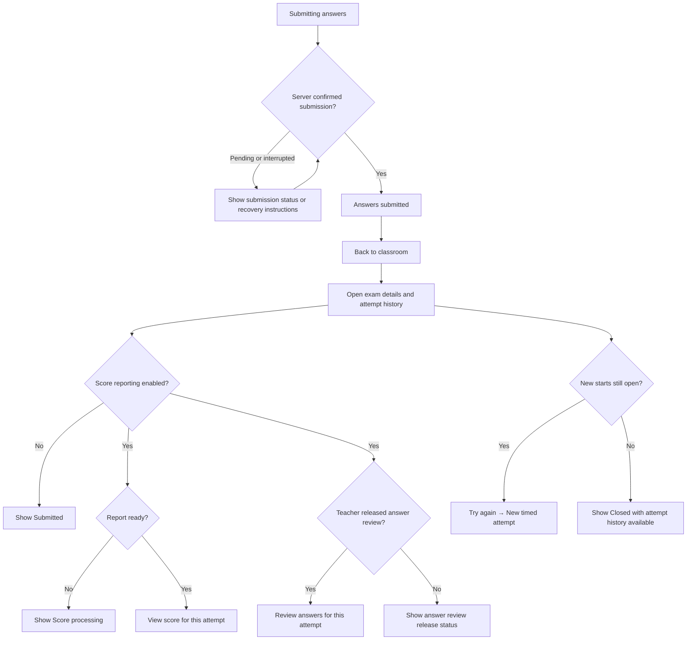

# SAT Classroom

A teacher creates a classroom, enrolls students, and publishes exams from the SAT library. A student signs in with a school-issued WCODE and password, joins the classroom once, and returns to the same exam list across visits.

**Teacher** · Classrooms → Create classroom → Exams → Add exam → Publish to classroom → Submissions

**Student** · Scan QR or open the displayed URL → Sign in and join → Classroom exams → Start or resume exam → Submit → View score or try again

**Returning student** · Student sign-in → My classrooms → Classroom exams → Open exam

**Sit-in student** · Host teacher grants access → My classrooms → Invited exams → Open exam

[View the Mermaid user flows](#mermaid-user-flows) · [Create a classroom](#2-classrooms-and-creation) · [Published exams](#4-exam-library-and-classroom-publishing) · [Sit-in guest access](#sit-in-guest-access) · [Edge cases](#edge-cases)

## Reference screens

| Reference | What to carry into SAT |
| --- | --- |
| Google Classroom · Create class and join by link | A class card as the entry point, a short creation form, and a join screen that identifies the class and account. Joining persists across visits. [Create a class](https://support.google.com/edu/classroom/answer/6020273) · [Join by link](https://support.google.com/edu/classroom/answer/15604494) |
| Google Classroom · Classwork and assignment creation | A scannable list inside each class, a draft visible to the teacher, and a publish action that makes work visible to students. SAT uses exam availability and attempt status on each row. [Student Classwork](https://support.google.com/edu/classroom/answer/9582544) · [Create an assignment](https://support.google.com/edu/classroom/answer/6020265) |
| Google Classroom · Class settings and reuse | Put class details and archive in settings. Give each reused exam its own classroom setup. [Class settings](https://support.google.com/edu/classroom/answer/6076302) · [Reuse work](https://support.google.com/edu/classroom/answer/6272593) |
| Google Admin · Directory and account details | Find a student in a searchable directory, then use a dedicated account page for actions that affect sign-in. [Find a user account](https://support.google.com/a/users/answer/33324) |
| Google Drive · Share with specific people | Start from an exam, identify the person, then show the list of people with access. [Share and manage access](https://support.google.com/drive/answer/7166529) |
| Khan Academy · Student dashboard | Put progress and the next action above the class work. [Student dashboard](https://support.khanacademy.org/hc/en-us/articles/46935588089997-How-do-I-use-the-student-dashboard-in-Khan-Academy) |
| College Board · My Practice | Show attempts newest first and let the student open the result for an individual sitting. [My Practice](https://satsuite.collegeboard.org/practice/my-practice-101) |
| SAT · Present student link | Reuse the full-screen QR presentation layout. Give the classroom passcode and expiration prominent positions with a readable URL for laptops. [Current presentation component](../src/products/sat/ui/SatStudentLink.tsx) |
| Bluebook · Taking the test | Give the exam a dedicated workspace with clear instructions, section timing, break screens, and a submission receipt. Reuse SAT delivery and recovery for these states. [Bluebook test-day experience](https://satsuite.collegeboard.org/sat/what-to-bring-do/what-to-expect) |

## Teacher and staff screens

### 1. Student accounts

#### Entry points

- **Account staff** · SAT staff navigation → **Student accounts** → Select a student → **Student account**.
- **Teacher or classroom staff** · **Classrooms** → Open a class → **Students** → Select a student → **Student account**.

Both entry points open the same student account screen. The back link returns to the directory or classroom roster the viewer came from, with their search and filters intact. Available actions follow the viewer's permissions.

| Action | Account staff | Teacher or classroom staff |
| --- | --- | --- |
| Find student, view WCODE and account status | Students within their assigned scope | Students in their own classrooms |
| Create student or edit the student's name | With account management permission | Available to teachers who also have account management permission |
| Reset password | With credential permission | With credential permission for students in their own classrooms |
| Suspend or restore sign-in | With account management permission | Hand off to authorized account staff |

#### Screen flow and copy

| Screen | Layout and next action |
| --- | --- |
| **Student accounts** | Directory title and **Create student** at the top. Below, **Search name or WCODE**, **Account status**, and a list with **Student**, **WCODE**, and **Status**. Select a row to open **Student account**. |
| **Create student** | A short form with **Full name** and **WCODE**, then **Create student** or **Cancel**. On a duplicate, show **“A student account already uses this WCODE.”** Offer **Open existing account** when permitted. On success, open **Sign-in details**. |
| **Student account** | Name and **Active** or **Suspended** at the top. Show **Username (WCODE)** with **Copy WCODE**. Below, show enrolled classrooms the viewer can access and actions such as **Edit name**, **Reset password**, and **Suspend sign-in** when permitted. |
| **Reset password** | Confirm the name and WCODE. Show **“This replaces the student’s password and signs them out of SAT.”** If an exam is active, add **“This student has an exam in progress. They’ll need the new password to sign in again.”** **Cancel** returns to **Student account**. **Reset password** opens **Sign-in details** on success. |
| **Sign-in details** | Use **Student account created** or **New password issued** as the heading. Show **Username (WCODE)**, masked **Password** with **Show password**, and **Copy sign-in details**. Supporting text reads **“Copy these details before closing and share them privately with the student.”** **Done** opens **Student account**. |
| **Edit name** | Edit **Full name**. **Save** returns to **Student account** with the updated name. The WCODE, enrollments, and attempts stay linked to the same account. |
| **Suspend or restore sign-in** | Confirm the action for the selected student. For suspension, show **“This student will be signed out and lose access until sign-in is restored.”** Return to **Student account** with the updated status and the available action. |

On desktop, use a full page for the directory and account, with a focused dialog for each short form and confirmation. On phones, give the same forms a full-height sheet. After **Create student** or **Reset password**, replace that form with **Sign-in details** so the credential panel is the only dialog open.

```text
‹ Saturday SAT Prep / Students

Mali S.                                   Active
Username (WCODE)                          [Copy WCODE]
W123456

Classrooms
Saturday SAT Prep

[Reset password]
```

Show the generated password once in **Sign-in details** after a successful create or reset. Later account visits show the WCODE and the available reset action. Preserve classroom memberships, scores, and attempt history through resets and suspension. Record who issued or reset a password, suspended sign-in, or restored it, with the time of the action. Keep credential values out of that history, the classroom roster, and the projector view.

### 2. Classrooms and creation

| Screen | Layout and next action |
| --- | --- |
| **Classrooms** | Show a grid of class cards with the class name, student count, and published exam count. Place **Create classroom** beside the page title. Empty state reads **“Create a classroom to invite students and add exams.”** |
| **Create classroom** | Ask for **Classroom name** and **Description (optional)**. Show **Time zone**, prefilled with the teacher’s local zone when available. Help reads **“Used when scheduling exams for this classroom.”** Use **Create classroom** and **Cancel**. |
| **New classroom → Exams** | Show the classroom name, **Exams**, **Students**, and **Settings**. Open **Exams** with **“Add your first exam from the SAT library.”** **Add exam** opens the library picker. **Invite students** opens the roster, where staff can present a join code. |

The creating teacher becomes the class owner. A classroom is ready to use as soon as creation succeeds. Staff can add the first exam and invite students in either order. Keep entered values if creation fails, and resolve a retry of the same create request to the classroom it already created.

Use SAT typography and one class accent across the card and class header. Class cards wrap into a single column on phones. Keep the exam and roster actions by their respective headings so the same actions are easy to find on a wide screen and a phone.

#### Classroom settings

| Section | Controls |
| --- | --- |
| **Class details** | Edit **Classroom name**, **Description**, and **Time zone**. Use the time zone for new exam schedules. Existing opening times and deadlines retain their saved instants. |
| **Teaching staff** | Show the owner and assigned staff. The owner can **Add staff** from existing staff accounts. Assigned staff can manage enrollment, exams, guests, and submissions for this class. Exam library editing and publishing use their own permissions. |
| **Class status** | **Archive classroom** confirms **“Enrollment and new exam starts will close. Students already taking an exam can finish, and results stay available.”** Put the class under **Archived classrooms**. |

### 3. Students and projected enrollment

In **Students**, show the enrolled count, search by name or WCODE, and a roster with enrollment dates. Open a student for account status and permitted sign-in actions. **Present join code** starts a 10-minute enrollment window and opens the projector view. Reopening the presentation while the code is live shows the same code and remaining time.

```text
                         Join Saturday SAT Prep

                                 [ QR code ]
                           Scan or open [join URL]

                              Class passcode
                                 482 731
                             Expires in 09:59

                           12 students enrolled
```

The QR and typed URL open the same classroom join screen. The projected count reflects confirmed enrollment, and the view shows the count only. **End enrollment** revokes the current code. Closing the presentation returns to the roster and the timer continues. When the code expires or staff end enrollment, replace the code with **“Enrollment code expired”** or **“Enrollment closed”** and **Generate new code**.

### 4. Exam library and classroom publishing

#### Publish a version in the exam library

An authorized exam author opens **Exam library → Exam → Review and publish version**. The review shows the exam title, sections, and validation issues. **Publish version** seals an immutable release and displays **Published · Version 3**. If the draft changes during review, show **“The draft changed. Review the latest changes before publishing.”** Publishing a library version makes it available for classroom assignment.

#### Add a published exam to a classroom

1. Open **Classroom → Exams → Add exam**. The picker has **Search exams** and the existing library folders. Each eligible row shows the exam name, latest published version, and exam scope. Example **SAT Math Practice · Version 3 · Math**. Select a row and choose **Continue**.
2. A draft-only exam the teacher can see shows **Needs publishing**. An authorized author can **Open in library** to publish it. If there are no eligible exams, show **“No published exams available. Ask an exam author to publish an exam.”** Archived exams are omitted from new selections.
3. **Set up classroom exam** displays the selected version and the following class-specific fields.

| Field | UI copy and behavior |
| --- | --- |
| **Exam title** | Starts with the library title and can be edited for this class. Example **Exam 1 · Baseline**. |
| **Opens** | **When published** or a scheduled date and time. Use the classroom time zone for the form. |
| **Start by (optional)** | “Last time students can start a new attempt. Students who have already started keep their remaining exam time.” Display the time zone with each time. |
| **Start mode** | **Student self-start**. “Students choose when to begin while the exam is open. Each attempt has its own timer.” |
| **Attempts** | **Unlimited**. “Students can try again while the exam is open.” |
| **Show score to students** | Prefill from the library exam’s score-report setting. The teacher can choose for this classroom exam before publishing. Help reads **“Students can see their score and skill breakdown when ready. You can release answer review separately.”** |

**Save draft** returns to the class exam list with a **Draft** row. **Review and publish** shows the classroom, source version, schedule, score visibility, and attempts. Require **“I understand students can start this exam on their own once it opens.”** Then select **Publish to classroom**. The exam appears to students as **Upcoming** or **Available**.

If the deadline is before or at the opening time, show **“Choose a deadline after the exam opens.”** If the source becomes unavailable during setup, keep the classroom draft and show **“This exam version is no longer available. Choose a published exam.”** For a temporary save failure, keep the form values and offer **Try again**.

#### After publishing

The teacher’s exam row shows position, class title, availability, and submission count. Exam details shows **Source exam · SAT Math Practice, Version 3** and the classroom’s score setting alongside **Guest access** and **Submissions**. The teacher can order the exam list. Eligibility follows each exam’s start window.

Each published classroom exam stores its selected library version and score visibility. If an author later publishes Version 4, the picker offers Version 4 for new classroom exams. An open classroom draft can explicitly switch to Version 4. A published class exam uses its pinned version for every sitting and retake, including when its library entry is archived. The same version can support separate classroom entries with their own titles, schedules, score settings, guests, and submissions.

### 5. Submissions

Open an exam to see **Submissions**. The header includes the availability window and **Student self-start**. The roster shows **Student**, **Status**, **Attempts**, and **Latest submission**. Use **Not started**, **In progress**, **Submitted**, or **Score processing** as applicable. Show the latest submission's score when available. Open a student row to see every attempt, newest first, with start time, submission time, status, and the existing report where available. The attempt count includes an active attempt. Submission totals count confirmed submissions.

For classroom exams with student score visibility enabled, show **Answer review · Hidden** and **Release answer review**. Confirm with **“Students will be able to review their submitted answers and the correct answers.”** If the exam is still open for new starts, add **“Students can still start or retake this exam after you release answer review.”** The action applies to submitted attempts for this classroom exam, including attempts submitted after release. The published exam then shows **Answer review · Released**.

## Student screens

### 6. Sign in

Heading **Sign in to SAT**. Fields **WCODE** and **Password**, a show/hide password control, and **Sign in**. Help reads **“Use the sign-in details your school gave you.”** If credentials fail, show **“Check your WCODE and password, then try again.”** Recovery copy reads **“Ask your school for a new password.”** Successful sign-in opens **My classrooms** or returns to the classroom the student was opening.

### 7. Join classroom

Heading **Join Saturday SAT Prep**. Show the class and teacher names above the form. On a signed-out device, show **WCODE**, **Personal password**, and **Class passcode** with **Sign in and join**. On a signed-in device, show the account, **Switch account**, **Class passcode**, and **Join classroom**. Keep the code field paste-friendly and show a single submit action.

On success, land on the classroom's **Exams** screen. For a student already enrolled in the class, open the class directly once their account is authenticated. For a first-time join, the server checks that the passcode is current before creating the membership. If the code expires during sign-in, show **“This class code expired. Ask your teacher for the new code.”** If staff end enrollment, show **“Enrollment is closed. Ask your teacher for a new code.”** For a mistyped code, show **“Check the class passcode on the screen and try again.”** Keep focus on the code field when it needs correction. If the join response is lost, retry the same join and open the class if membership was already created.

### 8. My classrooms

Show one card per enrolled classroom, with the class name, teacher, and **“2 of 5 exams submitted.”** The class name opens the classroom home. If the student has an active attempt in the class, show its title and **Resume exam** on the card. If the class has published zero exams, show **“No exams published yet.”** If the student has joined zero classes, show **“Your classrooms will appear here after you join. Scan the QR code or open the link your teacher shares.”** The account menu has **Sign out** for shared devices.

Show **Invited exams** below the classroom cards when a student has guest access or has attempted a guest exam. The host classroom name on an exam card identifies where the exam came from.

### 9. Classroom home

Use the same class name and accent as the class card. Put class progress and the next action above the **Exams** list. For **“2 of 5 exams submitted,”** count each published exam once when it has a confirmed submission. The total includes all published exams, including upcoming and closed exams. A pending score counts after submission is confirmed. A retake keeps the exam counted once. Pair the progress bar with the text count.

Show **Continue your exam** with **Resume exam** when an attempt is active. If there are several active attempts, feature the first in the teacher’s exam order and keep the others accessible in the list. Otherwise, feature the available, unstarted exam with the nearest **Start by** deadline, using the teacher’s order for ties and exams without a deadline. Skip the feature when there is no active or available unstarted exam.

Keep the full list in the teacher’s order. Put the status beside or under the exam title. Show the score for the latest confirmed submission when its report is ready. If its report is pending, show **Score processing** and keep previous scores in attempt history. During a retake, prioritize **Resume exam** and keep the earlier submission’s score labeled **Previous score** when available. On phones, stack the title, status, score, and action. Use text labels with color.

| Example row | What the student sees |
| --- | --- |
| **Exam 1 · Baseline** | **Submitted · 2 attempts** · **Latest score** · **1,160–1,200 estimated SAT score** · **View results**. |
| **Exam 2 · Math** | **In progress** and **Resume exam**. |
| **Exam 3 · Reading** | **Submitted · Score processing** and **View details**. |
| **Exam 4 · Reading and Writing** | **Available · Start by Friday at 5:00 PM ICT** and **Open exam**. |
| **Exam 5 · Skills check** | **Opens Monday at 10:00 AM ICT** and **View details**. |
| A closed exam | **Closed** and **View details**. Prior attempts are available from details. |

An enrolled student in an empty class sees **“Your teacher hasn’t published any exams yet.”**

### 10. Exam details and timed delivery

Show the exam title, duration, availability, **Unlimited attempts**, and the student's attempt history. The start copy reads **“Your timer starts when you select Start exam.”** **Start exam** is available for a first attempt during the start window. **Try again** creates a new attempt after a confirmed submission if the window is still open. **Resume exam** takes priority while an attempt is active.

Starting opens the existing SAT test workspace. Keep its timer, question navigation, exam tools, module transitions, and recovery instructions. On refresh or reconnect, route the student back to the same attempt and its authoritative remaining time. Apply the existing device recovery flow if a device change requires it. During a pending submission, show **“Submitting your answers…”** or the existing recovery instructions. Show **“Answers submitted”** only after the server confirms it.

If a student starts a 60-minute exam at **4:55 PM** with a **5:00 PM** start deadline, that attempt can run until **5:55 PM**. At **5:01 PM**, they can resume the same active attempt. A new attempt or retake is closed. An exam with no **Start by** time allows new attempts after it opens.

### 11. Submission and score

After submission, show **“Answers submitted”** and **Back to classroom**. List attempts newest first with their attempt number, submission date, and result. If scoring is enabled and still underway, show **“Your score is processing.”** When a report is ready, **View score** opens the existing SAT report for that attempt with the available section and skill breakdowns. Label an estimated range **“1,160–1,200 estimated SAT score”** and a raw result **“32 of 44 correct.”** When score reporting is disabled, the receipt and attempt history show **Submitted**.

After the teacher releases answer review, **Review answers** opens a submitted attempt’s delivered questions with the student’s response, the correct answer, and explanations where authored. Before release, the result shows **“Your teacher hasn’t released answer review yet.”** Apply the same release to the classroom’s answered-exam download. A ready score can appear before the teacher releases review.

**Try again** is available from the exam detail after confirmed submission while new starts are open, even if a prior score is still processing. Every new attempt gets its own submission and score record.

## Sit-in guest access

The host teacher grants a provisioned student access to a specific published exam in the host classroom. The student uses their existing WCODE and password. The host teacher sees the student on the selected exam’s guest list.

### Host teacher screens

| Screen | Layout and action |
| --- | --- |
| **Classroom → Exams → Exam 2 → Guest access** | Show the exam title and a list with **Student**, **WCODE**, **Start by**, and **Access status**. **Add guest** opens the grant form. Empty state reads **“Give a student from another classroom access to this exam.”** |
| **Add guest** | Enter the student's exact **WCODE** and select **Find student**. Show the matching student's name and WCODE for confirmation. If the account is unavailable, show **“Check the WCODE or ask account staff to verify this student’s account.”** If the student is enrolled in the host classroom, show **“This student already has access through this classroom.”** An existing guest grant opens its details. |
| **Grant exam access** | Show the exam name, the student's identity, and **Start by**. Default to the host exam's deadline if it has one. Otherwise, the teacher picks a deadline. Show the timezone and **“The student can start or retake this exam until this time. An attempt already started keeps its full time.”** Confirm with **Grant exam access**. |
| **Guest access granted** | Show **“Exam added to the student’s Invited exams.”** **Copy exam link** copies a shortcut that requires sign-in and exam access. **Done** returns to the guest list. |
| **End guest access** | Confirm **“This stops new starts and retakes. Any attempt already started can finish.”** Return to the guest list with **Access ended**. Existing attempts and scores remain in the student's history and the host exam's submissions. |
| **Submissions** | Show the student in the host exam's submissions with **Guest** on guest attempts. The host teacher sees those attempts and their available scores. |

### Student screens

1. **Sign in → My classrooms → Invited exams.** The card shows **Exam 2 · Math**, **Guest exam · Saturday SAT Prep**, and the applicable opening time or **Start by** deadline. The card opens the exam detail. A direct exam link returns the student to the same exam after sign-in.
2. **Exam detail.** Show **Start exam** while the host exam and guest window are both open. The student can **Try again** while new starts are open. **Resume exam** stays available for an active attempt after the deadline or after the host ends guest access. The original timer applies.
3. **After submission.** Keep the attempt under **Invited exams** so the student can view their result when ready. Use the host exam's score and answer review rules. The result belongs to the host exam and is visible to the student and authorized host staff.
4. **Access ended.** If the student never started the exam, remove it from **Invited exams** after access ends. An old direct link shows **“Guest access has ended. Ask the host teacher if you need to take this exam.”** If the student has submitted an attempt, show **Access ended** and keep **View results** or **View details** available.

## Mermaid user flows

### How the roles connect



### Staff and authorized teachers · Student account screens



### Teacher · Create a classroom, publish exams, and review submissions



### Exam author and teacher · Publish and reuse an exam version



### Teacher or classroom staff · Present enrollment



### Host teacher and sit-in student · Guest exam access



### Student · Sign in, join, or return to a classroom



### Student · Check classroom progress and results



### Student · Start or resume an exam



### Student · Confirm submission, view scores, or retake



## Backend rules that support the flow

- **Account identity.** Normalize WCODE and enforce uniqueness across SAT student accounts at provisioning. Use it to look up the existing stable account ID. Generate a private password from cryptographically secure randomness and store its salted Argon2id hash using the existing password service. Apply login throttling and authorize account creation, editing, credential reset, and status changes on the server within the caller's scope. Invalidate existing sessions when resetting a password or suspending sign-in. Record the actor, target, action, and time for issuance, reset, suspension, and restoration. [Current Argon2id implementation](../backend/go/internal/auth/auth.go) · [OWASP password storage](https://cheatsheetseries.owasp.org/cheatsheets/Password_Storage_Cheat_Sheet.html) · [OWASP authentication guidance](https://cheatsheetseries.owasp.org/cheatsheets/Authentication_Cheat_Sheet.html)
- **Class enrollment.** Any active, provisioned student can join with the current class passcode. Generate it securely, rate-limit verification, and enforce the 10-minute expiration and early revocation on the server. Keep one current code per classroom. Verify the code when creating membership so ending enrollment wins against a later join. Enforce one membership per classroom and student, and make repeated joins return that membership. Code expiry leaves confirmed memberships valid.
- **Class settings.** Set class ownership when creating the classroom. Apply staff assignments within the class. Archiving the class ends enrollment and blocks new starts at the server, including direct links and guest starts. Preserve active attempts and access to owned results.
- **Access.** Use staff classroom permissions for create, publish, roster, presentation, and guest access actions. Check active student membership for classroom content. For an individual published exam, authorize a new start through active class membership or a current guest grant. Check the student's identity and ownership when serving existing attempts and reports. Drafts are staff-only.
- **Guest access.** Authorize the host teacher or classroom staff for that published classroom exam and resolve WCODE to an active account in their SAT program. Bind the grant to the stable student account ID and the classroom exam ID. Keep one grant per student and classroom exam. Apply the earlier of the host and guest start deadlines and enforce revocation for new starts on the server. Preserve active attempts and owned results after the grant ends. Store guest access separately from classroom enrollment and count guest attempts under the host exam.
- **Classroom publication.** Check class management permission, active class status, and source version eligibility when publishing to a classroom. Record the selected immutable library version and classroom score setting together. Repeated publication of the same classroom draft converges on one published exam entry. Classroom identity, source version, and attempt ownership provide the scope for results and guest access.
- **Exam start.** Verify the published classroom exam and its start window on the server before creating a new attempt. Keep at most one active attempt per student and classroom exam so double clicks, lost responses, or two tabs return the existing attempt. Use the existing SAT runtime for timing and submission. A retake starts a fresh attempt with an independent timer.
- **Start deadline.** Enforce the cutoff on new starts at the saved instant and display it in the selected timezone. An active attempt can continue after the cutoff under its original timing rules. Keep the self-start acknowledgement with the published exam entry.
- **Student progress and results.** Derive completion from confirmed submissions for distinct published classroom exams. Use the latest confirmed submission for the list summary and preserve each attempt's own score state and report. Use the classroom exam's published score setting to decide score visibility and answer-review eligibility. The library exam’s current flag is the default for new class exam drafts. [Current library-level score gate](../backend/go/internal/results/service.go)
- **Answer review release.** Store the teacher's release on the classroom exam. Require an authorized release, score reporting enabled, and an owned, submitted attempt for student review and download. Apply the gate on the server for every review payload and download. Resolve correct answers and explanations from the attempt's pinned version for the modules the student took. The current answered-exam projection contains the student's responses and delivered questions, so correct answers and explanations require a dedicated student review projection. [Current answered-exam projection](../backend/go/internal/delivery/answered_exam.go)

## Edge cases

### Sit-in guest access and retakes

| Situation | Expected behavior and screen |
| --- | --- |
| A guest forwards the exam link | The link opens sign-in and the server checks access for the signed-in account. A student without membership, a guest grant, or their own attempt sees **“You don’t have access to this exam.”** |
| Staff enters the wrong WCODE or adds the same guest twice | Show the matched name and WCODE before committing. A repeated grant returns the existing record and deadline. It creates one guest row and one history. |
| The host exam closes before the guest deadline | Use the earlier deadline and display it on the guest card and exam detail. A new attempt can start only before the effective deadline. At the deadline, a guest opening the exam with no active attempt sees **Access ended**. |
| The student clicks **Try again** as the teacher ends guest access | The server resolves the start and revocation in order. If the start was accepted first, the student sees **Resume exam** and keeps their timer. If access ended first, show **“Guest access has ended. Ask the host teacher if you need to take this exam.”** |
| A guest retakes in two tabs or retries after a lost response | Both tabs resolve to the same active attempt. A retry of a previously accepted start returns that attempt, even if it has since finished. A new **Try again** action after confirmed submission starts a fresh attempt while access is open. |
| The teacher realizes they granted access to the wrong student | **End guest access** closes future starts for that student. The confirmation describes what happens to an active attempt. Their saved results remain available to the student and authorized host staff. |
| A guest submits after the start deadline | Confirm the submission under the host exam. **Invited exams** keeps the result accessible, with **View score** when ready and **Review answers** after release. |
| The same library exam appears in the guest's home class | Treat the two classroom exam entries as separate assignments. The guest attempt appears in the host exam’s **Submissions** and the student’s **Invited exams**. The home class counts submissions to its own exam entry. |

### Enrollment, accounts, and results

| Situation | Expected behavior and screen |
| --- | --- |
| A class passcode expires between sign-in and enrollment | The server checks the current code when committing enrollment. An expired first-time join shows **“This class code expired. Ask your teacher for the new code.”** Existing members can open the class. |
| Enrollment succeeded, but the phone lost the response | A retry returns the existing membership, including after the enrollment code expires. The student opens the class and the roster counts them once. |
| Staff resets a password during an attempt | The confirmation shows the active attempt. Once the student signs in again, **Resume exam** opens the same attempt if still active, with the server’s remaining time. |
| The teacher publishes a newer version of the library exam | The classroom exam and its retakes use the version pinned at publication. The attempt history continues to refer to the version the student took. |
| The student submits twice or loses the submission confirmation | Resolve both requests to the same submission. Until the server confirms it, show **Submitting your answers…** or recovery instructions. Show **Answers submitted** once confirmed and count the exam once toward class progress. |
| The latest attempt is still being scored, or the student earned zero | Show **Score processing** while grading is pending and preserve any older scores in history. Show a ready zero result in its actual format, such as **0 of 44 correct**. |
| The student opens an answer-review link before teacher release | Show **“Your teacher hasn’t released answer review yet.”** The server enforces release on review and download requests. A ready score is available under the exam’s score-report setting. |

### Decisions to confirm

1. **Two different exams in progress.** The current design allows a student to have a home exam and a guest exam active at the same time, each with its own running timer. Allow one active classroom exam per student across home and guest exams. When they try to start another, show **“Finish your current exam before starting another.”** Offer **Resume exam**.
2. **Guest later enrolls in the host classroom.** Move the exam from **Invited exams** into the classroom’s exam list, carry its attempt history forward, and count a confirmed guest submission once toward progress in the newly joined class. Keep the original **Guest** label on the host’s historical submission.
3. **Guest needs another sitting after access ends.** Allow the host teacher to **Grant access again** with a new **Start by** time while the host exam still accepts starts. Reuse the guest record and keep all previous attempts. The host exam’s deadline still applies.

## Verification scenarios

| Scenario | Expected outcome |
| --- | --- |
| Account staff creates a student or resets their password | Staff can copy the WCODE and newly generated password from the credential panel. After closing it, they can copy the WCODE or issue a replacement. |
| Teacher attempts to reset a password outside their classroom scope | The server denies the request. No credential changes are made. |
| Staff suspends and later restores a student account | Access is suspended and active sessions are invalidated. Restoration re-enables sign-in with existing enrollments and attempt history. |
| Staff creates a classroom and retries after losing the response | One classroom is created. Both successful responses lead to the same **Exams** screen with **Add exam** and **Invite students**. |
| Teacher tries to add a draft-only exam | The picker shows **Needs publishing** when the teacher can see the draft. The server requires an eligible published library version for class publication. |
| The library exam is archived after a teacher saves a classroom draft | The draft retains classroom settings. Publication asks the teacher to choose an eligible published exam. |
| Two classrooms publish the same library version with different score settings | Each student sees the score visibility selected for their classroom exam. Attempt history is scoped to each class entry. |
| A library author publishes Version 4 after a class published Version 3 | New classroom assignments can choose Version 4. Retakes in the existing assignment use Version 3. |
| The class owner archives a class during an active guest or member attempt | The existing attempt can finish with its original timer. Enrollment and new starts are closed. |
| Student scans on a signed-out phone | One **Sign in and join** action creates a session and one membership, then opens the exam list. |
| Student opens the same QR on a signed-in laptop | Student sees the current account and enters only the class passcode. A previously enrolled student opens the class directly. |
| Teacher ends enrollment while students are joining | Joins committed before revocation remain enrolled. A later first-time join sees **Enrollment closed** and is asked for a new code. |
| Teacher saves a draft and later publishes | Students see the exam only after publication. Teacher sees **Student self-start** and must acknowledge it in the publish review. |
| Exam 2 is open while Exam 1 is skipped | Student can start Exam 2. Both exams stay in the teacher's display order. |
| Student starts just before the cutoff | Student can resume after the cutoff with the original remaining time. New starts and retakes are closed. |
| Two tabs start the same exam | One active attempt is created and both responses identify it. |
| Student submits twice through separate attempts | Both submissions remain in history and can show their own scores. The teacher sees the latest submission and attempt count. |
| Student submits one exam twice while another score is processing | The class progress counts each submitted exam once. Each exam row reflects its latest confirmed submission. |
| Report is pending or disabled | Student sees the confirmed receipt. **View score** appears only for an enabled, ready report. |
| Score is ready before teacher releases review | Student can view the score and available skill breakdown. Direct review and download requests are denied. |
| Teacher releases answer review while retakes are open | Teacher sees the open-retake notice before confirming. Students can review their own submitted attempts for that classroom exam and can still retake it. |
| Student opens a class exam link from another class | The server authorizes the specific exam for an eligible guest grant and denies other exams and classroom content. A forwarded link alone grants no access. |
| Host teacher grants access by WCODE twice | The same guest grant and student exam history are returned. The student remains in their existing classrooms. |
| Guest deadline passes or the host ends access during an attempt | The active attempt keeps its timer and can be resumed. New starts and retakes are closed. |
| Guest tries to start exactly at the earlier of the two deadlines | The server denies a new start. An attempt accepted before that instant can still resume. |
| End guest access races a new retake | Test both server orderings. Only a retake accepted before access ends has an active attempt. |
| A guest retries a timed-out start request after that attempt has finished | The same attempt is returned. An explicit new retake action creates a separate attempt if access is open. |
| Guest submits an exam | The host sees a **Guest** submission. The student can view their own result under **Invited exams**. Their home class progress counts their home class exams. |
