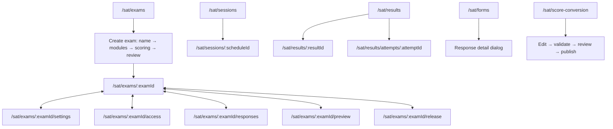

# SAT staff interaction contract

Applied reference: `Instacart_Rappi_UIUX_Microinteractions_Frontend_Engineering_SKILL.md`, supplied by the user, version 1.0.0 (2026-10-25).

The decisions below are **proposed adaptations for SAT administration**. They do not describe Instacart or Rappi's private design systems. The job is to prepare exams, operate rooms, review responses, and maintain scoring policies. Payment, shopping, delivery gestures, and native-app APIs do not apply. The earlier requirement for calm, non-disorienting motion remains in force.

## Route and state map

For every mutation: `available → pending → confirmed | recoverable failure`. Motion never supplies a success state. The existing API/query controller continues to decide whether work was saved, published, assigned, exported, or completed.

## Component and variant inventory

| Surface family | Shared boundary | Behavior |
| --- | --- | --- |
| Exams, rooms, responses, forms, scoring | `SatRoot`, `SatPage`, `SatButton` | Stable page chrome; immediate press response; focusable pending buttons; no large-row shrinking |
| Search, filters, pagination | `SatSearchField`, `SatSegmentedControl`, list/query owners | Synchronous typing; URL-backed selection; keyboard arrows/Home/End; existing query identity and list-return policies |
| Creation and direct confirmations | `SatFormDialog`, `SatConfirmDialog` | Stationary fade; focus entry/return; native dialog semantics; brief close transition |
| Authoring, form editing, import, release, response detail | `AuthoringDialog`, `AuthoringConfirmDialog` | Staff tokens follow portals; safe confirmation focus; pending operations keep existing close guards |
| Preview, settings, question navigator, inspector, room links, attempt inspector | Shared Radix `SheetContent` | No full-width slide; caller focus policies retained; otherwise capture and restore the persistent opener |
| Context menus, nested menus, popovers, tooltips | Shared Radix portal components and `SatMenu` | Local fade; no zoom; menu dismissal cannot steal focus from a newly opened dialog |
| Question and answer editing | `QuestionCardStack`, `AnswerKeyField`, `RichQuestionComposer` | Selected content stays still; one radio tab stop; focus follows arrows; no equation-preview animation on each keystroke |
| Save, collaboration, upload | `SaveCluster`, conflict notice/resolver, upload editor | Persistent truthful text; failures actionable immediately; no success bounce; reduced motion retains labels |
| Live room assignment | `SatStaffRoutePanel` | Selected action stays focused and visibly busy; other choices blocked; success only after server acknowledgement |

## Interaction contracts and choreography

| Trigger | Immediate acknowledgement | Pending/result/recovery | Motion and interruption |
| --- | --- | --- | --- |
| Activate a small control | Press fill/scale in the current interaction | Dispatch existing handler immediately; explicitly `aria-disabled` actions never execute | 100 ms release; no wait before action |
| Change a local segment or exam section | Selected label and semantic state update | Route/query remains the source of truth; draft and return context retain existing owners | 160 ms local indicator; independent groups have unique identities; reduced motion swaps instantly |
| Open a dialog or sheet | Modal semantics and focus apply at once | Close/Escape follows existing dirty/pending policy; return to the connected opener without scrolling | 180 ms opacity entrance, 100 ms exit; no translate or scale; Radix owns interrupted presence |
| Change a question or resolve a field issue | Reveal the actual target with nearest scrolling | Preserve draft identity and focus the field; no animation-completion callback controls navigation | Immediate positioning; no animated movement of the editing plane |
| Type an equation | Render the current expression | Incomplete input keeps existing validation; no speculative server result | No keyed entrance or layout animation per keystroke |
| Save or assign | Busy semantics appear on the initiating control | Success follows acknowledgement; errors remain in context with existing Retry/Review actions | Save text remains readable during a brief fade; no bouncing success glyph |
| Load more form responses | The same button becomes busy | Repeated activation is ignored while pending; existing rows remain mounted | Spinner stays in the button footprint; reduced motion keeps a static progress cue |
| Load a list | Shape-preserving skeleton and named status | Existing empty, error, cached-data and retry branches remain authoritative | Gentle opacity variation instead of a sweeping staff-list shimmer; static under reduced motion |

## State ownership and TypeScript interfaces

- `SurfaceScopeContext: string | undefined` supplies staff surface classes across portals. It owns no business data. Outside `SatRoot`, it defaults to `undefined` and applies no SAT styles.
- `captureOverlayReturnTarget(): HTMLElement | null` resolves a menu item's persistent trigger using Radix's accessible relationship. A caller-provided focus policy still takes precedence.
- `SatButtonProps` retains `pending`, native `disabled`, and `aria-disabled`. Both boolean and string `true` block activation; string `false` remains enabled.
- `SatSegmentedControlProps<T>` retains controlled `value`, `options`, and `onChange`. Keyboard and pointer both dispatch that same contract.
- `AnswerKeyFieldProps` retains the existing `QuestionRevision` and `onChange` payload; selected answers remain keyed by option ID rather than presentation position.
- No backend interfaces, authorizations, retry/idempotency policies, query keys, or persistence schemas change for motion.

## Accessibility and exceptional states

- Reduced motion removes spatial motion, CSS surface animations, skeleton variation, and decorative editor flashes while retaining text, selection, progress, and recovery actions.
- Portaled sheets, dialogs, menus, popovers and tooltips receive the same preference rules as inline staff content.
- Keyboard focus enters the active surface and returns to a persistent, connected trigger. Explicit caller focus handlers are preserved. Restoring focus does not initiate a page scroll.
- Answer choices have one radio tab stop, visible focus, arrow selection/focus parity, and stable option identity. Multiple question editors have distinct heading IDs.
- Loading is scoped to the affected control/surface. Existing save-offline, reconnect, conflict, forbidden, validation, empty-result, and error branches are retained. No visual effect invents progress or confirmation.

## Observable QA and instrumentation

Automated coverage includes staff portal scoping (and its absence outside SAT), menu-to-sheet/dialog focus restoration, disabled-action semantics, segmented keyboard navigation, answer-choice focus/tab order, pending Module 2 assignments, native dialog focus, reduced-motion CSS, and opacity-only surface keyframes. Existing SAT, authoring, settings, room lifecycle, response, and score-conversion tests supply domain/error coverage.

Existing action logging, API request identities, save-state/live-region semantics, Radix `data-state`, `aria-busy`, and list-return markers remain the observation points. This change introduces no analytics service or collection of student information. Timing values are design budgets, not measured production latency or frame-rate claims.

Browser review uses the real shared components in a development-only fixture. Authenticated production journeys, physical-device profiling, actual OS reduced-motion settings, and full assistive-technology sessions require separate verification; component/CSS tests do not establish those results.
