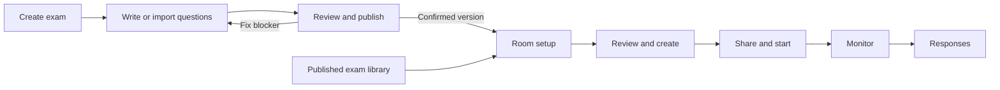

# SAT staff UX/UI implementation plan

Date: 14 October 2026 · Reviewed commit: `52517c27` · Status: proposed plan; implementation has not started.

Make exam preparation feel like one continuous task: **Create → Add questions → Review and publish → Create room → Share and run → View responses.** Improve the existing SAT workspace incrementally, with clear next actions and fewer decisions in the common case.

## 1. Scope and evidence

Actors: exam authors/builders, administrators preparing rooms, and proctors running them. Scope covers exam discovery and creation, manual authoring, imports, settings, publish review, room creation and management, sharing, waiting rooms, and the handoff to responses. Student test-taking and scoring algorithms are outside this redesign.

This is a **source-based workflow review**, supported by existing component tests. No authenticated live SAT UI was available during the review; neither a local frontend on port 3000 nor the local backend on port 4000 was running. Layout concerns below are inferred from rendered structure and CSS, not screenshot-verified defects. Phase 1 includes the browser validation needed before finalizing visual changes.

### Verified implementation map

All links refer to the inspected checkout.

| Area | Existing owner and behavior |
| --- | --- |
| SAT product shell | [SatRoot.tsx](/Users/rd-cream/Downloads/remix_-ielts-proctoring-system/src/products/sat/SatRoot.tsx) keeps role-specific navigation and a collaboration boundary across exam pages. [createRouter.tsx](/Users/rd-cream/Downloads/remix_-ielts-proctoring-system/src/app/router/createRouter.tsx) owns route permissions. |
| Exam library/create | [SatExamLibraryRoute.tsx](/Users/rd-cream/Downloads/remix_-ielts-proctoring-system/src/products/sat/routes/SatExamLibraryRoute.tsx:71): title-only creation, status filters, search, inline errors, and dirty-dialog confirmation. Every exam row opens authoring and arms an explicit draft-open intent. |
| Exam navigation | [ExamWorkspaceHeader.tsx](/Users/rd-cream/Downloads/remix_-ielts-proctoring-system/src/features/exam-authoring/ui/shell/ExamWorkspaceHeader.tsx) and [examLifecycle.ts](/Users/rd-cream/Downloads/remix_-ielts-proctoring-system/src/features/exam-authoring/ui/shell/examLifecycle.ts) already provide Questions, Rooms, Responses, Settings, lifecycle copy, and a state-dependent primary action. |
| Authoring | [AuthoringWorkspace.tsx](/Users/rd-cream/Downloads/remix_-ielts-proctoring-system/src/features/exam-authoring/ui/AuthoringWorkspace.tsx) owns selection, navigation/save barriers, import commands, and publish entry. [QuestionCardStack.tsx](/Users/rd-cream/Downloads/remix_-ielts-proctoring-system/src/features/exam-authoring/ui/spine/QuestionCardStack.tsx), [SpineQuestionView.tsx](/Users/rd-cream/Downloads/remix_-ielts-proctoring-system/src/features/exam-authoring/ui/spine/SpineQuestionView.tsx), and [ExamOverviewPane.tsx](/Users/rd-cream/Downloads/remix_-ielts-proctoring-system/src/features/exam-authoring/ui/spine/ExamOverviewPane.tsx) provide the question canvas and module overview. |
| Imports | [QuestionImportSheet.tsx](/Users/rd-cream/Downloads/remix_-ielts-proctoring-system/src/features/exam-authoring/import/QuestionImportSheet.tsx) appends accepted CSV/TSV or pasted rows to one module. Invalid rows are excluded and listed; the accepted batch is committed together. [SatWorkbookImportSheet.tsx](/Users/rd-cream/Downloads/remix_-ielts-proctoring-system/src/features/exam-authoring/import/SatWorkbookImportSheet.tsx) previews workbook modules, replacements, assets, and retryable stages; [WorkbookImportUndoBanner.tsx](/Users/rd-cream/Downloads/remix_-ielts-proctoring-system/src/features/exam-authoring/ui/WorkbookImportUndoBanner.tsx) exposes existing undo. |
| Publish | [ExamPublishSheet.tsx](/Users/rd-cream/Downloads/remix_-ielts-proctoring-system/src/features/exam-authoring/ui/publish/ExamPublishSheet.tsx:56) and [SatDeliveryReleasePage.tsx](/Users/rd-cream/Downloads/remix_-ielts-proctoring-system/src/features/exam-authoring/ui/SatDeliveryReleasePage.tsx) share [useSatPublish.ts](/Users/rd-cream/Downloads/remix_-ielts-proctoring-system/src/features/exam-authoring/ui/publish/useSatPublish.ts:26): committed-draft reads, exact revision/scope checks, collaboration flush, and the confirmed publication receipt. |
| Settings/results policy | [ExamSettingsPage.tsx](/Users/rd-cream/Downloads/remix_-ielts-proctoring-system/src/features/exam-authoring/ui/settings/ExamSettingsPage.tsx:21) and [DeliverySettingsPanel.tsx](/Users/rd-cream/Downloads/remix_-ielts-proctoring-system/src/features/exam-authoring/ui/settings/DeliverySettingsPanel.tsx) edit timing/routing. [ScoreReportSettingPanel.tsx](/Users/rd-cream/Downloads/remix_-ielts-proctoring-system/src/features/exam-authoring/ui/release/ScoreReportSettingPanel.tsx) and [ScoreConverterPanel.tsx](/Users/rd-cream/Downloads/remix_-ielts-proctoring-system/src/features/exam-authoring/ui/release/ScoreConverterPanel.tsx) currently sit on the full release page. |
| Exam rooms | [SatAccessRoute.tsx](/Users/rd-cream/Downloads/remix_-ielts-proctoring-system/src/products/sat/routes/SatAccessRoute.tsx) → [StudentLinksDashboard.tsx](/Users/rd-cream/Downloads/remix_-ielts-proctoring-system/src/features/exam-authoring/ui/access-links/StudentLinksDashboard.tsx) → [AccessLinkEditorSheet.tsx](/Users/rd-cream/Downloads/remix_-ielts-proctoring-system/src/features/exam-authoring/ui/access-links/AccessLinkEditorSheet.tsx:95). Four create steps: details, students, check-in, review. |
| Global rooms | [SatSessionsRoute.tsx](/Users/rd-cream/Downloads/remix_-ielts-proctoring-system/src/products/sat/routes/SatSessionsRoute.tsx) → [SatNewSessionFlow.tsx](/Users/rd-cream/Downloads/remix_-ielts-proctoring-system/src/products/sat/routes/SatNewSessionFlow.tsx:25) adds an exam chooser before the same four steps. |
| Room execution | [SatSessionRoomRoute.tsx](/Users/rd-cream/Downloads/remix_-ielts-proctoring-system/src/products/sat/routes/SatSessionRoomRoute.tsx) already separates room controls, roster, timeline, student inspector, connection health, and server-confirmed actions. [SatWaitingRoomPanel.tsx](/Users/rd-cream/Downloads/remix_-ielts-proctoring-system/src/products/sat/ui/SatWaitingRoomPanel.tsx) serves proctor-start rooms; [SatStartCodePanel.tsx](/Users/rd-cream/Downloads/remix_-ielts-proctoring-system/src/products/sat/ui/SatStartCodePanel.tsx) serves code-start rooms. |
| Authoritative rules | [satpublish/validator.go](/Users/rd-cream/Downloads/remix_-ielts-proctoring-system/backend/go/internal/satpublish/validator.go) validates SAT publishing. [accesslinks/service.go](/Users/rd-cream/Downloads/remix_-ielts-proctoring-system/backend/go/internal/accesslinks/service.go) atomically creates the link, schedule, and roster and fences edits by revision. [satstartcode.go](/Users/rd-cream/Downloads/remix_-ielts-proctoring-system/backend/go/internal/satstartcode/satstartcode.go:258) resolves start mode from backend rollout configuration. |

### What already works

Keep the title-only exam form, common header, automatic question saving, optional passage/explanation disclosure, existing import preview and undo, publication receipt, immutable version pins, shared room editor, dirty-form guards, clipboard acknowledgement, and the room-wide versus student-action distinction. They are the foundation of this plan, not features to rebuild.

### Friction and concrete gaps

| Priority | Finding | User impact | Proposed change |
| --- | --- | --- | --- |
| P0 | Publish issue navigation only parses `examQuestion:<id>:<field>`. Module count/pretest paths are `<section>.<moduleKey>`; converter paths are `scoringPolicy`. Existing Fix/click handlers return without a destination for these paths. | An author can press Fix, lose the publish sheet, and still not reach the work needed. | Resolve question, module, and scoring destinations centrally; show a useful explanation when a destination cannot be resolved. |
| P0 | Classification copy says Domain and Skill are required to publish; the inspected SAT publish validator deliberately does not inspect metadata, and the SAT release filter does not include those findings. | Authors cannot tell publishing requirements from recommended reporting metadata. | Match required/recommended labels to the actual SAT contract and keep authoring completeness distinct from publish blockers. |
| P0 | Room setup/review and global-room help repeatedly say a proctor starts the exam. The backend can resolve a new room to `access_code`, independently of practice/classroom type. | Staff follow the wrong starting instructions. | Use neutral instructions before creation; after creation use the returned schedule's actual start mode. |
| P0 | Session type is absent from the final room summary and from `editorSnapshot` dirty comparison/reset logic. | Staff cannot verify a consequential mode, and reopening or reverting other fields can mishandle its local state. | Include session type/route policy in initialization, dirty comparison, review, and reset behavior. |
| P0 | Global `NewSessionSetup` reads `overview.currentPublishedVersion` on each render and uses it at submission. The overview polls every 30–35 seconds. Exam-level creation already stores a stable target. | A room setup can switch versions while open; a scope update can also reinitialize the sheet. | Capture one target when setup begins and retain it until the user explicitly changes exams/restarts setup. |
| P1 | Every library row goes to editing, including published exams; overview is reached through the workspace overflow menu. | Running a published exam requires entering authoring first. | Give published exams a direct Rooms action and expose overview in the question navigation. |
| P1 | Publishing keeps scope and notes in component-local state; Fix closes/unmounts the review. | Authors repeat choices and lose release notes while correcting content. | Preserve the review context during the fix-and-return journey. |
| P1 | Four room steps, or five from global Rooms, are mandatory even for anyone/open-now defaults. | A straightforward sitting takes repeated Continue actions. | Setup → Review for exam-level creation; Choose exam → Setup → Review globally. |
| P1 | Header workbook copy says “Replace exam from workbook…” although the importer supports individual populated modules. | Authors may avoid a useful import because they expect the entire exam to be replaced. | Say “Import Excel workbook…”; the preview states the exact modules and counts that will change. |
| P1 | Full release, publish sheet, and Settings expose different amounts of policy information. | Authors search multiple places and repeat configuration decisions. | Put policy editing in Settings; publish surfaces show concise effective summaries and links to the relevant editor. |
| Verify visually | Exam Rooms repeats title/version context and uses a list plus a detail pane that stacks below the list on narrower screens. | Important room actions may require excessive scrolling. | Keep one context header; use a detail sheet on compact screens, with selection/focus preserved. |

## 2. Requirements and acceptance criteria

| ID | Observable behavior | Acceptance criterion |
| --- | --- | --- |
| FR1 | Staff enter the task they intend. | Drafts open editing; published exams offer Rooms without opening a draft. Explicit Edit remains available. Library filters, scroll, and focus survive return. |
| FR2 | Authors can start manually or import without hunting. | Empty modules expose Add question and Import. Import clearly identifies append versus replacement and the destination before committing. Required labels agree with the current SAT publish gate. |
| FR3 | Every publish blocker has a working recovery path. | Question → correct field; module → correct module; converter → scoring settings. Returning preserves scope/notes, while checks use the latest committed revision. No silent Fix action. |
| FR4 | Room creation is short and reviewable. | Two screens from an exam, three globally. Defaults are visible; roster and dates appear only when relevant. Review includes version, sections, audience, identification, check-in, session type, and route policy. |
| FR5 | The reviewed room is the room created. | Background republishing cannot change the captured version/scope or erase entered fields. Cancel resets mode correctly. Double clicking submits once. Failure retains the form. |
| FR6 | Starting and running are easy to distinguish from check-in. | Created rooms show the actual proctor/code-start instructions. Check-in and exam states remain separately labelled. Room-wide and individual actions name their scope. Finished rooms lead to Responses. |
| FR7 | The path works with keyboard, touch, small screens, and failures. | Keyboard can complete creation → publish → room setup; overlays restore focus, errors expose the affected field, pending controls stay stable, and compact screens have no page-wide horizontal overflow. |

Relevant quality requirements:

- **Accuracy:** server-owned version, permission, revision, start mode, timing, and completion remain authoritative. A UI simplification must not bypass an existing barrier.
- **Recoverability:** retain user input on validation/network failure; keep acknowledged successes even when a subsequent refresh fails. Never show “Saved”, “Published”, or “Created” before acknowledgement.
- **Accessibility:** preserve labelled inputs, keyboard navigation, visible focus, text status, and reduced motion. Use the existing 44px staff control convention; check WCAG 2.2 target-size and focus behavior rather than treating 44px as an AA minimum.
- **Efficiency:** reuse loaded shell/overview data for summaries; recheck publishing at saved revision/scope boundaries, not on each keystroke. Preserve in-place polling updates and existing cadence.

Proposed usability target: five staff participants can prepare a room from an already published exam without coaching in under two minutes, excluding roster entry. This is a target to validate, not an observed baseline. Record completion, wrong turns, abandoned steps, and whether participants can explain how students start.

## 3. Recommended experience

Choose **incremental workflow simplification** using the current routes and components.

A cosmetic pass alone leaves the broken handoffs. A new mandatory wizard for the whole exam lifecycle would constrain returning authors and recreate navigation/state ownership. Keep free navigation and improve each handoff, with a small review step only where staff commit a consequential configuration.



### Exam library and first use

Keep Create exam as a title-only form. After creation, provide a compact empty-state choice inside Questions: **Add question** and **Import questions**, with the standard SAT structure summarized once. Keep sample loading in the overflow menu.

For published exams, make the title/primary row destination Rooms and expose Edit as a secondary action. For drafts/unpublished changes, retain the authoring destination and offer Rooms when an existing published version is available. Respect current role permissions; a builder must not receive an operational room route or Responses access.

`SatListRow` currently renders a button. Do not nest new buttons/links inside it. Use a noninteractive row container with sibling native links/buttons for the exam library only, reusing its styling and return-focus attributes. Do not rewrite all list consumers.

### Questions and imports

Make Exam overview available next to the module selector/outline. Reuse its counts and module cards; show authored versus delivered question counts without making six modules appear to be six modules every student takes.

Keep question text, answer options/key, and publish blockers prominent. Label Domain/Skill as recommended reporting classification under the current inspected SAT contract; explain the reporting consequence of leaving them blank. Do not remove the data or change reporting/scoring behavior. Keep optional passage, explanation, tags, and advanced question properties progressively disclosed as they already are.

Use the existing Import menu for **Paste rows into this module** and **Import Excel workbook**. Add the same entry in empty modules. The workbook preview must state “This replaces X questions in Y modules” or the whole-draft effect when applicable. Preserve replacement confirmation, accepted/excluded row counts, capacity checks, asset staging, retry, and undo. After success, show counts locally and open the first affected module.

### Review and publish

Keep the sheet as the usual publish entry; retain `/release` for bookmarks/direct review. Both consume the same publishing owner and consistent readiness summary.

Show, in order: selected scope → blocking issues → candidate duration/section summary → optional notes → Publish. Group blockers using existing readiness families, then module/question location. Present a bounded initial list with Show all. Recommended authoring improvements must not appear as required SAT publish blockers.

Each Fix action names the destination. Module count/pretest issues open the matching module; converter issues open the scoring section in Settings. Preserve scope, notes, and a validated same-exam return destination while the author fixes issues; show **Return to publish** afterward. Saved changes invalidate old checks, so returning never reuses a stale “passed” state.

Put editing of timing/routing and scoring policy in Settings. On publish surfaces, display effective summaries and Edit links. Preserve the existing distinction: converter configuration is versioned; classroom score-report visibility is an exam-level live setting that can affect past attempts. Standard Practice does not show the classroom student report. A draft with no converter can publish for raw scores; an installed converter must cover the routes required by the existing server validator.

After a confirmed publish, show one receipt with the exact version and **Create room**, plus Done. Reuse `DeliveryTarget`; no latest-version lookup may replace this target. Keep both the sheet and the authoring receipt on the same copy/action contract.

### Room setup and review

Replace the four SAT create steps with **Setup → Review**. Global Rooms keeps its existing exam chooser first; label the count honestly as three steps. Editing an existing room stays a grouped editor, with current immutable-section and revision rules.

```text
┌ Create room · Exam title · Version 3 ──────────────┐
│ Setup                          Review            │
│                                                  │
│ Room name             [Saturday morning mock]    │
│ Session type          [Standard practice      ▾]  │
│ Sections              Reading & Writing + Math    │
│                       [Change sections]          │
│                                                  │
│ Who can join          [Anyone] [Listed students]  │
│                       roster only if listed       │
│ Check-in              [Open now] [Scheduled]      │
│                       dates only if scheduled    │
│ More settings         ▸ class/group, identification│
│                                                  │
│ Cancel                             Review room → │
└──────────────────────────────────────────────────┘
```

Defaults remain current behavior: standard practice, all sections enabled by the pinned release, anyone with the link, student-code identification, open now. Expose these defaults explicitly; collapsing a control must not conceal an access decision. Listed students force roster-checked student-code identification.

Present Practice/Classroom first. Under Classroom, offer adaptive routing by default and the existing easier/harder/teacher-choice options as an expanded Module 2 control. Preserve exact existing request mappings. Do not infer start mode or the authoritative timing model from this choice.

Review shows every consequential choice, including session type/Module 2 policy. Each group has Edit, returning to the corresponding setup control without clearing other values. Class/group remains an organizational label, not an admission restriction. Date values include timezone; retain existing schedule validation.

Before creation, say: **“Check-in lets students enter. Starting instructions are shown after the room is created.”** The create contract currently does not expose the rollout-resolved start mode in advance; neutral wording avoids an unnecessary backend capability endpoint.

Capture the published target when setup first opens. A later publish can show “A newer version is available; this room will use Version 3.” Keeping the reviewed target is the default. Changing exams/restarting setup is the explicit way to choose another target. Roster hydration must not erase locally changed values or advance steps.

### Rooms, sharing, and execution

Keep global Rooms for all operational sittings and exam Rooms for that exam's preparation/history. Reduce repeated exam/version headings in the exam view. Label check-in statuses as **Check-in open / opens later / paused / closed** alongside a separate **Exam not started / running / paused / finished** state. An older published version is informational, not automatically broken.

On compact screens, opening a room row should reveal its details in a sheet with a clear Back/Close path, retaining the list filter, scroll, selected row, and focus. Wide screens may retain the current master/detail layout.

After creation, administrators already land in the operational room; retain that behavior. Builders who cannot run rooms stay on the selected, shareable room in exam Rooms. Lead the arrival with confirmed room name/version and the actual next action:

- **Proctor start:** share the student link/QR, show joined/ready counts, then Review and start exam.
- **Code start:** share the student link and reveal/present the start code. Explain that revealing the code does not start a clock and admitted students use it to begin.
- **Running:** show current stage, authoritative timing, roster, and actionable attention. Keep individual controls in the selected-student inspector.
- **Paused/finished:** lead with Resume exam or View responses, respectively.

Keep room-wide Pause/Add time/End distinct from student actions. Existing confirmations name the affected scope; retain them. Keep code rotation confirmation. Show local pending/success/error feedback without rearranging the controls. A copy acknowledgement must not claim the link has been distributed.

## 4. Ownership, contracts, and invariants

No new database schema, service, component library, or generic workflow engine is required for the recommended delivery.

| Responsibility | Owner |
| --- | --- |
| Exam lifecycle copy and navigation | Existing `examLifecycle.ts` and `ExamWorkspaceHeader`. |
| Question selection/save barriers | Existing `AuthoringWorkspace`, `useAuthoringSelection`, persistence and collaboration owners. |
| Publish validation/write/receipt | Existing `useSatPublish`, query effects, backend SAT validator and publish transaction. UI state never decides publication truth. |
| Fix destination | Add a small typed resolver in existing `releaseSelectors.ts`, using issue codes/paths and the loaded shell. Existing question paths remain compatible. |
| Publish scope/notes/return context | One exam/user-scoped UI owner mounted in `SatRoot` outside the keyed route fade. Proposed new file: `/Users/rd-cream/Downloads/remix_-ielts-proctoring-system/src/features/exam-authoring/ui/publish/PublishReviewContext.tsx`. Clear on explicit cancel, successful publish, exam/user change. It stores UI context only, never server readiness or save truth. Legacy non-SAT-root hosts may keep local state. |
| Room form values/validation/review | Existing `AccessLinkEditorSheet`; extend its snapshot to include session type. Preserve non-SAT callers. |
| Captured create target | Each existing host captures the target once: dashboard `createTarget`; global `NewSessionSetup` must add equivalent stable state. |
| Room creation/update/admission | Existing access-link query/API and Go transaction. Preserve revision, roster, effective-section, and permission enforcement. |
| Actual start state and clock | Returned schedule/runtime and existing proctor controller. UI descriptions consume these values. |

Internal interface changes:

1. Publish review can accept controlled scope/notes from the shared UI context. Distinguish dismissal for Fix/Edit settings from explicit Cancel/Done so navigating to a correction retains context. Keep a single publisher in `useSatPublish`; do not create a second mutation path.
2. The issue resolver returns a question target, module target, scoring-settings target, or an explicit explanatory fallback. Match `<section>.<moduleKey>` against the shell. Add module deep-link consumption to [useAuthoringSelection.ts](/Users/rd-cream/Downloads/remix_-ielts-proctoring-system/src/features/exam-authoring/ui/useAuthoringSelection.ts), which currently consumes question/field only. Invalid IDs must not select another exam's content.
3. Settings accepts a same-exam panel deep link for scoring/timing. Preserve real page navigation, Back, and refresh; do not put unsaved notes/rosters in URLs.
4. Room setup keeps using `CreateAssessmentAccessLinkRequest` and `UpdateAssessmentAccessLinkRequest`. Always send the captured `publishedVersionId` on creation. No change to server request semantics is needed.

Invariants:

- INV1: Existing rooms and attempts retain their immutable published version after any republish.
- INV2: Publish uses acknowledged edits and matching draft revision/scope; receipt success survives a failed projection refresh.
- INV3: A room never admits listed-only students without roster validation; class labels never grant/restrict access.
- INV4: The version/scope reviewed in setup matches the create request despite polling or republishing.
- INV5: Opening/pausing check-in does not start/pause an existing attempt; revealing a code does not start its timer.
- INV6: Actions stay within current permissions; builders do not gain Responses or operational room access.
- INV7: Room creation remains one atomic transaction; status is never optimistically presented as confirmed.

Critical flow: create exam → current draft → save/flush → scoped readiness → publish transaction → immutable receipt → captured room target → reviewed create request → atomic link/schedule/roster → role-appropriate share/run surface. Never insert an extra publish or separate schedule-create call into this chain.

## 5. Ordered implementation phases

Each phase should be a reviewable change. Complete the behavioral changes before broad visual polish.

| Phase | Files/components | Specific work | Done when |
| --- | --- | --- | --- |
| 1 · Validate and correct misleading behavior | Publish sheet, `releaseSelectors`, `useAuthoringSelection`; room editor, `satSessionType`, `SatNewSessionFlow`; global Rooms help; classification copy | Record real browser journeys for admin/builder/proctor, full/partial SAT, practice/classroom, proctor/code start. Implement issue destinations; correct required/recommended and starting copy; include type in snapshot/review/reset; freeze global target. | Every blocker leads somewhere useful. Reopening a form resets its type; cancellation protects mode-only edits. Republish while setup is open does not change the target or erase fields. FR2/3/5/6 verified. |
| 2 · Exam entry and authoring discovery | Library, `SatPage` row styling, workspace, question stack, overview, both import sheets | Add direct Rooms/Edit actions without nested interactive markup. Expose overview and useful empty-state actions. Clarify import destination/replacement labels; keep staged progress and undo. | A published exam reaches Rooms directly; a new author can locate manual and both import paths. Existing save/navigation barriers and imports pass regression checks. FR1/2 verified. |
| 3 · Publish and settings handoff | `SatRoot`, proposed publish context, `useSatPublish`, publish sheet, release page/route, Settings page/sheet/panel, readiness panel and scoring panels | Preserve scope/notes on Fix. Add Return to publish and exact-destination links. Align grouped blockers and summaries across both publish views. Place policy editing in Settings while preserving live versus versioned semantics. | Fix → save → return preserves notes/scope and checks the committed revision. Every settings mutation uses its existing owner and refresh effects. Receipt targets survive a concurrent later publish. FR3 verified. |
| 4 · Short room setup | Room editor, `SatRoomSetupProgress`, dashboard, `SatNewSessionFlow`, `satSessionType` | Replace four SAT steps with Setup/Review and adjust global progress to three total screens. Conditional roster/date controls; classroom Module 2 disclosure; Edit links from review. Preserve non-SAT edit/create behavior. | Common setup requires two screens from an exam and three globally. All request values remain reviewable; hidden invalid fields reopen and focus the relevant group. Create failure preserves input. FR4/5 verified. |
| 5 · Room management and run handoff | Dashboard, row/detail/share components, `SatSessionRoomRoute`, waiting/start-code panels, room controls, room CSS | Remove repeated context; label both states; compact detail sheet; focused arrival confirmation; accurate start-mode actions. Retain existing runtime clock, attention, inspection, confirmations, and completed-room response links. | Staff can explain who may join and how they start. Copy, sharing, running, individual actions, and Responses work in both entry paths and allowed roles. FR6 verified. |
| 6 · Visual consistency and acceptance | Changed staff components, [index.css](/Users/rd-cream/Downloads/remix_-ielts-proctoring-system/src/index.css), [spine.css](/Users/rd-cream/Downloads/remix_-ielts-proctoring-system/src/features/exam-authoring/ui/spine/spine.css), room CSS, affected test suites | Use existing staff tokens/primitives. Standardize field rhythm, copy, focus, stable loading, and compact layouts. Run keyboard, touch, failure, and regression scenarios below; validate the proposed usability target. | All P0 behaviors and invariants have evidence; no serious accessibility findings or lost-input regressions in the changed journey. FR7 verified. |

Dependencies: phases 2–4 rely on phase 1's truthful semantics. Phase 3 owns publish return state. Phase 4 relies on the frozen-target fix. Phase 5 consumes the confirmed room setup. Phase 6 covers the combined journey.

Visual direction: retain the current neutral canvas, white grouped surfaces, blue primary accent, hairline boundaries, and status labels. Use existing staff typography tokens; operational labels/body copy should follow the current 14px staff convention. Keep 12px text for short ancillary metadata rather than instructions. Use one main commit/next action per surface, with secondary tools visually quieter. Reuse press/reduced-motion tokens and do not replay entrance animations on polling updates.

## 6. Failure and compatibility decisions

| Risk | Protection and enforcement | Verification / limit |
| --- | --- | --- |
| Republish during setup | Host freezes receipt/current target, then submits that explicit ID; backend pins the immutable version. | Controlled overview refresh changes current version while form is open; displayed version, fields, and create payload remain unchanged. |
| Stale publish checks or local work | Keep `useSatPublish` flush, committed-shell refresh, and revision/scope match. Retained review context contains no cached passed flag. | Change/save a question from Fix; old report cannot enable publication. |
| Session-type-only edits/reopening | Include type in snapshot and initialization/reset. Preserve exact practice/classroom route mappings. | Change only type, Cancel, discard/keep, close/reopen, and revert another field. |
| Room write timeout | Existing transport does not automatically retry unsafe POSTs. Preserve input; explain that the outcome is uncertain and offer Refresh rooms to check before another create. | Simulate committed POST with lost response. Refresh can find it; no automatic second create. Manual retries are not guaranteed idempotent by the current room-create contract. |
| Publish commits but refresh fails | Receipt is the success authority; retain existing background reconciliation. | Keep exact version/Create room despite rejected or delayed overview refresh. |
| Stale room edit/live view | Preserve backend revision fences and existing stale-data blocking for runtime actions. | Concurrent editor or disconnected runtime shows refresh/recovery; never show a guessed success. |
| Role or student-data leak | Keep current route/backend permissions; publish UI context contains no roster or student data and resets on user change. | Builder sees no operational room/Responses route; proctor cannot edit the exam. Never log roster names/emails/codes. |
| UI overhaul changes existing routes | Keep `/access`, `/release`, existing query links, and old issue paths. Additive module/panel navigation only. | Direct links, refresh, browser Back, and legacy non-SAT hosts continue to work. |

## 7. Verification matrix

These are planned acceptance checks, separate from the baseline tests already run.

| Case | Setup/action | Expected outcome | Level / coverage |
| --- | --- | --- | --- |
| T1 | Create an exam; cancel a dirty create; create successfully. | Title retained on error/keep; one create; standard structure opens. | Component + browser; FR1/2 |
| T2 | Open a published exam's Rooms action, then explicitly Edit. | Rooms creates no draft; only Edit arms draft intent; return restores list context. | Component + browser; FR1, INV6 |
| T3 | Inspect missing classification versus missing answer/module/pretest. | Recommended metadata is distinct from server publish blockers; actual blocking requirements remain enforced. | Component + backend integration; FR2/3, INV2 |
| T4 | Paste valid/invalid rows; import a single workbook module; import over existing content. | Accepted/excluded rows explicit; destination/capacity exact; replacement confirmation required; undo behavior preserved. | Existing import suites + browser; FR2 |
| T5 | Fix question text/key, module count/pretest, and converter blocker. | Correct field/module/settings opens; unresolvable issue explains recovery; no silently closed review. | Resolver + component + browser; FR3 |
| T6 | Set Math-only scope and notes; Fix; save; return. | Same scope/notes; fresh revision/scope report; excluded Reading & Writing findings do not block Math-only. | Component + integration/browser; FR3, INV2 |
| T7 | Publish with pending local/coedit changes, stale report, no permission, or offline. | Existing gates refuse unsafe publication and explain the recoverable reason. | Existing publish suites; FR3/7, INV2/6 |
| T8 | Publish Version 3; another author publishes Version 4 before Create room. | Room setup and submitted pin remain Version 3. Prior rooms unchanged. | Component + backend integration; FR5, INV1/4 |
| T9 | Open global room setup; background poll changes release ID and scope. | Target and entered values remain stable; newer-version notice is informational. | Component; FR5, INV4 |
| T10 | Choose each session type/route policy; change only type; close/reopen; return from review. | Exact existing payload mapping, accurate review, correct dirty protection/reset, retained input during Edit. | Component; FR4/5 |
| T11 | Listed audience: empty/duplicate roster codes, invalid email; scheduled window: past/too short/invalid. | Existing validation holds; offending group/field is visible and focused; no create request. | Existing validators + component/browser; FR4/7, INV3 |
| T12 | Double-click Create; network rejection; uncertain committed timeout. | One in-flight request; input retained; uncertain outcome prompts refresh, not automatic retry. | Controlled component/transport; FR5/7, INV7 |
| T13 | Create proctor-start and code-start rooms, including classroom policy. | Correct starting instructions/action from actual schedule; type does not imply start mode. Share/reveal do not start timers. | Browser + backend integration; FR6, INV5 |
| T14 | Pause check-in while an attempt runs; pause exam; add room/student time; end exam. | Check-in and runtime states stay separate; actions/confirmation identify affected scope; clocks retain existing server authority. | Existing room/Go suites + browser; FR6, INV5/7 |
| T15 | Builder, admin, proctor; stale/disconnected room; finish and view responses. | Existing permissions and stale-data guards hold; role-appropriate confirmed destination. | Component + browser; FR6/7, INV6 |
| T16 | Keyboard-only and touch at 390px, 768px, and 1440px; desktop 200% zoom; reduced motion. | Useful focus order/restoration, no obscured focused control, usable roster/detail sheet, no page-wide overflow, stable pending feedback. | Manual browser + axe; FR7 |

Extend existing suites where the behavior already belongs:

- Library/global setup: [SatExamLibraryRoute.test.tsx](/Users/rd-cream/Downloads/remix_-ielts-proctoring-system/src/products/sat/routes/__tests__/SatExamLibraryRoute.test.tsx) and [SatSessionsRoute.test.tsx](/Users/rd-cream/Downloads/remix_-ielts-proctoring-system/src/products/sat/routes/__tests__/SatSessionsRoute.test.tsx).
- Publish/readiness: [ExamPublishSheet.test.tsx](/Users/rd-cream/Downloads/remix_-ielts-proctoring-system/src/features/exam-authoring/ui/publish/__tests__/ExamPublishSheet.test.tsx), [examLifecycle.test.ts](/Users/rd-cream/Downloads/remix_-ielts-proctoring-system/src/features/exam-authoring/ui/shell/__tests__/examLifecycle.test.ts), and existing release/selection tests.
- Room setup/detail: [AccessLinkEditorSheet.test.tsx](/Users/rd-cream/Downloads/remix_-ielts-proctoring-system/src/features/exam-authoring/ui/access-links/__tests__/AccessLinkEditorSheet.test.tsx), [StudentLinksDashboard.test.tsx](/Users/rd-cream/Downloads/remix_-ielts-proctoring-system/src/features/exam-authoring/ui/access-links/__tests__/StudentLinksDashboard.test.tsx), [AccessLinkDetail.test.tsx](/Users/rd-cream/Downloads/remix_-ielts-proctoring-system/src/features/exam-authoring/ui/access-links/__tests__/AccessLinkDetail.test.tsx), their existing interaction suites, and [DeliveryFlow.test.tsx](/Users/rd-cream/Downloads/remix_-ielts-proctoring-system/src/features/exam-authoring/ui/access-links/__tests__/DeliveryFlow.test.tsx).
- Browser journeys: [sat-staff-room-ux.spec.ts](/Users/rd-cream/Downloads/remix_-ielts-proctoring-system/e2e/sat-staff-room-ux.spec.ts), [sat-authoring-lifecycle.spec.ts](/Users/rd-cream/Downloads/remix_-ielts-proctoring-system/e2e/sat-authoring-lifecycle.spec.ts), and [sat-product-workspace.spec.ts](/Users/rd-cream/Downloads/remix_-ielts-proctoring-system/e2e/sat-product-workspace.spec.ts). Add a dedicated staff preparation journey only if these do not cover the cross-page sequence cleanly.

Implementation checks use Bun:

```sh
bun run typecheck
bun run lint
bun run build
bunx vitest run src/products/sat/routes/__tests__ src/features/exam-authoring/ui src/features/exam-authoring/import
bunx playwright test e2e/sat-staff-room-ux.spec.ts e2e/sat-authoring-lifecycle.spec.ts e2e/sat-product-workspace.spec.ts --project=chromium
```

Run browser checks only against the configured disposable local/test backend. The existing default Playwright config requires MySQL, Go API/worker, and the coedit service and includes global setup; inspect that setup before execution. `e2e:sat-a11y` covers student SAT accessibility and does not establish staff-flow accessibility. Use the staff journey's existing axe helper plus manual focus checks. Run Go contract suites when an authoritative contract changes; this plan does not require such changes by default.

Accessibility references: [W3C target size](https://www.w3.org/WAI/WCAG22/Understanding/target-size-minimum.html), [focus not obscured](https://www.w3.org/WAI/WCAG22/Understanding/focus-not-obscured-minimum.html), and [modal dialog focus behavior](https://www.w3.org/WAI/ARIA/apg/patterns/dialog-modal/).

### Baseline verification performed

On 14 October 2026, the following existing suites passed: **5 files, 88 tests**.

```sh
bunx vitest run src/products/sat/routes/__tests__/SatExamLibraryRoute.test.tsx src/products/sat/routes/__tests__/SatSessionsRoute.test.tsx src/features/exam-authoring/ui/publish/__tests__/ExamPublishSheet.test.tsx src/features/exam-authoring/ui/access-links/__tests__/AccessLinkEditorSheet.test.tsx src/features/exam-authoring/ui/access-links/__tests__/DeliveryFlow.test.tsx
```

This verifies the existing tested behaviors. It does not prove the proposed redesign, live backend contracts, visual usability, or accessibility end to end. No production application code was changed for this plan.

## 8. Delivery and unresolved validation

Ship in the phase order, with compatible routes and payloads throughout. Review phase 1 behavioral fixes first, then authoring/publish handoffs, then shorter room setup, then the combined visual experience. A frontend rollback restores the prior interface; it does not undo exams, publications, rooms, or attempts created while the new UI was active. Version pins and normal room controls remain the recovery mechanisms.

No new feature flag is required by default. Use existing deployment controls for a staff preview if available; otherwise validate on a test environment before deployment. Review existing structured logs and local errors for publish/create/start failures; do not add a new analytics system merely for this redesign.

Before implementation completes, confirm these specifics in the running application:

1. Which start modes are enabled in the target deployment, and which practice/classroom paths staff actually use. Support both inspected modes regardless of the active default.
2. The saved classification/reporting consequences, so “recommended” guidance is useful and truthful without changing the server gate.
3. The proposed two-screen setup remains manageable with a large listed roster and tablet keyboard; adjust disclosure/scroll behavior if observation warrants it.
4. Whether recent score-conversion workflows change the preferred Settings destination. Reuse existing policy editors and show the correct version/live scope; avoid creating a third policy editor.

These are validation tasks with default decisions above, not blockers to writing or beginning the plan. Completion requires FR1–FR7 and INV1–INV7 to be covered by the specified tests and a recorded browser walkthrough of the full staff journey.
